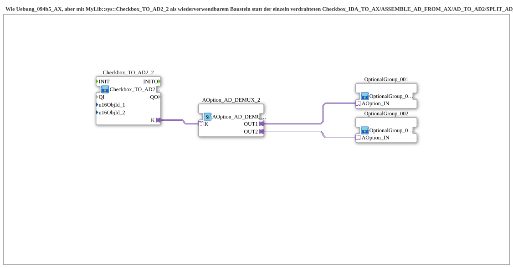

# Uebung_094b5b_AX: Checkbox-Kette als wiederverwendbarer Baustein

* * * * * * * * * *

## Einleitung

Zweite Version von `Uebung_094b5_AX`: Alles außer [`AOption_AD_DEMUX_2`](https://meisterschulen-am-ostbahnhof-munchen-docs.readthedocs.io/projects/4diac-library-reference-docs/de/latest/Bibliotheken/ExternalLibraries/Option/selection/AOption_AD_DEMUX_2/), [`OptionalGroup_001`](https://meisterschulen-am-ostbahnhof-munchen-docs.readthedocs.io/projects/4diac-library-reference-docs/de/latest/Bibliotheken/ExternalLibraries/MyLib_AX_Option/sys/OptionalGroup_001/) und [`OptionalGroup_002`](https://meisterschulen-am-ostbahnhof-munchen-docs.readthedocs.io/projects/4diac-library-reference-docs/de/latest/Bibliotheken/ExternalLibraries/MyLib_AX_Option/sys/OptionalGroup_002/) wurde in den wiederverwendbaren Baustein [`MyLib::sys::Checkbox_TO_AD2_2`](https://meisterschulen-am-ostbahnhof-munchen-docs.readthedocs.io/projects/4diac-library-reference-docs/de/latest/Bibliotheken/ExternalLibraries/MyLib_AX/sys/Checkbox_TO_AD2_2/) ausgelagert. Das Netzwerk besteht dadurch nur noch aus vier Instanzen.

## Verwendete Funktionsbausteine (FBs)

- **Checkbox_TO_AD2_2**: Wiederverwendbarer Baustein für zwei VT-Checkboxen
    - **Typ**: [`MyLib::sys::Checkbox_TO_AD2_2`](https://meisterschulen-am-ostbahnhof-munchen-docs.readthedocs.io/projects/4diac-library-reference-docs/de/latest/Bibliotheken/ExternalLibraries/MyLib_AX/sys/Checkbox_TO_AD2_2/) (SubApp)
    - **Parameter**: keine
    - **Erklärung**: Fasst zwei VT-Checkboxen zu einer Bitmaske zusammen und stellt sie am bidirektionalen Plug `K` bereit. Ersetzt die einzeln verdrahtete Kette `Checkbox_IDA_TO_AX`/`ASSEMBLE_AD_FROM_AX`/[`AD_TO_AD2`](https://meisterschulen-am-ostbahnhof-munchen-docs.readthedocs.io/projects/4diac-library-reference-docs/de/latest/Bibliotheken/ExternalLibraries/adapter/conversion/bidirectional/DWORD/AD_TO_AD2/)/`SPLIT_AD_INTO_AX`/[`AX_TO_Checkbox`](https://meisterschulen-am-ostbahnhof-munchen-docs.readthedocs.io/projects/4diac-library-reference-docs/de/latest/Bibliotheken/ExternalLibraries/MyLib_AX/sys/AX_TO_Checkbox/) aus `Uebung_094b5_AX`.
- **AOption_AD_DEMUX_2**: Auswahl von Optionsgruppen
    - **Typ**: [`Option::selection::AOption_AD_DEMUX_2`](https://meisterschulen-am-ostbahnhof-munchen-docs.readthedocs.io/projects/4diac-library-reference-docs/de/latest/Bibliotheken/ExternalLibraries/Option/selection/AOption_AD_DEMUX_2/)
    - **Parameter**: keine
    - **Erklärung**: Empfängt die Bitmaske am Socket `K` und gibt über `OUT1`/`OUT2` die Optionsgruppen frei.
- **OptionalGroup_001**: Optionsgruppe 1
    - **Typ**: [`MyLib_AX_Option::sys::OptionalGroup_001`](https://meisterschulen-am-ostbahnhof-munchen-docs.readthedocs.io/projects/4diac-library-reference-docs/de/latest/Bibliotheken/ExternalLibraries/MyLib_AX_Option/sys/OptionalGroup_001/) (SubApp)
    - **Parameter**: keine
    - **Erklärung**: Wird über den Adapter `AOption_IN` freigegeben (QI anstelle Permit).
- **OptionalGroup_002**: Optionsgruppe 2
    - **Typ**: [`MyLib_AX_Option::sys::OptionalGroup_002`](https://meisterschulen-am-ostbahnhof-munchen-docs.readthedocs.io/projects/4diac-library-reference-docs/de/latest/Bibliotheken/ExternalLibraries/MyLib_AX_Option/sys/OptionalGroup_002/) (SubApp)
    - **Parameter**: keine
    - **Erklärung**: Wird über den Adapter `AOption_IN` freigegeben (QI anstelle Permit).

## Programmablauf und Verbindungen

1. `Checkbox_TO_AD2_2.K` → `AOption_AD_DEMUX_2.K` (AdapterConnection): die Bitmaske der beiden Checkboxen gelangt zum Demultiplexer.
2. `AOption_AD_DEMUX_2.OUT1` → `OptionalGroup_001.AOption_IN`: Freigabe der Optionsgruppe 1.
3. `AOption_AD_DEMUX_2.OUT2` → `OptionalGroup_002.AOption_IN`: Freigabe der Optionsgruppe 2.

## Zusammenfassung

Funktional entspricht die Übung `Uebung_094b5_AX`, ist aber durch die Auslagerung in [`Checkbox_TO_AD2_2`](https://meisterschulen-am-ostbahnhof-munchen-docs.readthedocs.io/projects/4diac-library-reference-docs/de/latest/Bibliotheken/ExternalLibraries/MyLib_AX/sys/Checkbox_TO_AD2_2/) deutlich übersichtlicher.

---

### 🌐 Passende Themen-Unterseiten auf ms-muc-docs.de

- [🌐 Eclipse 4diac IDE & Farb-Referenz auf ms-muc-docs.de](https://www.ms-muc-docs.de/iec-61499/eclipse-4diac/)
