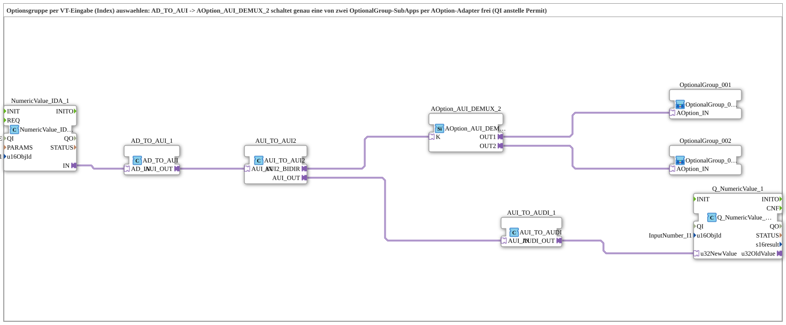

# Uebung_094b_AX: Optionsgruppe per VT-Eingabe (Index) auswählen

* * * * * * * * * *

## Einleitung

Ein VT-Eingabefeld (`InputNumber_I1`) wählt per Index eine von zwei Optionsgruppen aus: [`AOption_AUI_DEMUX_2`](https://meisterschulen-am-ostbahnhof-munchen-docs.readthedocs.io/projects/4diac-library-reference-docs/de/latest/Bibliotheken/ExternalLibraries/Option/selection/AOption_AUI_DEMUX_2/) schaltet genau eine der beiden `OptionalGroup`-SubApps per [`AOption`](https://meisterschulen-am-ostbahnhof-munchen-docs.readthedocs.io/projects/4diac-library-reference-docs/de/latest/Bibliotheken/ExternalLibraries/Option/AOption/)-Adapter frei (`QI` anstelle von Permit). Der vom Consumer zurückgemeldete Wert wird zusätzlich in das Eingabefeld zurückgeschrieben (Echo).

## Verwendete Funktionsbausteine (FBs)

- **NumericValue_IDA_1**: VT-Eingabefeld lesen
    - **Typ**: [`isobus::UT::io::NumericValue::NumericValue_IDA`](https://meisterschulen-am-ostbahnhof-munchen-docs.readthedocs.io/projects/4diac-library-reference-docs/de/latest/Bibliotheken/ExternalLibraries/isobus/UT/io/NumericValue/NumericValue_IDA/)
    - **Parameter**: `QI = TRUE`, `u16ObjId = InputNumber_I1`
    - **Erklärung**: Liest den Wert des VT-Eingabefelds `InputNumber_I1` und gibt ihn über den Adapter `IN` aus.
- **AD_TO_AUI_1**: Adapterwandler AD nach AUI
    - **Typ**: [`adapter::conversion::unidirectional::AD_TO_AUI`](https://meisterschulen-am-ostbahnhof-munchen-docs.readthedocs.io/projects/4diac-library-reference-docs/de/latest/Bibliotheken/ExternalLibraries/adapter/conversion/unidirectional/AD_AUI/AD_TO_AUI/)
    - **Parameter**: keine
    - **Erklärung**: Wandelt den Adapter `AD_IN` des Eingabefelds in einen `AUI_OUT`.
- **AUI_TO_AUI2**: Bidirektionale Brücke
    - **Typ**: [`adapter::conversion::bidirectional::AUI_TO_AUI2`](https://meisterschulen-am-ostbahnhof-munchen-docs.readthedocs.io/projects/4diac-library-reference-docs/de/latest/Bibliotheken/ExternalLibraries/adapter/conversion/bidirectional/UINT/AUI_TO_AUI2/)
    - **Parameter**: keine
    - **Erklärung**: Stellt den Index als bidirektionalen Stecker `AUI2_BIDIR` für den Consumer bereit und liefert über `AUI_OUT` den vom Consumer zurückgemeldeten Wert.
- **AOption_AUI_DEMUX_2**: Auswahl genau einer von zwei Optionsgruppen
    - **Typ**: [`Option::selection::AOption_AUI_DEMUX_2`](https://meisterschulen-am-ostbahnhof-munchen-docs.readthedocs.io/projects/4diac-library-reference-docs/de/latest/Bibliotheken/ExternalLibraries/Option/selection/AOption_AUI_DEMUX_2/)
    - **Parameter**: keine
    - **Erklärung**: Empfängt den Index am Socket `K` und gibt über `OUT1`/`OUT2` genau eine der beiden Optionsgruppen frei.
- **OptionalGroup_001**: Optionsgruppe 1
    - **Typ**: [`MyLib_AX_Option::sys::OptionalGroup_001`](https://meisterschulen-am-ostbahnhof-munchen-docs.readthedocs.io/projects/4diac-library-reference-docs/de/latest/Bibliotheken/ExternalLibraries/MyLib_AX_Option/sys/OptionalGroup_001/) (SubApp)
    - **Parameter**: keine
    - **Erklärung**: Wird über den Adapter `OPTION` freigegeben (QI anstelle Permit).
- **OptionalGroup_002**: Optionsgruppe 2
    - **Typ**: [`MyLib_AX_Option::sys::OptionalGroup_002`](https://meisterschulen-am-ostbahnhof-munchen-docs.readthedocs.io/projects/4diac-library-reference-docs/de/latest/Bibliotheken/ExternalLibraries/MyLib_AX_Option/sys/OptionalGroup_002/) (SubApp)
    - **Parameter**: keine
    - **Erklärung**: Wird über den Adapter `OPTION` freigegeben (QI anstelle Permit).
- **AUI_TO_AUDI_1**: Adapterwandler AUI nach AUDI
    - **Typ**: [`adapter::conversion::unidirectional::AUI_TO_AUDI`](https://meisterschulen-am-ostbahnhof-munchen-docs.readthedocs.io/projects/4diac-library-reference-docs/de/latest/Bibliotheken/ExternalLibraries/adapter/conversion/unidirectional/AUDI_AUI/AUI_TO_AUDI/)
    - **Parameter**: keine
    - **Erklärung**: Wandelt den zurückgemeldeten Index in einen `AUDI_OUT` für die VT-Rückschreibung.
- **Q_NumericValue_1**: VT-Wert schreiben
    - **Typ**: [`isobus::UT::Q::Q_NumericValue_AUDI`](https://meisterschulen-am-ostbahnhof-munchen-docs.readthedocs.io/projects/4diac-library-reference-docs/de/latest/Bibliotheken/ExternalLibraries/isobus/UT/Q/Q_NumericValue_AUDI/)
    - **Parameter**: `u16ObjId = InputNumber_I1`
    - **Erklärung**: Schreibt den Wert über `u32NewValue` zurück in das Eingabefeld `InputNumber_I1`.

## Programmablauf und Verbindungen

1. `NumericValue_IDA_1.IN` → `AD_TO_AUI_1.AD_IN` (AdapterConnection): der Wert des Eingabefelds wird in einen AUI-Strom gewandelt.
2. `AD_TO_AUI_1.AUI_OUT` → `AUI_TO_AUI2.AUI_IN`: der Wert wird in die bidirektionale Brücke eingespeist.
3. `AUI_TO_AUI2.AUI2_BIDIR` → `AOption_AUI_DEMUX_2.K`: der Index gelangt zum Demultiplexer.
4. `AOption_AUI_DEMUX_2.OUT1` → `OptionalGroup_001.OPTION` und `AOption_AUI_DEMUX_2.OUT2` → `OptionalGroup_002.OPTION`: genau eine Gruppe wird freigegeben.
5. `AUI_TO_AUI2.AUI_OUT` → `AUI_TO_AUDI_1.AUI_IN` → `Q_NumericValue_1.u32NewValue`: der zurückgemeldete Wert wird ins Eingabefeld geschrieben.

## Zusammenfassung

Die Übung zeigt die Auswahl einer Optionsgruppe per VT-Eingabe: Der Index läuft über `AUI_TO_AUI2` in `AOption_AUI_DEMUX_2`, das genau eine von zwei Optionsgruppen per `QI` freigibt; die Rückmeldung wird ins Eingabefeld gespiegelt.

---

### 🌐 Passende Themen-Unterseiten auf ms-muc-docs.de

- [🌐 Eclipse 4diac IDE & Farb-Referenz auf ms-muc-docs.de](https://www.ms-muc-docs.de/iec-61499/eclipse-4diac/)
