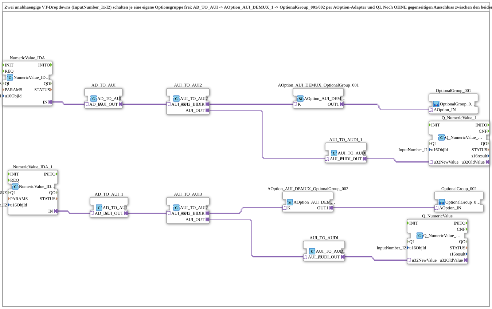

# Uebung_094c_AX: Zwei unabhängige VT-Dropdowns schalten je eine Optionsgruppe frei

* * * * * * * * * *

## Einleitung

Zwei unabhängige VT-Dropdowns (`InputNumber_I1` und `InputNumber_I2`) schalten je eine eigene Optionsgruppe frei: `AD_TO_AUI` → [`AOption_AUI_DEMUX_1`](https://meisterschulen-am-ostbahnhof-munchen-docs.readthedocs.io/projects/4diac-library-reference-docs/de/latest/Bibliotheken/ExternalLibraries/Option/selection/AOption_AUI_DEMUX_1/) → [`OptionalGroup_001`](https://meisterschulen-am-ostbahnhof-munchen-docs.readthedocs.io/projects/4diac-library-reference-docs/de/latest/Bibliotheken/ExternalLibraries/MyLib_AX_Option/sys/OptionalGroup_001/)/[`OptionalGroup_002`](https://meisterschulen-am-ostbahnhof-munchen-docs.readthedocs.io/projects/4diac-library-reference-docs/de/latest/Bibliotheken/ExternalLibraries/MyLib_AX_Option/sys/OptionalGroup_002/) per [`AOption`](https://meisterschulen-am-ostbahnhof-munchen-docs.readthedocs.io/projects/4diac-library-reference-docs/de/latest/Bibliotheken/ExternalLibraries/Option/AOption/)-Adapter und `QI`. Es gibt noch **keinen** gegenseitigen Ausschluss zwischen den beiden Gruppen; dafür wäre ein vorgeschalteter Arbiter nötig, der aus den zwei unabhängigen Dropdown-Events einen gemeinsamen K-Wert ableitet (offene Rückfrage aus Krauternter: Bunker_Klappen/Aufnahme_Rechts, „letzter Aktiviert gewinnt“ plus Boot-Tiebreak). Das Netzwerk enthält die Kette je Dropdown doppelt (inline dupliziert).

## Verwendete Funktionsbausteine (FBs)

- **NumericValue_IDA**: VT-Dropdown 1 lesen
    - **Typ**: [`isobus::UT::io::NumericValue::NumericValue_IDA`](https://meisterschulen-am-ostbahnhof-munchen-docs.readthedocs.io/projects/4diac-library-reference-docs/de/latest/Bibliotheken/ExternalLibraries/isobus/UT/io/NumericValue/NumericValue_IDA/)
    - **Parameter**: `QI = TRUE`, `u16ObjId = InputNumber_I1`
    - **Erklärung**: Liest das VT-Eingabefeld `InputNumber_I1`.
- **AD_TO_AUI**: Adapterwandler AD nach AUI
    - **Typ**: [`adapter::conversion::unidirectional::AD_TO_AUI`](https://meisterschulen-am-ostbahnhof-munchen-docs.readthedocs.io/projects/4diac-library-reference-docs/de/latest/Bibliotheken/ExternalLibraries/adapter/conversion/unidirectional/AD_AUI/AD_TO_AUI/)
    - **Parameter**: keine
    - **Erklärung**: Wandelt `AD_IN` in `AUI_OUT`.
- **AUI_TO_AUI2**: Bidirektionale Brücke
    - **Typ**: [`adapter::conversion::bidirectional::AUI_TO_AUI2`](https://meisterschulen-am-ostbahnhof-munchen-docs.readthedocs.io/projects/4diac-library-reference-docs/de/latest/Bibliotheken/ExternalLibraries/adapter/conversion/bidirectional/UINT/AUI_TO_AUI2/)
    - **Parameter**: keine
    - **Erklärung**: Liefert den Index als `AUI2_BIDIR` an den Demultiplexer und gibt über `AUI_OUT` den zurückgemeldeten Wert aus.
- **AOption_AUI_DEMUX_OptionalGroup_001**: Freigabe für Optionsgruppe 1
    - **Typ**: [`Option::selection::AOption_AUI_DEMUX_1`](https://meisterschulen-am-ostbahnhof-munchen-docs.readthedocs.io/projects/4diac-library-reference-docs/de/latest/Bibliotheken/ExternalLibraries/Option/selection/AOption_AUI_DEMUX_1/)
    - **Parameter**: keine
    - **Erklärung**: Gibt über `OUT1` die Optionsgruppe 1 frei (Socket `K`).
- **OptionalGroup_001**: Optionsgruppe 1
    - **Typ**: [`MyLib_AX_Option::sys::OptionalGroup_001`](https://meisterschulen-am-ostbahnhof-munchen-docs.readthedocs.io/projects/4diac-library-reference-docs/de/latest/Bibliotheken/ExternalLibraries/MyLib_AX_Option/sys/OptionalGroup_001/) (SubApp)
    - **Parameter**: keine
    - **Erklärung**: Wird über den Adapter `AOption_IN` freigegeben (QI anstelle Permit).
- **AUI_TO_AUDI_1**: Adapterwandler AUI nach AUDI
    - **Typ**: [`adapter::conversion::unidirectional::AUI_TO_AUDI`](https://meisterschulen-am-ostbahnhof-munchen-docs.readthedocs.io/projects/4diac-library-reference-docs/de/latest/Bibliotheken/ExternalLibraries/adapter/conversion/unidirectional/AUDI_AUI/AUI_TO_AUDI/)
    - **Parameter**: keine
    - **Erklärung**: Wandelt den zurückgemeldeten Wert für die VT-Rückschreibung.
- **Q_NumericValue_1**: VT-Wert schreiben
    - **Typ**: [`isobus::UT::Q::Q_NumericValue_AUDI`](https://meisterschulen-am-ostbahnhof-munchen-docs.readthedocs.io/projects/4diac-library-reference-docs/de/latest/Bibliotheken/ExternalLibraries/isobus/UT/Q/Q_NumericValue_AUDI/)
    - **Parameter**: `u16ObjId = InputNumber_I1`
    - **Erklärung**: Schreibt den Wert zurück in `InputNumber_I1`.
- **NumericValue_IDA_1**: VT-Dropdown 2 lesen
    - **Typ**: [`isobus::UT::io::NumericValue::NumericValue_IDA`](https://meisterschulen-am-ostbahnhof-munchen-docs.readthedocs.io/projects/4diac-library-reference-docs/de/latest/Bibliotheken/ExternalLibraries/isobus/UT/io/NumericValue/NumericValue_IDA/)
    - **Parameter**: `QI = TRUE`, `u16ObjId = InputNumber_I2`
    - **Erklärung**: Liest das VT-Eingabefeld `InputNumber_I2`.
- **AD_TO_AUI_1**: Adapterwandler AD nach AUI
    - **Typ**: [`adapter::conversion::unidirectional::AD_TO_AUI`](https://meisterschulen-am-ostbahnhof-munchen-docs.readthedocs.io/projects/4diac-library-reference-docs/de/latest/Bibliotheken/ExternalLibraries/adapter/conversion/unidirectional/AD_AUI/AD_TO_AUI/)
    - **Parameter**: keine
    - **Erklärung**: Wandelt `AD_IN` in `AUI_OUT`.
- **AUI_TO_AUI3**: Bidirektionale Brücke
    - **Typ**: [`adapter::conversion::bidirectional::AUI_TO_AUI2`](https://meisterschulen-am-ostbahnhof-munchen-docs.readthedocs.io/projects/4diac-library-reference-docs/de/latest/Bibliotheken/ExternalLibraries/adapter/conversion/bidirectional/UINT/AUI_TO_AUI2/)
    - **Parameter**: keine
    - **Erklärung**: Liefert den Index als `AUI2_BIDIR` an den Demultiplexer und gibt über `AUI_OUT` den zurückgemeldeten Wert aus.
- **AOption_AUI_DEMUX_OptionalGroup_002**: Freigabe für Optionsgruppe 2
    - **Typ**: [`Option::selection::AOption_AUI_DEMUX_1`](https://meisterschulen-am-ostbahnhof-munchen-docs.readthedocs.io/projects/4diac-library-reference-docs/de/latest/Bibliotheken/ExternalLibraries/Option/selection/AOption_AUI_DEMUX_1/)
    - **Parameter**: keine
    - **Erklärung**: Gibt über `OUT1` die Optionsgruppe 2 frei (Socket `K`).
- **OptionalGroup_002**: Optionsgruppe 2
    - **Typ**: [`MyLib_AX_Option::sys::OptionalGroup_002`](https://meisterschulen-am-ostbahnhof-munchen-docs.readthedocs.io/projects/4diac-library-reference-docs/de/latest/Bibliotheken/ExternalLibraries/MyLib_AX_Option/sys/OptionalGroup_002/) (SubApp)
    - **Parameter**: keine
    - **Erklärung**: Wird über den Adapter `AOption_IN` freigegeben (QI anstelle Permit).
- **AUI_TO_AUDI**: Adapterwandler AUI nach AUDI
    - **Typ**: [`adapter::conversion::unidirectional::AUI_TO_AUDI`](https://meisterschulen-am-ostbahnhof-munchen-docs.readthedocs.io/projects/4diac-library-reference-docs/de/latest/Bibliotheken/ExternalLibraries/adapter/conversion/unidirectional/AUDI_AUI/AUI_TO_AUDI/)
    - **Parameter**: keine
    - **Erklärung**: Wandelt den zurückgemeldeten Wert für die VT-Rückschreibung.
- **Q_NumericValue**: VT-Wert schreiben
    - **Typ**: [`isobus::UT::Q::Q_NumericValue_AUDI`](https://meisterschulen-am-ostbahnhof-munchen-docs.readthedocs.io/projects/4diac-library-reference-docs/de/latest/Bibliotheken/ExternalLibraries/isobus/UT/Q/Q_NumericValue_AUDI/)
    - **Parameter**: `u16ObjId = InputNumber_I2`
    - **Erklärung**: Schreibt den Wert zurück in `InputNumber_I2`.

## Programmablauf und Verbindungen

1. `NumericValue_IDA.IN` → `AD_TO_AUI.AD_IN` → `AUI_TO_AUI2.AUI_IN`; `AUI_TO_AUI2.AUI2_BIDIR` → `AOption_AUI_DEMUX_OptionalGroup_001.K`; `AOption_AUI_DEMUX_OptionalGroup_001.OUT1` → `OptionalGroup_001.AOption_IN` (Dropdown 1).
2. `NumericValue_IDA_1.IN` → `AD_TO_AUI_1.AD_IN` → `AUI_TO_AUI3.AUI_IN`; `AUI_TO_AUI3.AUI2_BIDIR` → `AOption_AUI_DEMUX_OptionalGroup_002.K`; `AOption_AUI_DEMUX_OptionalGroup_002.OUT1` → `OptionalGroup_002.AOption_IN` (Dropdown 2).
3. Echo Dropdown 1: `AUI_TO_AUI2.AUI_OUT` → `AUI_TO_AUDI_1.AUI_IN` → `Q_NumericValue_1.u32NewValue`.
4. Echo Dropdown 2: `AUI_TO_AUI3.AUI_OUT` → `AUI_TO_AUDI.AUI_IN` → `Q_NumericValue.u32NewValue`.

## Zusammenfassung

Jedes Dropdown schaltet unabhängig seine eigene Optionsgruppe frei; ein gegenseitiger Ausschluss fehlt bewusst noch. Die doppelt vorhandene Kette wird in `Uebung_094c2_AX` in einen wiederverwendbaren Baustein ausgelagert.

---

### 🌐 Passende Themen-Unterseiten auf ms-muc-docs.de

- [🌐 Eclipse 4diac IDE & Farb-Referenz auf ms-muc-docs.de](https://www.ms-muc-docs.de/iec-61499/eclipse-4diac/)
