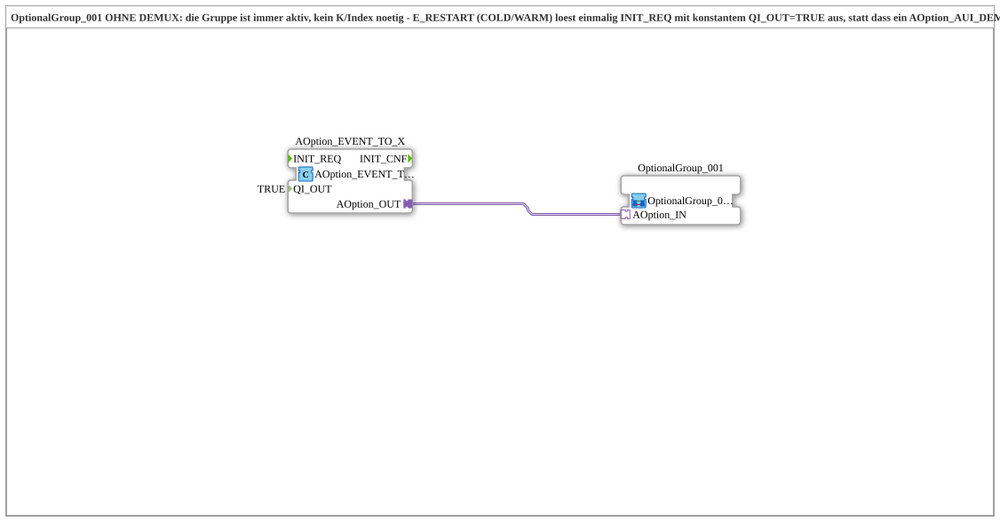

# Uebung_094d_AX: Optionsgruppe ohne DEMUX – immer aktiv, einmalig beim Ressourcenstart initialisiert

* * * * * * * * * *

## Einleitung

Die Übung zeigt [`OptionalGroup_001`](https://meisterschulen-am-ostbahnhof-munchen-docs.readthedocs.io/projects/4diac-library-reference-docs/de/latest/Bibliotheken/ExternalLibraries/MyLib_AX_Option/sys/OptionalGroup_001/) OHNE DEMUX: Die Gruppe ist immer aktiv, es ist kein Index `K` nötig. Statt dass ein `AOption_AUI_DEMUX_N` je nach `K` einen von mehreren `OUTx`-Anschlüssen wählt, löst der Ressourcenstart einmalig `INIT_REQ` mit konstantem `QI_OUT = TRUE` aus (`E_RESTART` und `E_TRIG` liegen in der `EMB_RES`, nicht im SubApp). Der Baustein [`AOption_EVENT_TO_X`](https://meisterschulen-am-ostbahnhof-munchen-docs.readthedocs.io/projects/4diac-library-reference-docs/de/latest/Bibliotheken/ExternalLibraries/Option/conversion/AOption_EVENT_TO_X/) hält dabei den Plug `AOption_OUT` des Adapters [`AOption`](https://meisterschulen-am-ostbahnhof-munchen-docs.readthedocs.io/projects/4diac-library-reference-docs/de/latest/Bibliotheken/ExternalLibraries/Option/AOption/).

## Verwendete Funktionsbausteine (FBs)

- **AOption_EVENT_TO_X**: wandelt ein Event samt Qualifier in einen Options-Adapter
    - **Typ**: [`Option::conversion::AOption_EVENT_TO_X`](https://meisterschulen-am-ostbahnhof-munchen-docs.readthedocs.io/projects/4diac-library-reference-docs/de/latest/Bibliotheken/ExternalLibraries/Option/conversion/AOption_EVENT_TO_X/)
    - **Parameter**: `QI_OUT = TRUE`
    - **Erklärung**: Composite-FB mit dem Plug `AOption_OUT`. `INIT_REQ` und `QI_OUT` werden an den Adapter weitergereicht, `INIT_CNF` des Adapters wird als `INIT_CNF` ausgegeben. `QI_OUT = TRUE` fordert die Option an bzw. aktiviert sie.
- **OptionalGroup_001**: Optionsgruppe 1
    - **Typ**: [`MyLib_AX_Option::sys::OptionalGroup_001`](https://meisterschulen-am-ostbahnhof-munchen-docs.readthedocs.io/projects/4diac-library-reference-docs/de/latest/Bibliotheken/ExternalLibraries/MyLib_AX_Option/sys/OptionalGroup_001/) (SubApp-Instanz)
    - **Parameter**: keine
    - **Erklärung**: Schaltet `Input_I1`/`Output_Q1` über den Options-Adapter (Socket `AOption_IN`) frei; `QI` aktiviert bzw. deaktiviert die ganze Gruppe.

## Programmablauf und Verbindungen

1. In der `EMB_RES` führt `E_RESTART` (`START.COLD`) auf einen `E_TRIG` (`EVENTTYPE = 'EInit'`), der einmalig die Initialisierung auslöst, die als `AOption_EVENT_TO_X.INIT_REQ` ankommt; der Parameter `QI_OUT = TRUE` ist konstant gesetzt.
2. `AOption_EVENT_TO_X.AOption_OUT` → `OptionalGroup_001.AOption_IN` (AdapterConnection): Der Adapter reicht `INIT_REQ` und `QI_OUT = TRUE` an die Gruppe weiter.
3. Die Gruppe initialisiert ihre I/O-Bausteine mit `QI = TRUE` und ist damit dauerhaft aktiv.

**Verhalten**: Es gibt keinen DEMUX und keinen Index `K`. Die Gruppe wird nach dem Start einmal initialisiert und bleibt aktiv.

## Lernziele

- Eine Optionsgruppe auch ohne Auswahl-DEMUX betreiben
- Den Options-Adapter `AOption` mit [`AOption_EVENT_TO_X`](https://meisterschulen-am-ostbahnhof-munchen-docs.readthedocs.io/projects/4diac-library-reference-docs/de/latest/Bibliotheken/ExternalLibraries/Option/conversion/AOption_EVENT_TO_X/) direkt aus einem Event speisen
- Die Initialisierung einmalig über `E_RESTART` und `E_TRIG` in der `EMB_RES` anstoßen
- Den Qualifier `QI_OUT` als Konstante setzen

## Zusammenfassung

Gegenüber den Übungen mit `AOption_AUI_DEMUX_N` entfallen Index und Auswahl: `AOption_EVENT_TO_X` mit `QI_OUT = TRUE` speist die Gruppe `OptionalGroup_001` direkt, sodass sie immer aktiv ist.

---

### 🌐 Passende Themen-Unterseiten auf ms-muc-docs.de

- [🌐 Eclipse 4diac IDE & Farb-Referenz auf ms-muc-docs.de](https://www.ms-muc-docs.de/iec-61499/eclipse-4diac/)
