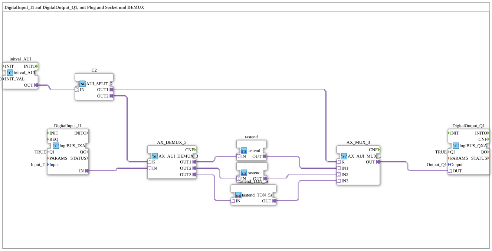

# Uebung_103c: DigitalInput_I1 auf DigitalOutput_Q1, mit Plug and Socket und DEMUX

* * * * * * * * * *

## Einleitung

Ziel der Übung ist das Testen eines spezifischen Pfads der MUX/DEMUX-Struktur. Im Vergleich zu [Uebung_103](./Uebung_103.md) wurde das VT-Eingabefeld entfernt: Der Auswahlindex für `AX_DEMUX_3` und `AX_MUX_3` wird stattdessen von einem `initval_AUI` mit festem Wert vorgegeben. Der Taster `I1` wirkt dadurch dauerhaft über denselben der drei Zweige (`tastend`, `rastend`, `tastend_TON_5s`) auf den Ausgang `Q1`, obwohl die Struktur für die anderen Modi noch vorhanden ist. Das dient oft zum Debugging oder zum schnellen Einfrieren einer Konfiguration.

## Verwendete Funktionsbausteine (FBs)

- **DigitalInput_I1**: logiBUS Digitaleingang
    - **Typ**: [`logiBUS::io::DI::logiBUS_IXA`](https://meisterschulen-am-ostbahnhof-munchen-docs.readthedocs.io/projects/4diac-library-reference-docs/de/latest/Bibliotheken/ExternalLibraries/logiBUS/io/DI/logiBUS_IXA/)
    - **Parameter**: `QI = TRUE`, `Input = Input_I1`
    - **Erklärung**: Liefert den Zustand von `I1` als AX-Adaptersignal.
- **initval_AUI**: fester Auswahlindex
    - **Typ**: [`adapter::types::unidirectional::AUI::initval::initval_AUI`](https://meisterschulen-am-ostbahnhof-munchen-docs.readthedocs.io/projects/4diac-library-reference-docs/de/latest/Bibliotheken/ExternalLibraries/adapter/types/unidirectional/UINT/initval/initval_AUI/)
    - **Parameter**: `INIT_VAL = 0`
    - **Erklärung**: Stellt den konstanten Index 0 als AUI-Signal bereit.
- **C2**: Verteiler des Index
    - **Typ**: [`adapter::events::unidirectional::AUI_SPLIT_2`](https://meisterschulen-am-ostbahnhof-munchen-docs.readthedocs.io/projects/4diac-library-reference-docs/de/latest/Bibliotheken/ExternalLibraries/adapter/events/unidirectional/UINT/AUI_SPLIT_2/)
    - **Parameter**: keine
    - **Erklärung**: Verteilt den Index auf `AX_AUI_MUX_3.K` (`OUT1`) und `AX_AUI_DEMUX_3.K` (`OUT2`).
- **AX_DEMUX_3**: Demultiplexer
    - **Typ**: [`adapter::selection::unidirectional::AX_AUI_DEMUX_3`](https://meisterschulen-am-ostbahnhof-munchen-docs.readthedocs.io/projects/4diac-library-reference-docs/de/latest/Bibliotheken/ExternalLibraries/adapter/selection/unidirectional/BOOL/AX_AUI_DEMUX_3/)
    - **Parameter**: keine
    - **Erklärung**: Leitet das Signal von `IN` an einen der Ausgänge `OUT1` bis `OUT3` weiter; der Index kommt über den Adapter `K` und ist 0-basiert (Index 0 → `OUT1`, 1 → `OUT2`, 2 → `OUT3`).
- **tastend**: Zweig 1, tastende Funktion
    - **Typ**: `MyLib::sys::tastend` (SubApp-Instanz, siehe [tastend](https://meisterschulen-am-ostbahnhof-munchen-docs.readthedocs.io/projects/4diac-library-reference-docs/de/latest/Bibliotheken/ExternalLibraries/MyLib_AX/sys/tastend/))
    - **Parameter**: keine
    - **Erklärung**: Leitet das Signal direkt (1:1) von `IN` an `OUT` weiter.
- **rastend**: Zweig 2, rastende Funktion
    - **Typ**: `MyLib::sys::rastend` (SubApp-Instanz, siehe [rastend](https://meisterschulen-am-ostbahnhof-munchen-docs.readthedocs.io/projects/4diac-library-reference-docs/de/latest/Bibliotheken/ExternalLibraries/MyLib_AX/sys/rastend/))
    - **Parameter**: keine
    - **Erklärung**: Wandelt den Taster in einen Schalter (Toggle) um; das Umschalten erfolgt beim Loslassen (fallende Flanke über `AX_F_TRIG` auf `AX_T_FF`).
- **tastend_TON_5s**: Zweig 3, tastend mit 5 s Einschaltverzögerung
    - **Typ**: `MyLib::sys::tastend_TON_5s` (SubApp-Instanz, siehe [tastend_TON_5s](https://meisterschulen-am-ostbahnhof-munchen-docs.readthedocs.io/projects/4diac-library-reference-docs/de/latest/Bibliotheken/ExternalLibraries/MyLib_AX/sys/tastend_TON_5s/))
    - **Parameter**: keine
    - **Erklärung**: Leitet das Signal über einen `AX_TON` mit `PT = t#5s` weiter, also mit 5 s Einschaltverzögerung.
- **AX_MUX_3**: Multiplexer
    - **Typ**: [`adapter::selection::unidirectional::AX_AUI_MUX_3`](https://meisterschulen-am-ostbahnhof-munchen-docs.readthedocs.io/projects/4diac-library-reference-docs/de/latest/Bibliotheken/ExternalLibraries/adapter/selection/unidirectional/BOOL/AX_AUI_MUX_3/)
    - **Parameter**: keine
    - **Erklärung**: Gibt den durch den Index `K` gewählten Eingang `IN1` bis `IN3` an `OUT` weiter (Index 0 → `IN1`, 1 → `IN2`, 2 → `IN3`).
- **DigitalOutput_Q1**: logiBUS Digitalausgang
    - **Typ**: [`logiBUS::io::DQ::logiBUS_QXA`](https://meisterschulen-am-ostbahnhof-munchen-docs.readthedocs.io/projects/4diac-library-reference-docs/de/latest/Bibliotheken/ExternalLibraries/logiBUS/io/DO/logiBUS_QXA/)
    - **Parameter**: `QI = TRUE`, `Output = Output_Q1`
    - **Erklärung**: Gibt das Ergebnis am physischen Ausgang `Q1` aus.

## Programmablauf und Verbindungen

1. `initval_AUI.OUT` → `C2.IN`; `C2.OUT2` → `AX_DEMUX_3.K` und `C2.OUT1` → `AX_MUX_3.K`: Beide Selektoren erhalten denselben festen Index.
2. `DigitalInput_I1.IN` → `AX_DEMUX_3.IN`: Der Taster speist den Demultiplexer.
3. `AX_DEMUX_3.OUT1` → `tastend.IN`, `AX_DEMUX_3.OUT2` → `rastend.IN`, `AX_DEMUX_3.OUT3` → `tastend_TON_5s.IN`: Die drei Zweige.
4. `tastend.OUT` → `AX_MUX_3.IN1`, `rastend.OUT` → `AX_MUX_3.IN2`, `tastend_TON_5s.OUT` → `AX_MUX_3.IN3`: Die Zweige laufen im Multiplexer zusammen.
5. `AX_MUX_3.OUT` → `DigitalOutput_Q1.OUT`: Das Ergebnis des gewählten Zweigs wird auf `Q1` gelegt.

**Verhalten**: Mit `INIT_VAL = 0` ist der Index 0 gewählt, also der Zweig `tastend`: `Q1` folgt `I1` direkt. Wird der Wert von `INIT_VAL` im Quelltext auf 1 bzw. 2 geändert, wirkt stattdessen der Zweig `rastend` bzw. `tastend_TON_5s`.

## Anwendungsbeispiel

Fest eingestellte Konfiguration einer umschaltbaren Bedienlogik, zum Debugging eines einzelnen Zweigs oder um eine Einstellung dauerhaft einzufrieren.

## Zusammenfassung

Die Übung `Uebung_103c` zeigt die MUX/DEMUX-Struktur mit festem Auswahlindex: Ein `initval_AUI` legt über `AUI_SPLIT_2` denselben Index an `AX_AUI_DEMUX_3` und `AX_AUI_MUX_3` an, sodass nur ein Zweig der drei Verarbeitungslogiken aktiv ist.

---

### 🌐 Passende Themen-Unterseiten auf ms-muc-docs.de

- [🌐 Eclipse 4diac IDE & Farb-Referenz auf ms-muc-docs.de](https://www.ms-muc-docs.de/iec-61499/eclipse-4diac/)
