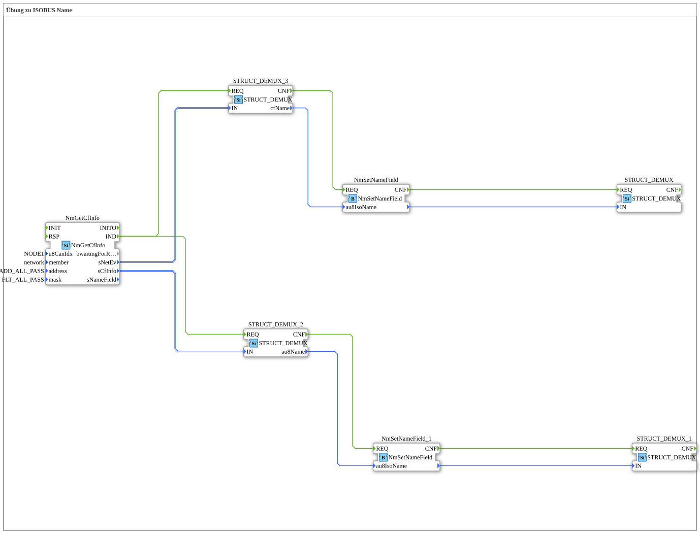

# Uebung_120_AX: Übung zu ISOBUS Name

Dieser Artikel beschreibt die 4diac IDE Subapplikation Uebung_120_AX (Übung zu ISOBUS Name).

----

## Ziel der Übung

Das Ziel dieser Übung ist die Umsetzung folgender Anforderung: **Übung zu ISOBUS Name**

-----

## Beschreibung und Komponenten

Die Übung besteht aus der Subapplikation Uebung_120_AX.SUB, welche die folgende Bausteinstruktur verwendet:

### Verwendete Funktionsbausteine (FBs)

- **NmGetCfInfo**: Instanz des Typs isobus::pgn::NmGetCfInfo.
  - Parameter u8CanIdx = NODE1
  - Parameter member = network
  - Parameter address = ADD_ALL_PASS
  - Parameter mask = FLT_ALL_PASS
- **STRUCT_DEMUX_2**: Instanz des Typs eclipse4diac::convert::STRUCT_DEMUX.
- **STRUCT_DEMUX_3**: Instanz des Typs eclipse4diac::convert::STRUCT_DEMUX.
- **NmSetNameField**: Instanz des Typs isobus::pgn::NmSetNameField.
- **NmSetNameField_1**: Instanz des Typs isobus::pgn::NmSetNameField.
- **STRUCT_DEMUX**: Instanz des Typs eclipse4diac::convert::STRUCT_DEMUX.
- **STRUCT_DEMUX_1**: Instanz des Typs eclipse4diac::convert::STRUCT_DEMUX.

### Verbindungen und Schnittstellen

**Ereignisverbindungen:**

- NmGetCfInfo.IND -> STRUCT_DEMUX_3.REQ
- NmGetCfInfo.IND -> STRUCT_DEMUX_2.REQ
- STRUCT_DEMUX_3.CNF -> NmSetNameField.REQ
- STRUCT_DEMUX_2.CNF -> NmSetNameField_1.REQ
- NmSetNameField.CNF -> STRUCT_DEMUX.REQ
- NmSetNameField_1.CNF -> STRUCT_DEMUX_1.REQ

**Datenverbindungen:**

- NmGetCfInfo.sNetEv -> STRUCT_DEMUX_3.IN
- NmGetCfInfo.sCfInfo -> STRUCT_DEMUX_2.IN
- STRUCT_DEMUX_3.cfName -> NmSetNameField.au8IsoName
- STRUCT_DEMUX_2.au8Name -> NmSetNameField_1.au8IsoName
- NmSetNameField. -> STRUCT_DEMUX.IN
- NmSetNameField_1. -> STRUCT_DEMUX_1.IN

### Hinweise aus dem Modell

> mit einem Event an RSP wird der nächste ACL abgefragt.

-----

## Muster mit `NmGetCfInfo` (IND/RSP)

`NmGetCfInfo` meldet ein Netzwerkereignis mit `IND` und wartet danach auf `RSP` (`bwaitingForRSP = TRUE`). Erst nach `RSP` liefert der Baustein das nächste Ereignis aus seiner internen Warteschlange. Diese Übung ist deshalb so aufgebaut:

- `NmGetCfInfo.sNetEv` geht an `STRUCT_DEMUX`, dessen `CNF` an `NmGetCfInfo.RSP` (reine Anzeige, die Verbindung ist in der IDE ausgeblendet).

Stand der Umstellung: 2026-11-17, noch nicht auf Hardware getestet.

## Programmablauf und Funktionsweise

1. **Initialisierung**: Beim Systemstart werden alle beteiligten Bausteine initialisiert.
2. **Ereignis- und Signalverarbeitung**: Zustandsänderungen an den Eingängen erzeugen Ereignisse, die über die definierten Verbindungen an die nachgelagerten Bausteine weitergeleitet werden.
3. **Ausgangsaktualisierung**: Die Zielbausteine verarbeiten die empfangenen Signale und aktualisieren entsprechend die Ausgänge.

-----

## Zusammenfassung

Die Übung Uebung_120_AX demonstriert anschaulich die modulare IEC 61499 Architektur in 4diac IDE.
