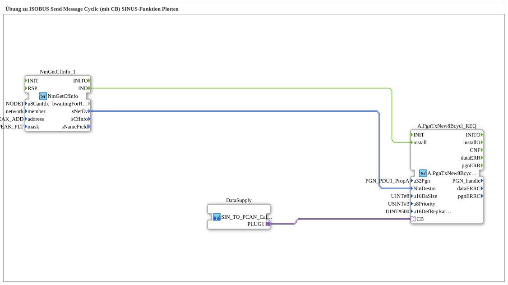

# Uebung_126b2_AX: Übung zu ISOBUS Send Message Cyclic (mit CB) SINUS-Funktion Plotten

Dieser Artikel beschreibt die 4diac IDE Subapplikation Uebung_126b2_AX (Übung zu ISOBUS Send Message Cyclic (mit CB) SINUS-Funktion Plotten).

----

## Ziel der Übung

Das Ziel dieser Übung ist die Umsetzung folgender Anforderung: **Übung zu ISOBUS Send Message Cyclic (mit CB) SINUS-Funktion Plotten**

-----

## Gegenstück

Dieser Sender beantwortet auch Requests. Als Gegenstück passen der Empfänger [Uebung_130_AX](Uebung_130_AX.md) (nimmt jede Nachricht an), der zyklische Empfänger [Uebung_131_AX](Uebung_131_AX.md) sowie die anfragenden Übungen [Uebung_132_AX](Uebung_132_AX.md) und [Uebung_133_AX](Uebung_133_AX.md). Siehe auch die [CAN-Übersicht](Uebungen_CAN_Uebersicht.md).

## Beschreibung und Komponenten

Die Übung besteht aus der Subapplikation Uebung_126b2_AX.SUB, welche die folgende Bausteinstruktur verwendet:

### Verwendete Funktionsbausteine (FBs)

- **NmGetCfInfo_1**: Instanz des Typs isobus::pgn::NmGetCfInfo.
  - Parameter u8CanIdx = NODE1
  - Parameter member = network
  - Parameter address = PEAK_ADD
  - Parameter mask = PEAK_FLT
- **AlPgnTxNew8Bcycl_REQ**: Instanz des Typs isobus::pgn::tx::AlPgnTxNew8Bcycl_REQ.
  - Parameter u32Pgn = PGN_PDU1_PropA
  - Parameter u16DaSize = 8
  - Parameter u8Priority = 3
  - Parameter u16DefRepRate = 500

### Verbindungen und Schnittstellen

**Adapterverbindungen:**

- DataSupply.PLUG1 -> AlPgnTxNew8Bcycl_REQ.CB

**Ereignisverbindungen:**

- NmGetCfInfo_1.IND -> AlPgnTxNew8Bcycl_REQ.install

**Datenverbindungen:**

- NmGetCfInfo_1.sNetEv -> AlPgnTxNew8Bcycl_REQ.NmDestin

-----

## Muster mit `NmGetCfInfo` (IND/RSP)

`NmGetCfInfo` meldet ein Netzwerkereignis mit `IND` und wartet danach auf `RSP` (`bwaitingForRSP = TRUE`). Erst nach `RSP` liefert der Baustein das nächste Ereignis aus seiner internen Warteschlange. Diese Übung ist deshalb so aufgebaut:

- `IND` löst `STRUCT_DEMUX` (`sNetEv`) aus. Dessen `CNF` geht an `NetEv_Install.REQ`, `eNetEvent` an `NetEv_Install.eNetEvent`.
- Die SubApp `NetEv_Install` (`MyLib::sys::NetEv_Install_Filter`) filtert nach dem Ereignis: Bei `Active` und `NewAddress` gibt sie `INSTALL` aus (nur beim ersten Mal, danach `RSP`), alle anderen Ereignisse gehen direkt auf `RSP`. Ereignisnummern ab 7 landen ebenfalls auf `RSP`.
- `installO` geht an `NetEv_Install.SET` und an `RSP`, `pgnERR` ebenfalls an `RSP`.
- `INIT` bleibt unverbunden (`EInit`), so wird beim Start der Replay aller bekannten Ereignisse ausgelöst.
- Alle Verbindungen auf `RSP` sind in der IDE ausgeblendet.

Stand der Umstellung: 2026-11-17, noch nicht auf Hardware getestet. Offen ist, ob die PGN nach Abmelden und Wiederanmelden des Partners weiter ankommt, denn sie wird pro Deploy nur einmal installiert.

## Programmablauf und Funktionsweise

1. **Initialisierung**: Beim Systemstart werden alle beteiligten Bausteine initialisiert.
2. **Ereignis- und Signalverarbeitung**: Zustandsänderungen an den Eingängen erzeugen Ereignisse, die über die definierten Verbindungen an die nachgelagerten Bausteine weitergeleitet werden.
3. **Ausgangsaktualisierung**: Die Zielbausteine verarbeiten die empfangenen Signale und aktualisieren entsprechend die Ausgänge.

-----

## Zusammenfassung

Die Übung Uebung_126b2_AX demonstriert anschaulich die modulare IEC 61499 Architektur in 4diac IDE.
