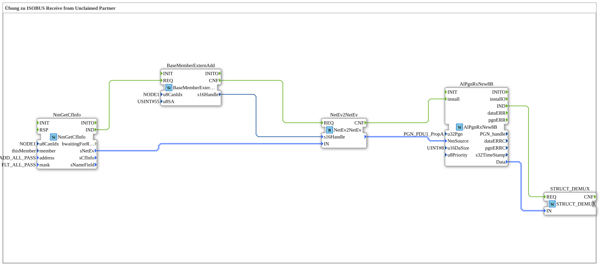

# Uebung_134_AX: Übung zu ISOBUS Receive from Unclaimed Partner

Dieser Artikel beschreibt die 4diac IDE Subapplikation Uebung_134_AX (Übung zu ISOBUS Receive from Unclaimed Partner).

----

## Ziel der Übung

Das Ziel dieser Übung ist die Umsetzung folgender Anforderung: **Übung zu ISOBUS Receive from Unclaimed Partner**

-----

## Beschreibung und Komponenten

Die Übung besteht aus der Subapplikation Uebung_134_AX.SUB, welche die folgende Bausteinstruktur verwendet:

### Verwendete Funktionsbausteine (FBs)

- **BaseMemberExternAdd**: Instanz des Typs isobus::pgn::BaseMemberExternAdd.
  - Parameter u8CanIdx = NODE1
  - Parameter u8SA = 55
- **AlPgnRxNew8B**: Instanz des Typs isobus::pgn::rx::AlPgnRxNew8B.
  - Parameter u32Pgn = PGN_PDU1_PropA
  - Parameter u16DaSize = 8
- **NmGetCfInfo**: Instanz des Typs isobus::pgn::NmGetCfInfo.
  - Parameter u8CanIdx = NODE1
  - Parameter member = thisMember
  - Parameter address = ADD_ALL_PASS
  - Parameter mask = FLT_ALL_PASS
- **NetEv2NetEv**: Instanz des Typs isobus::pgn::NetEv2NetEv.
- **STRUCT_DEMUX**: Instanz des Typs eclipse4diac::convert::STRUCT_DEMUX.

### Verbindungen und Schnittstellen

**Ereignisverbindungen:**

- BaseMemberExternAdd.CNF -> NetEv2NetEv.REQ
- NetEv2NetEv.CNF -> AlPgnRxNew8B.install
- NmGetCfInfo.IND -> BaseMemberExternAdd.REQ
- AlPgnRxNew8B.IND -> STRUCT_DEMUX.REQ

**Datenverbindungen:**

- BaseMemberExternAdd.s16Handle -> NetEv2NetEv.s16Handle
- NmGetCfInfo.sNetEv -> NetEv2NetEv.IN
- NetEv2NetEv. -> AlPgnRxNew8B.NmSource
- AlPgnRxNew8B.Data -> STRUCT_DEMUX.IN

-----

## Muster mit `NmGetCfInfo` (IND/RSP)

`NmGetCfInfo` meldet ein Netzwerkereignis mit `IND` und wartet danach auf `RSP` (`bwaitingForRSP = TRUE`). Erst nach `RSP` liefert der Baustein das nächste Ereignis aus seiner internen Warteschlange. Diese Übung ist deshalb so aufgebaut:

- `IND` löst `STRUCT_DEMUX` (`sNetEv`) aus. Dessen `CNF` geht an `NetEv_Install.REQ`, `eNetEvent` an `NetEv_Install.eNetEvent`.
- Die SubApp `NetEv_Install` (`MyLib::sys::NetEv_Install_Filter`) filtert nach dem Ereignis: Bei `Active` und `NewAddress` gibt sie `INSTALL` aus (nur beim ersten Mal, danach `RSP`), alle anderen Ereignisse gehen direkt auf `RSP`. Ereignisnummern ab 7 landen ebenfalls auf `RSP`.
- `installO` geht an `NetEv_Install.SET` und an `RSP`, `pgnERR` ebenfalls an `RSP`.
- `INIT` bleibt unverbunden (`EInit`), so wird beim Start der Replay aller bekannten Ereignisse ausgelöst.
- Alle Verbindungen auf `RSP` sind in der IDE ausgeblendet.

Stand der Umstellung: 2026-11-17, noch nicht auf Hardware getestet. Offen ist, ob die PGN nach Abmelden und Wiederanmelden des Partners weiter ankommt, denn sie wird pro Deploy nur einmal installiert.

## Programmablauf und Funktionsweise

1. **Initialisierung**: Beim Systemstart werden alle beteiligten Bausteine initialisiert.
2. **Ereignis- und Signalverarbeitung**: Zustandsänderungen an den Eingängen erzeugen Ereignisse, die über die definierten Verbindungen an die nachgelagerten Bausteine weitergeleitet werden.
3. **Ausgangsaktualisierung**: Die Zielbausteine verarbeiten die empfangenen Signale und aktualisieren entsprechend die Ausgänge.

-----

## Zusammenfassung

Die Übung Uebung_134_AX demonstriert anschaulich die modulare IEC 61499 Architektur in 4diac IDE.
