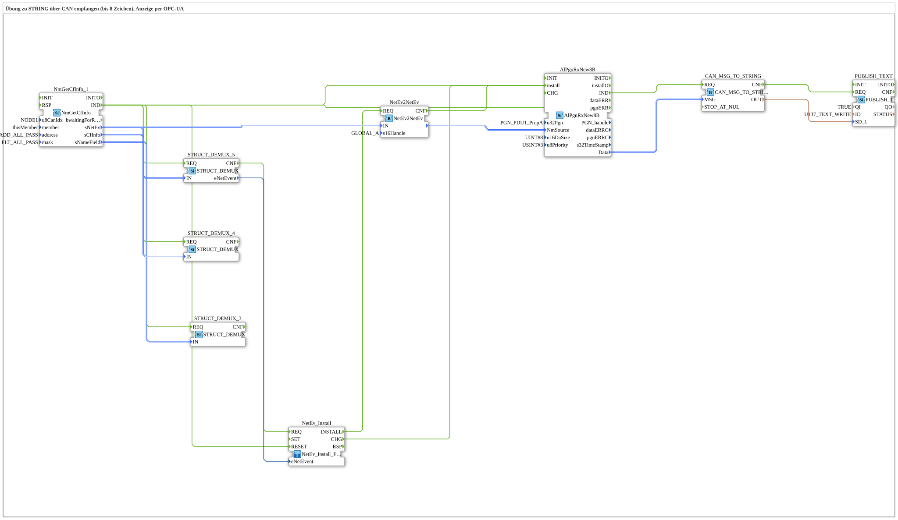

# Uebung_137c_AX: Übung zu STRING über CAN empfangen (bis 8 Zeichen), Anzeige per OPC-UA

Dieser Artikel beschreibt die 4diac IDE Subapplikation Uebung_137c_AX (Übung zu STRING über CAN empfangen (bis 8 Zeichen), Anzeige per OPC-UA).

----

## Ziel der Übung

Das Ziel dieser Übung ist die Umsetzung folgender Anforderung: **Übung zu STRING über CAN empfangen (bis 8 Zeichen), Anzeige per OPC-UA**

-----

## Beschreibung und Komponenten

Die Übung besteht aus der Subapplikation Uebung_137c_AX.SUB, welche die folgende Bausteinstruktur verwendet:

### Verwendete Funktionsbausteine (FBs)

- **STRUCT_DEMUX_3**: Instanz des Typs eclipse4diac::convert::STRUCT_DEMUX.
- **NmGetCfInfo_1**: Instanz des Typs isobus::pgn::NmGetCfInfo.
  - Parameter u8CanIdx = NODE1
  - Parameter member = thisMember
  - Parameter address = ADD_ALL_PASS
  - Parameter mask = FLT_ALL_PASS
- **STRUCT_DEMUX_4**: Instanz des Typs eclipse4diac::convert::STRUCT_DEMUX.
- **STRUCT_DEMUX_5**: Instanz des Typs eclipse4diac::convert::STRUCT_DEMUX.
- **NetEv2NetEv**: Instanz des Typs isobus::pgn::NetEv2NetEv.
  - Parameter s16Handle = GLOBAL_A
- **AlPgnRxNew8B**: Instanz des Typs isobus::pgn::rx::AlPgnRxNew8B.
  - Parameter u32Pgn = PGN_PDU1_PropA
  - Parameter u16DaSize = 8
  - Parameter u8Priority = 3
- **CAN_MSG_TO_STRING**: Instanz des Typs isobus::pgn::CAN_MSG_TO_STRING.
- **PUBLISH_TEXT**: Instanz des Typs iec61499::net::PUBLISH_1.
  - Parameter QI = TRUE
  - Parameter ID = U137_TEXT_WRITE
- **NetEv_Install**: Untergeordnete Subapplikation (SubApp) MyLib::sys::NetEv_Install_Filter.

Die Übung nutzt das gemeinsame Muster mit `NmGetCfInfo` (IND/RSP): `IND` löst `STRUCT_DEMUX` aus, `NetEv_Install` verarbeitet das Ereignis und quittiert mit `RSP`.

-----

## Zusammenfassung

Die Übung Uebung_137c_AX demonstriert die modulare IEC 61499 Architektur in 4diac IDE.
