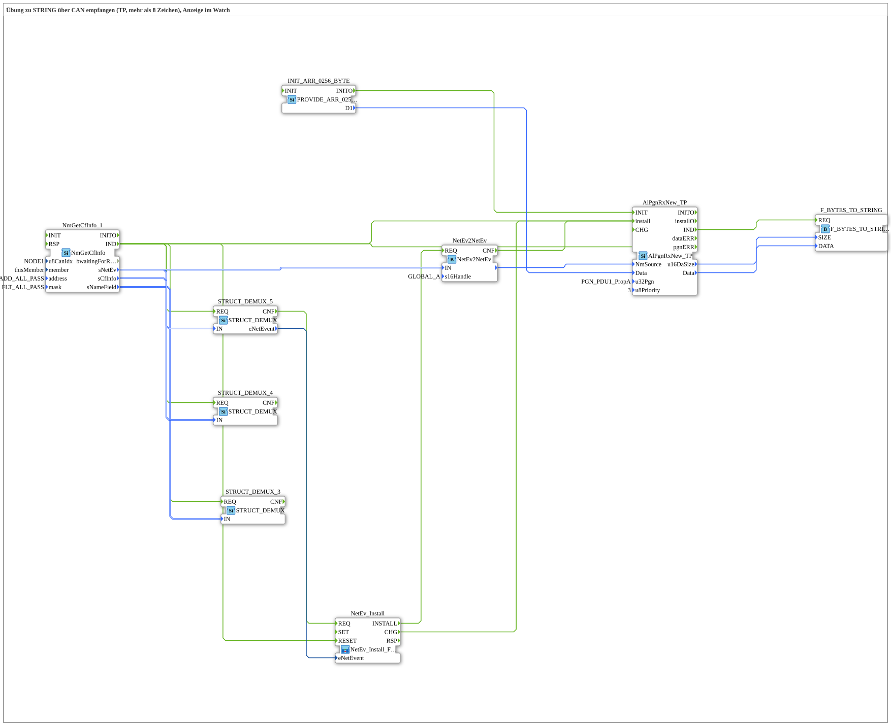

# Uebung_139_AX: Übung zu STRING über CAN empfangen (TP, mehr als 8 Zeichen), Anzeige im Watch

Dieser Artikel beschreibt die 4diac IDE Subapplikation Uebung_139_AX (Übung zu STRING über CAN empfangen (TP, mehr als 8 Zeichen), Anzeige im Watch).

----

## Ziel der Übung

Das Ziel dieser Übung ist die Umsetzung folgender Anforderung: **Übung zu STRING über CAN empfangen (TP, mehr als 8 Zeichen), Anzeige im Watch**

-----

## Beschreibung und Komponenten

Die Übung besteht aus der Subapplikation Uebung_139_AX.SUB, welche die folgende Bausteinstruktur verwendet:

### Verwendete Funktionsbausteine (FBs)

- **STRUCT_DEMUX_3**: Instanz des Typs eclipse4diac::convert::STRUCT_DEMUX.
- **NmGetCfInfo_1**: Instanz des Typs isobus::pgn::NmGetCfInfo.
  - Parameter u8CanIdx = NODE1
  - Parameter member = thisMember
  - Parameter address = ADD_ALL_PASS
  - Parameter mask = FLT_ALL_PASS
- **STRUCT_DEMUX_4**: Instanz des Typs eclipse4diac::convert::STRUCT_DEMUX.
- **STRUCT_DEMUX_5**: Instanz des Typs eclipse4diac::convert::STRUCT_DEMUX.
- **NetEv2NetEv**: Instanz des Typs isobus::pgn::NetEv2NetEv.
  - Parameter s16Handle = GLOBAL_A
- **INIT_ARR_0256_BYTE**: Instanz des Typs eclipse4diac::convert::providers::PROVIDE_ARR_0256_BYTE.
- **AlPgnRxNew_TP**: Instanz des Typs isobus::pgn::rx::AlPgnRxNew_TP.
  - Parameter u32Pgn = PGN_PDU1_PropA
  - Parameter u8Priority = 3
- **F_BYTES_TO_STRING**: Instanz des Typs logiBUS::utils::dyn_arr::F_BYTES_TO_STRING.
- **NetEv_Install**: Untergeordnete Subapplikation (SubApp) MyLib::sys::NetEv_Install_Filter.

Die Übung nutzt das gemeinsame Muster mit `NmGetCfInfo` (IND/RSP): `IND` löst `STRUCT_DEMUX` aus, `NetEv_Install` verarbeitet das Ereignis und quittiert mit `RSP`.

-----

## Zusammenfassung

Die Übung Uebung_139_AX demonstriert die modulare IEC 61499 Architektur in 4diac IDE.
