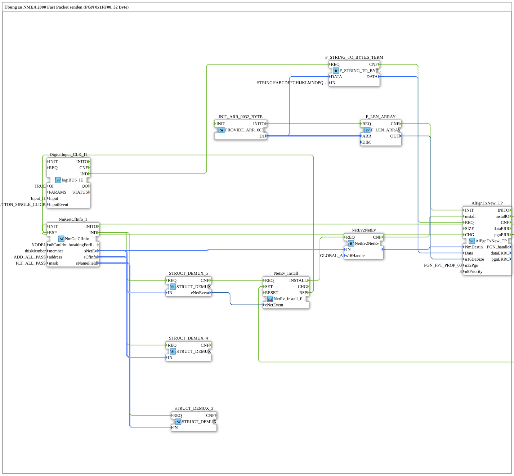

# Uebung_142_AX: Übung zu NMEA 2000 Fast Packet senden (PGN 0x1FF00, 32 Byte)

Dieser Artikel beschreibt die logiBUS®-Übung `Uebung_142_AX`.

----

## Ziel der Übung

Eine PGN im proprietären Bereich `0x1FF00` mit 32 Byte wird per Fast Packet gesendet, nicht per ISO-TP, also ohne RTS/CTS.

-----

## Beschreibung und Komponenten

### Funktionsbausteine (FBs)

- `DigitalInput_CLK_I1`: `logiBUS_IE` an `I1`, Ereignis `BUTTON_SINGLE_CLICK`, löst das Senden aus.
- `F_STRING_TO_BYTES`: wandelt den Text `ABCDEFGHIJKLMNOPQRSTUVWXYZ01234` in Bytes. `INIT_ARR_0032_BYTE` liefert den 32-Byte-Puffer, `F_LEN_ARRAY` die Länge.
- `AlPgnTxNew_TP`: `isobus::pgn::tx::AlPgnTxNew_TP` mit `u32Pgn = PGN_FPT_PROP_00` (0x1FF00) und `u8Priority = 3`. Das Ziel ist global (`NetEv2NetEv` mit `s16Handle = GLOBAL_A`).
- `NmGetCfInfo_1`, `STRUCT_DEMUX_*`, `NetEv_Install`: Muster mit `thisMember`.

Die Übung nutzt das gemeinsame Muster mit `NmGetCfInfo` (IND/RSP): `IND` löst `STRUCT_DEMUX` aus, `NetEv_Install` (`MyLib::sys::NetEv_Install_Filter`) verarbeitet das Ereignis und quittiert immer mit `RSP` (die RSP-Verbindungen sind in der IDE ausgeblendet). `INIT` ist als `EInit` nicht verbunden.

-----

## Funktionsweise

1. Ein Klick auf `I1` sendet den Text samt abschließendem Byte `16#00` (32 Byte) als Fast Packet.
2. Auf dem Bus erwartet man Rahmen mit der CAN-ID der PGN `0x1FF00`: Rahmen 0 enthält in Byte 0 Sequenz- und Rahmenzähler, in Byte 1 die Länge 32 (`0x20`) und danach `ABCDEF`. Rahmen 1 bis 4 haben je den Zähler und 7 Datenbytes: `GHIJKLM`, `NOPQRST`, `UVWXYZ0`, `1234 00 FF FF`.
3. Als Fast Packet gehen PGNs im Bereich `0x1F000` bis `0x1FFFF` mit mehr als 8 Byte, immer als Rundsendung. Proprietary A (`0xEF00`) bleibt ISO-TP.
4. Das Gegenstück ist die Übung 143.

-----

## Erwartetes Verhalten

- Ein Busmitschnitt zeigt nach dem Klick fünf Rahmen mit dem oben beschriebenen Aufbau (erwartet).
- Mehr zum Protokoll: [NMEA 2000 Fast Packet](https://meisterschulen-am-ostbahnhof-munchen-docs.readthedocs.io/projects/isobus-other-docs/de/latest/NMEA2000-Fast-Packet/).

Es sind keine Hardware-Ergebnisse dokumentiert: Die Übung ist noch nicht auf Hardware getestet. Aussagen zum Verhalten stammen aus dem Kommentar im Netzwerk der Übung und sind als erwartet zu lesen.

-----

## Anwendungsbeispiel

Herstellerspezifische Daten von mehr als 8 Byte, die ein Gerät ohne Verbindungsaufbau an alle sendet, etwa Statuswerte.

