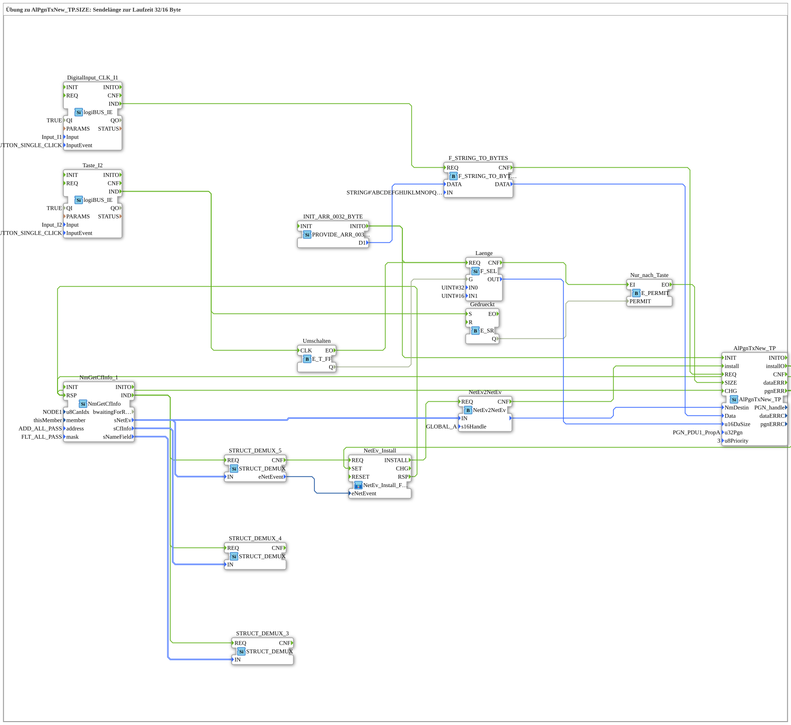

# Uebung_144_AX: Übung zu AlPgnTxNew_TP.SIZE (Sendelänge zur Laufzeit)

Dieser Artikel beschreibt die logiBUS®-Übung `Uebung_144_AX`.

----

## Ziel der Übung

Die Sendelänge einer PGN wird zur Laufzeit zwischen 32 und 16 Byte umgeschaltet, ohne neu zu installieren.

-----

## Beschreibung und Komponenten

### Funktionsbausteine (FBs)

- `AlPgnTxNew_TP`: `isobus::pgn::tx::AlPgnTxNew_TP` mit `u32Pgn = PGN_PDU1_PropA` (Proprietary A) und `u8Priority = 3`. Der Eingang `SIZE` setzt die Sendelänge.
- `DigitalInput_CLK_I1`: Klick auf `I1` sendet. `Taste_I2`: Klick auf `I2` schaltet um.
- `Umschalten` (`E_T_FF`) und `Laenge` (`F_SEL`): `IN0 = UINT#32`, `IN1 = UINT#16`. Bei `Q = FALSE` gilt 32 Byte, bei `Q = TRUE` 16 Byte.
- `Gedrueckt` (`E_SR`) und `Nur_nach_Taste` (`E_PERMIT`): `SIZE` wird erst nach dem ersten Klick auf `I2` gesetzt.
- `F_STRING_TO_BYTES_TERM` und `INIT_ARR_0032_BYTE`: Text `ABCDEFGHIJKLMNOPQRSTUVWXYZ01234` im 32-Byte-Puffer.

Die Übung nutzt das gemeinsame Muster mit `NmGetCfInfo` (IND/RSP): `IND` löst `STRUCT_DEMUX` aus, `NetEv_Install` (`MyLib::sys::NetEv_Install_Filter`) verarbeitet das Ereignis und quittiert immer mit `RSP` (die RSP-Verbindungen sind in der IDE ausgeblendet). `INIT` ist als `EInit` nicht verbunden.

-----

## Funktionsweise

1. Beim `install` gilt die Länge 32 Byte (`Laenge` beim Start). Das ist zugleich die Obergrenze.
2. Ein Klick auf `I2` schaltet auf 16 Byte, der nächste wieder auf 32 Byte. Das Ergebnis geht an `AlPgnTxNew_TP.SIZE`.
3. `SIZE` darf nie größer sein als beim `install`, sonst meldet `pgnERR` den Fehler `E_OVERFLOW`.
4. Ein Klick auf `I1` sendet.

-----

## Erwartetes Verhalten

- Als Empfänger dient Übung 139. Im Watch wird für `u16DaSize` abwechselnd 16 und 32 erwartet.

Es sind keine Hardware-Ergebnisse dokumentiert: Die Übung ist noch nicht auf Hardware getestet. Aussagen zum Verhalten stammen aus dem Kommentar im Netzwerk der Übung und sind als erwartet zu lesen.

-----

## Anwendungsbeispiel

Nachrichten mit wechselnder Nutzlast, etwa eine kurze Variante im Normalbetrieb und eine lange bei Bedarf.

