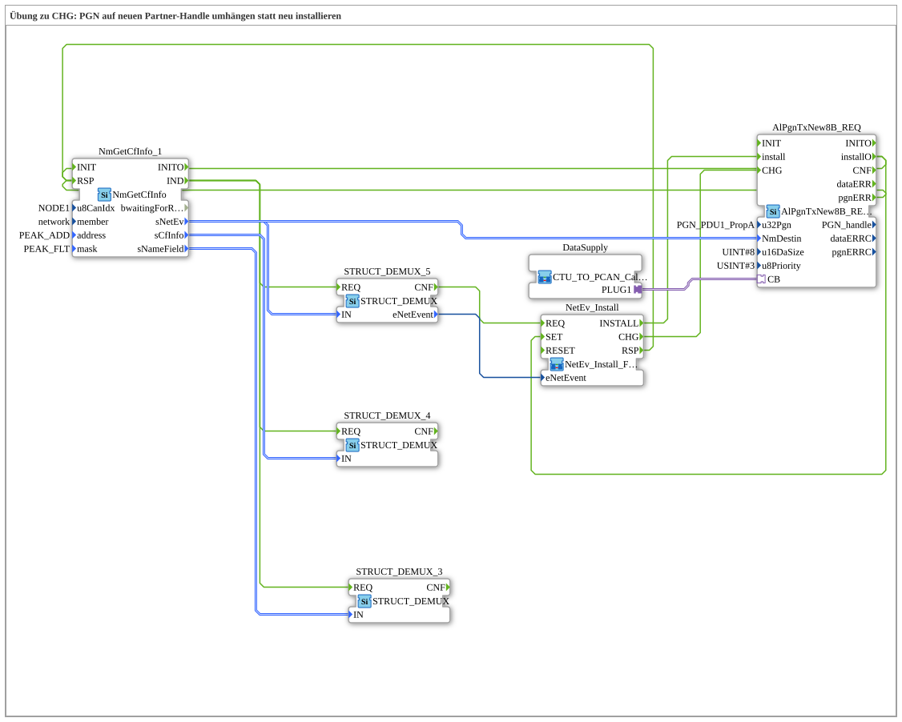

# Uebung_145_AX: Übung zu CHG (PGN auf neuen Partner-Handle umhängen)

Dieser Artikel beschreibt die logiBUS®-Übung `Uebung_145_AX`.

----

## Ziel der Übung

Meldet sich der Partner nach einem Ausfall mit anderem Handle wieder an, wird die bestehende Sende-PGN umgehängt, statt neu installiert.

-----

## Beschreibung und Komponenten

### Funktionsbausteine (FBs)

- `NmGetCfInfo_1`: `member = network`, `address = PEAK_ADD`, `mask = PEAK_FLT`, beobachtet den Partner (PEAK).
- `AlPgnTxNew8B_REQ`: `isobus::pgn::tx::AlPgnTxNew8B_REQ` mit `u32Pgn = PGN_PDU1_PropA`, `u16DaSize = 8`, `u8Priority = 3`. Der neue Eingang `CHG` hängt die PGN um.
- `DataSupply`: `MyLib::sys::CTU_TO_PCAN_Callback`, liefert die Daten.
- `NetEv_Install` (`NetEv_Install_Filter`): hat den neuen Ausgang `CHG`, der vor `RSP` feuert.

Die Übung nutzt das gemeinsame Muster mit `NmGetCfInfo` (IND/RSP): `IND` löst `STRUCT_DEMUX` aus, `NetEv_Install` (`MyLib::sys::NetEv_Install_Filter`) verarbeitet das Ereignis und quittiert immer mit `RSP` (die RSP-Verbindungen sind in der IDE ausgeblendet). `INIT` ist als `EInit` nicht verbunden.

-----

## Funktionsweise

1. Das erste `Active` löst `install` aus.
2. Meldet sich der Partner ab (`Inactive`) und wieder an (`Active`, eventuell mit anderem Handle), löst `NetEv_Install.CHG` den Eingang `AlPgnTxNew8B_REQ.CHG` mit dem neuen `NmDestin` aus. Danach kommt `RSP`.

-----

## Erwartetes Verhalten

- PEAK abziehen und wieder anstecken: Die PGN muss danach wieder ankommen (erwartet).

Es sind keine Hardware-Ergebnisse dokumentiert: Die Übung ist noch nicht auf Hardware getestet. Aussagen zum Verhalten stammen aus dem Kommentar im Netzwerk der Übung und sind als erwartet zu lesen.

-----

## Anwendungsbeispiel

Kommunikation mit einem Partner, der im laufenden Betrieb neu startet oder die Adresse wechselt.

