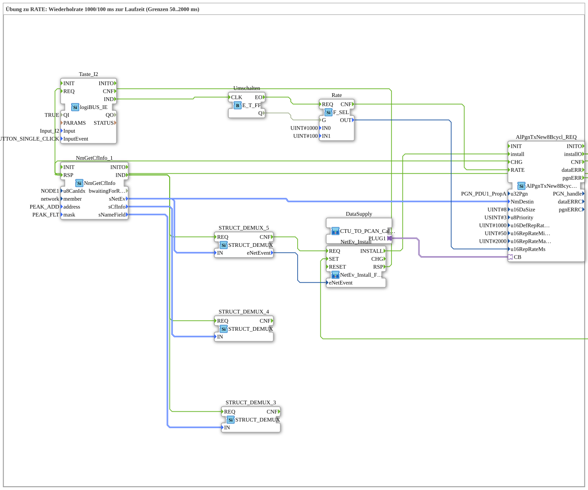

# Uebung_146_AX: Übung zu RATE (Wiederholrate zur Laufzeit)

Dieser Artikel beschreibt die logiBUS®-Übung `Uebung_146_AX`.

----

## Ziel der Übung

Die Wiederholrate einer zyklisch gesendeten PGN wird zur Laufzeit zwischen 1000 und 100 ms umgeschaltet. Die Grenzen werden beim `install` festgelegt.

-----

## Beschreibung und Komponenten

### Funktionsbausteine (FBs)

- `AlPgnTxNew8Bcycl_REQ`: `isobus::pgn::tx::AlPgnTxNew8Bcycl_REQ` mit `u32Pgn = PGN_PDU1_PropA`, `u16DaSize = 8`, `u16DefRepRate = 1000`, `u16RepRateMin = 50` und `u16RepRateMax = 2000`.
- `Taste_I2`, `Umschalten` (`E_T_FF`), `Rate` (`F_SEL`): `IN0 = UINT#1000`, `IN1 = UINT#100`. Das Ergebnis geht an `RATE` (`u16RepRateMs`).
- `DataSupply` (`CTU_TO_PCAN_Callback`), `NmGetCfInfo_1` (`network`, `PEAK_ADD`/`PEAK_FLT`), `NetEv_Install`: wie in Übung 145.

Die Übung nutzt das gemeinsame Muster mit `NmGetCfInfo` (IND/RSP): `IND` löst `STRUCT_DEMUX` aus, `NetEv_Install` (`MyLib::sys::NetEv_Install_Filter`) verarbeitet das Ereignis und quittiert immer mit `RSP` (die RSP-Verbindungen sind in der IDE ausgeblendet). `INIT` ist als `EInit` nicht verbunden.

-----

## Funktionsweise

1. Die neuen Eingänge `u16RepRateMin` und `u16RepRateMax` (Vorgabe 0 = aus) begrenzen die Rate. Für `RATE` müssen beide beim `install` ungleich 0 sein, sonst meldet `pgnERR` den Fehler `E_CONFIG`.
2. Start mit 1000 ms. Ein Klick auf `I2` schaltet auf 100 ms, der nächste wieder auf 1000 ms.
3. Ein Wert außerhalb von 50 bis 2000 ms ergibt `pgnERR` mit `E_VALUE_WRONG`.

-----

## Erwartetes Verhalten

- Ein Busmitschnitt zeigt nach dem Klick den geänderten Abstand der Nachrichten (erwartet).

Es sind keine Hardware-Ergebnisse dokumentiert: Die Übung ist noch nicht auf Hardware getestet. Aussagen zum Verhalten stammen aus dem Kommentar im Netzwerk der Übung und sind als erwartet zu lesen.

-----

## Anwendungsbeispiel

Eine Nachricht, die im Normalbetrieb langsam und bei Bedarf schneller gesendet wird, ohne dass die Busbelastung unbegrenzt steigen kann.

