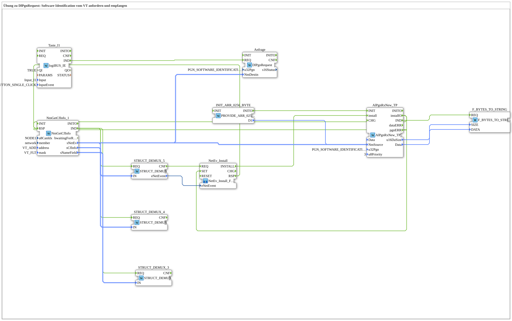

# Uebung_148_AX: Übung zu DlPgnRequest (Software Identification vom VT anfordern)

Dieser Artikel beschreibt die logiBUS®-Übung `Uebung_148_AX`.

----

## Ziel der Übung

Die Software-Identifikation (PGN `0xFEDA`) wird vom Virtual Terminal angefordert. Die Antwort wird empfangen und als Text angezeigt.

-----

## Beschreibung und Komponenten

### Funktionsbausteine (FBs)

- `Taste_I1`: Klick auf `I1` löst die Anfrage aus.
- `Anfrage`: `isobus::pgn::tx::DlPgnRequest` mit `u32Pgn = PGN_SOFTWARE_IDENTIFICATION`. Es sendet einen Request (PGN `0xEA00`) an den VT.
- `NmGetCfInfo_1`: `member = network`, `address = VT_ADD`, `mask = VT_FLT`, meldet den VT (`NmDestin` aus `sNetEv`).
- `AlPgnRxNew_TP`: empfängt `PGN_SOFTWARE_IDENTIFICATION` vom VT. `INIT_ARR_0256_BYTE` liefert den Empfangspuffer.
- `F_BYTES_TO_STRING`: macht aus den empfangenen Bytes einen Text für das Watch-Fenster.

Die Übung nutzt das gemeinsame Muster mit `NmGetCfInfo` (IND/RSP): `IND` löst `STRUCT_DEMUX` aus, `NetEv_Install` (`MyLib::sys::NetEv_Install_Filter`) verarbeitet das Ereignis und quittiert immer mit `RSP` (die RSP-Verbindungen sind in der IDE ausgeblendet). `INIT` ist als `EInit` nicht verbunden.

-----

## Funktionsweise

1. `NmGetCfInfo` meldet den VT, `AlPgnRxNew_TP` wird auf `0xFEDA` von ihm installiert.
2. Ein Klick auf `I1` löst `Anfrage.REQ` aus, der Request geht an den VT. `s16Status = 0` heißt OK.
3. Die Antwort kommt meist per TP. Im Watch stehen `u16DaSize` und der Text von `F_BYTES_TO_STRING`, die Felder sind durch `*` getrennt.

-----

## Erwartetes Verhalten

- Welche Felder der VT liefert, hängt vom Terminal ab und ist hier nicht dokumentiert.

Es sind keine Hardware-Ergebnisse dokumentiert: Die Übung ist noch nicht auf Hardware getestet. Aussagen zum Verhalten stammen aus dem Kommentar im Netzwerk der Übung und sind als erwartet zu lesen.

-----

## Anwendungsbeispiel

Auslesen von Hersteller- und Versionsangaben anderer Teilnehmer, etwa für Diagnose oder Kompatibilitätsprüfung.

