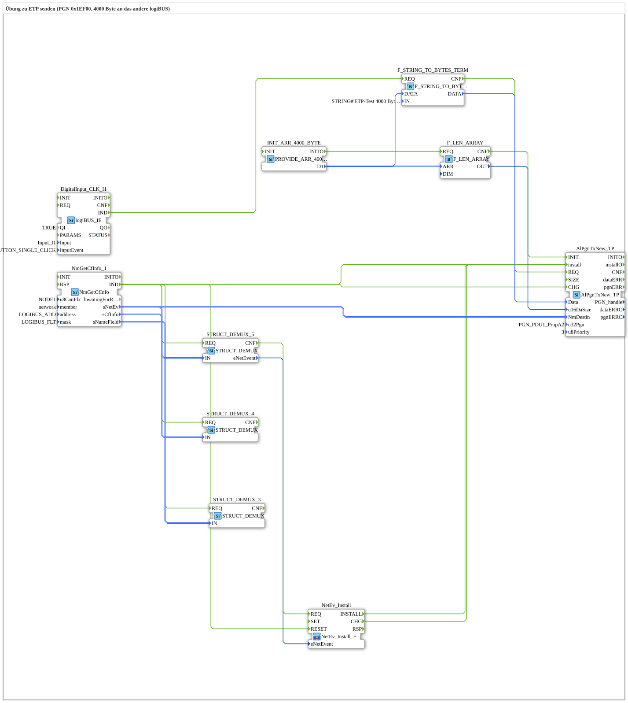

# Uebung_149_AX: Übung zu ETP senden (PGN 0x1EF00, 4000 Byte an das andere logiBUS)

Dieser Artikel beschreibt die 4diac IDE Subapplikation Uebung_149_AX (Übung zu ETP senden (PGN 0x1EF00, 4000 Byte an das andere logiBUS)).

----

## Ziel der Übung

Das Ziel dieser Übung ist die Umsetzung folgender Anforderung: **Übung zu ETP senden (PGN 0x1EF00, 4000 Byte an das andere logiBUS)**

-----

## Beschreibung und Komponenten

Die Übung besteht aus der Subapplikation Uebung_149_AX.SUB, welche die folgende Bausteinstruktur verwendet:

### Verwendete Funktionsbausteine (FBs)

- **STRUCT_DEMUX_3**: Instanz des Typs eclipse4diac::convert::STRUCT_DEMUX.
- **NmGetCfInfo_1**: Instanz des Typs isobus::pgn::NmGetCfInfo.
  - Parameter u8CanIdx = NODE1
  - Parameter member = network
  - Parameter address = LOGIBUS_ADD
  - Parameter mask = LOGIBUS_FLT
- **STRUCT_DEMUX_4**: Instanz des Typs eclipse4diac::convert::STRUCT_DEMUX.
- **STRUCT_DEMUX_5**: Instanz des Typs eclipse4diac::convert::STRUCT_DEMUX.
- **INIT_ARR_4000_BYTE**: Instanz des Typs eclipse4diac::convert::providers::PROVIDE_ARR_4000_BYTE.
- **F_LEN_ARRAY**: Instanz des Typs eclipse4diac::utils::arrays::F_LEN_ARRAY.
- **F_STRING_TO_BYTES_TERM**: Instanz des Typs logiBUS::utils::dyn_arr::F_STRING_TO_BYTES_TERM.
  - Parameter IN = STRING#'ETP-Test 4000 Byte'
- **AlPgnTxNew_TP**: Instanz des Typs isobus::pgn::tx::AlPgnTxNew_TP.
  - Parameter u32Pgn = PGN_PDU1_PropA2
  - Parameter u8Priority = 3
- **DigitalInput_CLK_I1**: Instanz des Typs logiBUS::io::DI::logiBUS_IE.
  - Parameter QI = TRUE
  - Parameter Input = Input_I1
  - Parameter InputEvent = BUTTON_SINGLE_CLICK
- **NetEv_Install**: Untergeordnete Subapplikation (SubApp) MyLib::sys::NetEv_Install_Filter.

Die Übung nutzt das gemeinsame Muster mit `NmGetCfInfo` (IND/RSP): `IND` löst `STRUCT_DEMUX` aus, `NetEv_Install` verarbeitet das Ereignis und quittiert mit `RSP`.

-----

## Ablauf und erwartetes Verhalten (aus dem Kommentar im Netzwerk)

- ETP senden: PGN PropA2 0x1EF00, 4000 Byte an das andere logiBUS
- Mehr als 1785 Byte gehen per ETP (Extended Transport Protocol). Das geht nur an EINEN Empfänger, nicht global.
- Partner: NmGetCfInfo mit network + Filter LOGIBUS_ADD/LOGIBUS_FLT (Hersteller 1116, Funktion 128).
- I1 Klick sendet: Text ETP-Test 4000 Byte, dann 16#00, Rest 16#FF. Den Stack wählt TP oder ETP selbst.
- Gegenstück: Übung 149b (oder 149c mit zu kleinem Puffer). Nicht 0x1F000-0x1FFFF: das ist Fast Packet.
- Firmware ab LOGIBUS 24534469 auf BEIDEN Geräten.

Hinweis: Die Übung ist noch nicht auf Hardware getestet. Die Beschreibung stammt aus der Subapplikation und ihrem Kommentar, das Verhalten ist als erwartet zu lesen.

-----

## Zusammenfassung

Die Übung Uebung_149_AX demonstriert die modulare IEC 61499 Architektur in 4diac IDE.
