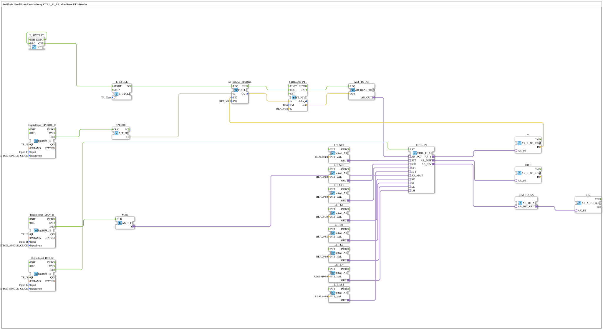

# Uebung_155_AX: Stoßfreie Hand/Auto-Umschaltung CTRL_PI_AR, simulierte PT1-Strecke

Dieser Artikel beschreibt die 4diac IDE Subapplikation Uebung_155_AX (Stoßfreie Hand/Auto-Umschaltung CTRL_PI_AR, simulierte PT1-Strecke).

----

## Ziel der Übung

Das Ziel dieser Übung ist die Umsetzung folgender Anforderung: **Stoßfreie Hand/Auto-Umschaltung CTRL_PI_AR, simulierte PT1-Strecke**

-----

## Beschreibung und Komponenten

Die Übung besteht aus der Subapplikation Uebung_155_AX.SUB, welche die folgende Bausteinstruktur verwendet:

### Verwendete Funktionsbausteine (FBs)

- **CTRL_PI**: Instanz des Typs OSCAT_adapter::Control::CTRL_PI_AR.
- **LIT_SET**: Instanz des Typs adapter::types::unidirectional::AR::initval::initval_AR.
  - Parameter INIT_VAL = 50.0
- **LIT_SUP**: Instanz des Typs adapter::types::unidirectional::AR::initval::initval_AR.
  - Parameter INIT_VAL = 0.0
- **LIT_OFS**: Instanz des Typs adapter::types::unidirectional::AR::initval::initval_AR.
  - Parameter INIT_VAL = 0.0
- **LIT_KP**: Instanz des Typs adapter::types::unidirectional::AR::initval::initval_AR.
  - Parameter INIT_VAL = 1.0
- **LIT_KI**: Instanz des Typs adapter::types::unidirectional::AR::initval::initval_AR.
  - Parameter INIT_VAL = 0.5
- **LIT_LL**: Instanz des Typs adapter::types::unidirectional::AR::initval::initval_AR.
  - Parameter INIT_VAL = 0.0
- **LIT_LH**: Instanz des Typs adapter::types::unidirectional::AR::initval::initval_AR.
  - Parameter INIT_VAL = 100.0
- **E_RESTART**: Instanz des Typs events::init::INIT.
- **SPERRE**: Instanz des Typs iec61499::events::E_T_FF.
- **MAN**: Instanz des Typs adapter::events::unidirectional::AX_T_FF.
- **Y**: Instanz des Typs adapter::conversion::unidirectional::AR_R_TO_REAL.
- **DIFF**: Instanz des Typs adapter::conversion::unidirectional::AR_R_TO_REAL.
- **LIM_TO_AX**: Instanz des Typs adapter::conversion::unidirectional::AB_TO_AX.
- **LIM**: Instanz des Typs adapter::conversion::unidirectional::AX_X_TO_BOOL.
- **DigitalInput_MAN_I1**: Instanz des Typs logiBUS::io::DI::logiBUS_IE.
  - Parameter QI = TRUE
  - Parameter Input = Input_I1
  - Parameter InputEvent = BUTTON_SINGLE_CLICK
- **DigitalInput_RST_I2**: Instanz des Typs logiBUS::io::DI::logiBUS_IE.
  - Parameter QI = TRUE
  - Parameter Input = Input_I2
  - Parameter InputEvent = BUTTON_SINGLE_CLICK
- **DigitalInput_SPERRE_I3**: Instanz des Typs logiBUS::io::DI::logiBUS_IE.
  - Parameter QI = TRUE
  - Parameter Input = Input_I3
  - Parameter InputEvent = BUTTON_SINGLE_CLICK
- **E_CYCLE**: Instanz des Typs iec61499::events::E_CYCLE.
  - Parameter DT = T#100ms
- **STRECKE_SPERRE**: Instanz des Typs iec61131::selection::F_SEL.
  - Parameter IN1 = REAL#0.0
- **STRECKE_PT1**: Instanz des Typs OSCAT::Basic::POUs::Engineering::Control::FT_PT1.
  - Parameter TM = T#5s
  - Parameter K = 1.0
- **ACT_TO_AR**: Instanz des Typs adapter::conversion::unidirectional::AR_REAL_TO_R.
- **LIT_M_I**: Instanz des Typs adapter::types::unidirectional::AR::initval::initval_AR.
  - Parameter INIT_VAL = 40.0

-----

## Ablauf und erwartetes Verhalten (aus dem Kommentar im Netzwerk)

- Test stoßfreie Hand/Auto-Umschaltung (CTRL_PI_AR, OSCAT-Fix #385)
- Strecke simuliert: PT1 (5 s) aus Y, Takt 100 ms, startet von selbst.
- I1 = Hand/Auto (Start: Auto), I2 = RST Integrator, I3 = Ausgang sperren (Strecke bekommt 0).
- Handwert M_I: 40 (fest, LIT_M_I). Watch: Y.IN, STRECKE_PT1.out (Istwert), DIFF.IN, LIM.IN.
- (1) I1 Hand: Y = M_I. I1 Auto: Y springt nicht, regelt von M_I aus weiter.
- (2) Start in Auto: Y beginnt bei 50 (KP*DIFF), läuft nicht erst bis LH hoch.
- (3) Gegenprobe: in Auto I2 drücken -> Integrator 0, Y springt auf KP*DIFF.
- (4) Windup: I3 sperren -> Istwert fällt, Y läuft bis LH (100), LIM = TRUE. Lösung im Projekt: RST bei steigender Freigabe.

Hinweis: Die Übung ist noch nicht auf Hardware getestet. Die Beschreibung stammt aus der Subapplikation und ihrem Kommentar, das Verhalten ist als erwartet zu lesen.

-----

## Zusammenfassung

Die Übung Uebung_155_AX demonstriert die modulare IEC 61499 Architektur in 4diac IDE.
