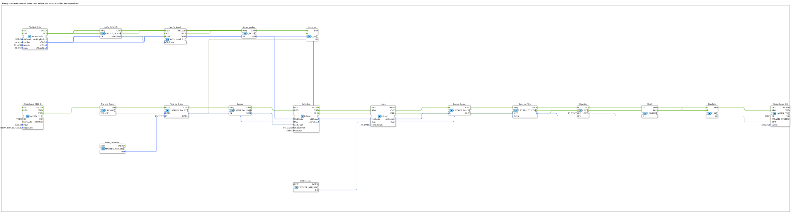

# Uebung_156_AX: Übung zu FsWrite/FsRead: kleine Datei auf den File Server schreiben und zurücklesen

Dieser Artikel beschreibt die 4diac IDE Subapplikation Uebung_156_AX (Übung zu FsWrite/FsRead: kleine Datei auf den File Server schreiben und zurücklesen).

----

## Ziel der Übung

Das Ziel dieser Übung ist die Umsetzung folgender Anforderung: **Übung zu FsWrite/FsRead: kleine Datei auf den File Server schreiben und zurücklesen**

-----

## Beschreibung und Komponenten

Die Übung besteht aus der Subapplikation Uebung_156_AX.SUB, welche die folgende Bausteinstruktur verwendet:

### Verwendete Funktionsbausteine (FBs)

- **NmGetCfInfo**: Instanz des Typs isobus::pgn::NmGetCfInfo.
  - Parameter u8CanIdx = NODE1
  - Parameter member = network
  - Parameter address = FS_ADD
  - Parameter mask = FS_FLT
- **NetEv_DEMUX**: Instanz des Typs eclipse4diac::convert::STRUCT_DEMUX.
- **NetEv_Install**: Untergeordnete Subapplikation (SubApp) MyLib::sys::NetEv_Install_Filter.
- **Server_merken**: Instanz des Typs iec61131::selection::F_MOVE.
- **Server_da**: Instanz des Typs iec61499::events::E_SR.
- **DigitalInput_CLK_I1**: Instanz des Typs logiBUS::io::DI::logiBUS_IE.
  - Parameter QI = TRUE
  - Parameter Input = Input_I1
  - Parameter InputEvent = BUTTON_SINGLE_CLICK
- **Nur_mit_Server**: Instanz des Typs iec61499::events::E_PERMIT.
- **Puffer_Schreiben**: Instanz des Typs eclipse4diac::convert::providers::PROVIDE_ARR_0064_BYTE.
- **Text_zu_Bytes**: Instanz des Typs logiBUS::utils::dyn_arr::F_STRING_TO_BYTES.
  - Parameter IN = FS_TEXT
- **Laenge**: Instanz des Typs iec61131::conversion::F_UINT_TO_UDINT.
- **Schreiben**: Instanz des Typs isobus::fs::FsWrite.
  - Parameter sRemotePath = FS_DATEI
  - Parameter bAppend = FALSE
- **Puffer_Lesen**: Instanz des Typs eclipse4diac::convert::providers::PROVIDE_ARR_0064_BYTE.
- **Lesen**: Instanz des Typs isobus::fs::FsRead.
  - Parameter sRemotePath = FS_DATEI
- **Laenge_Lesen**: Instanz des Typs iec61131::conversion::F_UDINT_TO_UINT.
- **Bytes_zu_Text**: Instanz des Typs logiBUS::utils::dyn_arr::F_BYTES_TO_STRING.
- **Vergleich**: Instanz des Typs iec61131::comparison::F_EQ.
  - Parameter IN1 = FS_TEXT
- **Gleich**: Instanz des Typs iec61499::events::E_SWITCH.
- **Ergebnis**: Instanz des Typs iec61499::events::E_SR.
- **DigitalOutput_Q1**: Instanz des Typs logiBUS::io::DQ::logiBUS_QX.
  - Parameter QI = TRUE
  - Parameter Output = Output_Q1

Die Übung nutzt das gemeinsame Muster mit `NmGetCfInfo` (IND/RSP): `IND` löst `STRUCT_DEMUX` aus, `NetEv_Install` verarbeitet das Ereignis und quittiert mit `RSP`.

-----

## Ablauf und erwartetes Verhalten (aus dem Kommentar im Netzwerk)

- File Server: Datei schreiben und zurücklesen (FsWrite, FsRead)
- NmGetCfInfo (network, Filter FS_ADD/FS_FLT = NAME-Funktion 61) meldet den File Server, z. B. CCI 1200 mit USB-Stick.
- I1 Klick (nur mit Server): FS_TEXT nach FS_DATEI schreiben, danach zurücklesen und vergleichen. Q1 an = gleich, Q1 aus = Fehler.
- Watch bei ERR: Schreiben/Lesen.s16Status und .u16FsError (ISO 11783-13 B.9, ab 6400 Client). FS_DATEI ohne Volume landet im aktuellen Verzeichnis des File Servers (CCI 1200: USB-Stick).
- Pfade: Am CCI 1200 gibt es kein festes Volume `\\USB\`, ein Stick heißt nach seiner FAT-Seriennummer. Deshalb steht in FS_DATEI ein Pfad ohne Volume (`logibus_test.txt`).
- Weiter: Übung 156b (FsGet/FsPut über eine lokale Datei).

Hinweis: Auf Hardware getestet am CCI 1200 mit USB-Stick (2026-11-26): FsWrite und FsRead bestanden. Q1 geht an, wenn der zurückgelesene Text gleich ist.

-----

## Zusammenfassung

Die Übung Uebung_156_AX demonstriert die modulare IEC 61499 Architektur in 4diac IDE.
