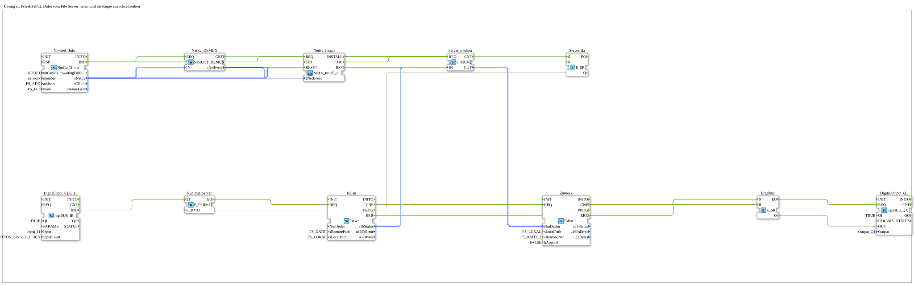

# Uebung_156b_AX: Übung zu FsGet/FsPut: Datei vom File Server holen und als Kopie zurückschreiben

Dieser Artikel beschreibt die 4diac IDE Subapplikation Uebung_156b_AX (Übung zu FsGet/FsPut: Datei vom File Server holen und als Kopie zurückschreiben).

----

## Ziel der Übung

Das Ziel dieser Übung ist die Umsetzung folgender Anforderung: **Übung zu FsGet/FsPut: Datei vom File Server holen und als Kopie zurückschreiben**

-----

## Beschreibung und Komponenten

Die Übung besteht aus der Subapplikation Uebung_156b_AX.SUB, welche die folgende Bausteinstruktur verwendet:

### Verwendete Funktionsbausteine (FBs)

- **NmGetCfInfo**: Instanz des Typs isobus::pgn::NmGetCfInfo.
  - Parameter u8CanIdx = NODE1
  - Parameter member = network
  - Parameter address = FS_ADD
  - Parameter mask = FS_FLT
- **NetEv_DEMUX**: Instanz des Typs eclipse4diac::convert::STRUCT_DEMUX.
- **NetEv_Install**: Untergeordnete Subapplikation (SubApp) MyLib::sys::NetEv_Install_Filter.
- **Server_merken**: Instanz des Typs iec61131::selection::F_MOVE.
- **Server_da**: Instanz des Typs iec61499::events::E_SR.
- **DigitalInput_CLK_I1**: Instanz des Typs logiBUS::io::DI::logiBUS_IE.
  - Parameter QI = TRUE
  - Parameter Input = Input_I1
  - Parameter InputEvent = BUTTON_SINGLE_CLICK
- **Nur_mit_Server**: Instanz des Typs iec61499::events::E_PERMIT.
- **Holen**: Instanz des Typs isobus::fs::FsGet.
  - Parameter sRemotePath = FS_DATEI
  - Parameter sLocalPath = FS_LOKAL
- **Zurueck**: Instanz des Typs isobus::fs::FsPut.
  - Parameter sLocalPath = FS_LOKAL
  - Parameter sRemotePath = FS_DATEI_2
  - Parameter bAppend = FALSE
- **Ergebnis**: Instanz des Typs iec61499::events::E_SR.
- **DigitalOutput_Q1**: Instanz des Typs logiBUS::io::DQ::logiBUS_QX.
  - Parameter QI = TRUE
  - Parameter Output = Output_Q1

Die Übung nutzt das gemeinsame Muster mit `NmGetCfInfo` (IND/RSP): `IND` löst `STRUCT_DEMUX` aus, `NetEv_Install` verarbeitet das Ereignis und quittiert mit `RSP`.

-----

## Ablauf und erwartetes Verhalten (aus dem Kommentar im Netzwerk)

- File Server: Datei holen und als Kopie zurückschreiben (FsGet, FsPut)
- NmGetCfInfo (network, Filter FS_ADD/FS_FLT = NAME-Funktion 61) meldet den File Server, z. B. CCI 1200 mit USB-Stick.
- I1 Klick (nur mit Server): FS_DATEI nach FS_LOKAL (/data/fs/) holen, dann als FS_DATEI_2 zurückschreiben. Q1 an = fertig, Q1 aus = Fehler.
- Watch: u32Bytes (PROG beim Holen), bei ERR s16Status und u16FsError. FS_DATEI muss es geben, z. B. aus Übung 156.
- Pfade: FS_DATEI steht ohne Volume (`logibus_test.txt`, aktuelles Verzeichnis des File Servers). Fehlende Verzeichnisse unter `/data/` legt FsGet selbst an.

Hinweis: Auf Hardware ist bisher nur FsGet getestet (CCI 1200 mit USB-Stick, 2026-11-26, 24 Bytes). FsPut und der gesamte Ablauf dieser Übung sind noch nicht getestet, das Verhalten ist als erwartet zu lesen.

-----

## Zusammenfassung

Die Übung Uebung_156b_AX demonstriert die modulare IEC 61499 Architektur in 4diac IDE.
