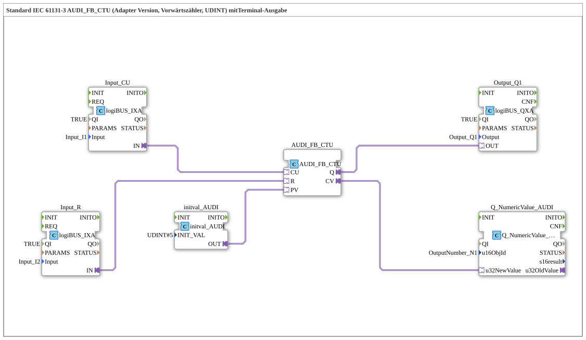

# Uebung_213_AUDI: Standard IEC 61131-3 AUDI_FB_CTU (Adapter-Version, Vorwärtszähler, UDINT) mit Terminal-Ausgabe

* * * * * * * * * *

## Einleitung

Diese Übung zeigt einen Vorwärtszähler (CTU) nach IEC 61131-3 als Adapter-Version für den Datentyp UDINT. Der Zähler wird über zwei digitale Eingänge bedient (Zählen und Reset), der feste Vorgabewert `5` kommt aus einem `initval_AUDI`-Konstantenbaustein. Der Zählerstand wird auf dem ISOBUS-Terminal angezeigt, das Erreichen des Vorgabewerts auf `Q1` ausgegeben.

## Verwendete Funktionsbausteine (FBs)

- **Input_CU**: Zähleingang
    - **Typ**: [`logiBUS::io::DI::logiBUS_IXA`](https://meisterschulen-am-ostbahnhof-munchen-docs.readthedocs.io/projects/4diac-library-reference-docs/de/latest/Bibliotheken/ExternalLibraries/logiBUS/io/DI/logiBUS_IXA/)
    - **Parameter**: `QI = TRUE`, `Input = Input_I1`
    - **Erklärung**: Stellt den Zustand von `I1` als Adapterausgang `IN` bereit.
- **Input_R**: Reset-Eingang
    - **Typ**: [`logiBUS::io::DI::logiBUS_IXA`](https://meisterschulen-am-ostbahnhof-munchen-docs.readthedocs.io/projects/4diac-library-reference-docs/de/latest/Bibliotheken/ExternalLibraries/logiBUS/io/DI/logiBUS_IXA/)
    - **Parameter**: `QI = TRUE`, `Input = Input_I2`
    - **Erklärung**: Stellt den Zustand von `I2` als Adapterausgang `IN` bereit.
- **initval_AUDI**: Konstante für den Vorgabewert
    - **Typ**: [`adapter::types::unidirectional::AUDI::initval::initval_AUDI`](https://meisterschulen-am-ostbahnhof-munchen-docs.readthedocs.io/projects/4diac-library-reference-docs/de/latest/Bibliotheken/ExternalLibraries/adapter/types/unidirectional/UDINT/initval/initval_AUDI/)
    - **Parameter**: `INIT_VAL = 5`
    - **Erklärung**: Liefert den Vorgabewert `5` als `AUDI`-Adapterwert an `AUDI_FB_CTU.PV`.
- **AUDI_FB_CTU**: Vorwärtszähler (UDINT, Adapter-Version)
    - **Typ**: [`adapter::iec61131::counters::AUDI_FB_CTU`](https://meisterschulen-am-ostbahnhof-munchen-docs.readthedocs.io/projects/4diac-library-reference-docs/de/latest/Bibliotheken/ExternalLibraries/adapter/iec61131-3/counters/AUDI_FB_CTU/)
    - **Parameter**: keine
    - **Erklärung**: Zählt über den Adapter-Socket `CU` aufwärts, `R` setzt den Zähler zurück, `PV` ist der Vorgabewert. Der Adapterausgang `Q` ist `TRUE`, wenn der Zählerstand `CV` den Vorgabewert `PV` erreicht oder überschreitet; `CV` liefert den aktuellen Zählerstand.
- **Output_Q1**: Digitalausgang
    - **Typ**: [`logiBUS::io::DQ::logiBUS_QXA`](https://meisterschulen-am-ostbahnhof-munchen-docs.readthedocs.io/projects/4diac-library-reference-docs/de/latest/Bibliotheken/ExternalLibraries/logiBUS/io/DO/logiBUS_QXA/)
    - **Parameter**: `QI = TRUE`, `Output = Output_Q1`
    - **Erklärung**: Gibt den Zählerausgang `Q` am physischen Ausgang `Q1` aus.
- **Q_NumericValue_AUDI**: Anzeige auf dem ISOBUS-Terminal
    - **Typ**: [`isobus::UT::Q::Q_NumericValue_AUDI`](https://meisterschulen-am-ostbahnhof-munchen-docs.readthedocs.io/projects/4diac-library-reference-docs/de/latest/Bibliotheken/ExternalLibraries/isobus/UT/Q/Q_NumericValue_AUDI/)
    - **Parameter**: `u16ObjId = OutputNumber_N1`
    - **Erklärung**: Empfängt den Zählerstand über den `AUDI`-Adapter `u32NewValue` und zeigt ihn im Objekt `OutputNumber_N1` an.

## Programmablauf und Verbindungen

1. `Input_CU.IN` → `AUDI_FB_CTU.CU` (AdapterConnection): Der Zustand von `I1` ist der Zähleingang.
2. `Input_R.IN` → `AUDI_FB_CTU.R` (AdapterConnection): Der Zustand von `I2` setzt den Zähler zurück.
3. `initval_AUDI.OUT` → `AUDI_FB_CTU.PV` (AdapterConnection): Der Vorgabewert `5` wird als Preset übergeben.
4. `AUDI_FB_CTU.Q` → `Output_Q1.OUT` (AdapterConnection): Der Zählerausgang liegt an `Q1`.
5. `AUDI_FB_CTU.CV` → `Q_NumericValue_AUDI.u32NewValue` (AdapterConnection): Der Zählerstand wird auf dem Terminal angezeigt.

**Verhalten**: Jede steigende Flanke an `I1` erhöht den Zählerstand; `Q1` wird `TRUE`, sobald der Zählerstand `5` erreicht oder überschreitet. `I2` setzt den Zähler zurück. Der Zählerstand erscheint in `OutputNumber_N1`. Laut Netzwerk-Kommentar kann hier gegebenenfalls ein `AX_D_FF` eingebaut werden, damit die Events reduziert werden.

## Zusammenfassung

Die Übung zeigt die adapterbasierte Anbindung eines IEC-61131-3-Zählers: Ein- und Ausgänge, Vorgabewert und Anzeige sind rein über Adapterverbindungen verschaltet, ohne zusätzliche Ereignisverbindungen.

---

### 🌐 Passende Themen-Unterseiten auf ms-muc-docs.de

- [🌐 Eclipse 4diac IDE & Farb-Referenz on ms-muc-docs.de](https://www.ms-muc-docs.de/iec-61499/eclipse-4diac/)
