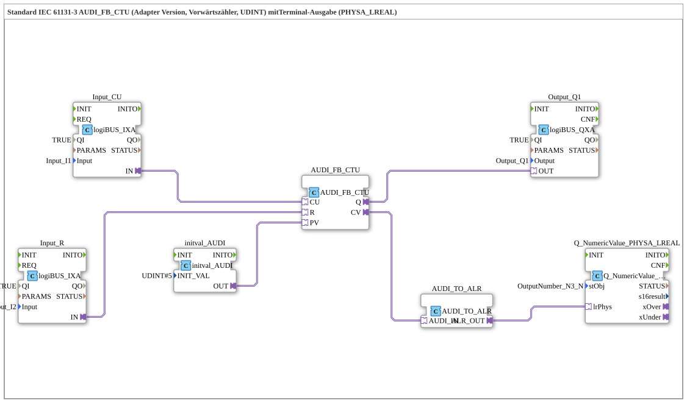

# Uebung_213b_ALR: Standard IEC 61131-3 AUDI_FB_CTU (Adapter-Version, Vorwärtszähler, UDINT) mit Terminal-Ausgabe (PHYSA_LREAL)

* * * * * * * * * *

## Einleitung

Diese Übung realisiert einen Vorwärtszähler (CTU) nach IEC 61131-3 mit dem Zählbereich `UDINT` als Adapter-Version. Taster `I1` zählt hoch (`CU`), `I2` setzt zurück (`R`). Der Vorgabewert `PV` ist über `initval_AUDI` fest auf 5 gesetzt, sodass der Ausgang `Q` bei Erreichen von 5 aktiv wird und `Q1` schaltet. Der Zählerstand `CV` wird in einen `LREAL`-Wert gewandelt und am Terminal-Objekt `OutputNumber_N3_N` ausgegeben.

## Verwendete Funktionsbausteine (FBs)

- **Input_CU**: Zählimpulse
    - **Typ**: [`logiBUS::io::DI::logiBUS_IXA`](https://meisterschulen-am-ostbahnhof-munchen-docs.readthedocs.io/projects/4diac-library-reference-docs/de/latest/Bibliotheken/ExternalLibraries/logiBUS/io/DI/logiBUS_IXA/)
    - **Parameter**: `QI = TRUE`, `Input = Input_I1`
    - **Erklärung**: Stellt den Zustand von `I1` als Adapter `IN` bereit; geht an `AUDI_FB_CTU.CU`.
- **Input_R**: Rücksetzen
    - **Typ**: [`logiBUS::io::DI::logiBUS_IXA`](https://meisterschulen-am-ostbahnhof-munchen-docs.readthedocs.io/projects/4diac-library-reference-docs/de/latest/Bibliotheken/ExternalLibraries/logiBUS/io/DI/logiBUS_IXA/)
    - **Parameter**: `QI = TRUE`, `Input = Input_I2`
    - **Erklärung**: Stellt den Zustand von `I2` als Adapter `IN` bereit; geht an `AUDI_FB_CTU.R`.
- **initval_AUDI**: Vorgabewert
    - **Typ**: [`adapter::types::unidirectional::AUDI::initval::initval_AUDI`](https://meisterschulen-am-ostbahnhof-munchen-docs.readthedocs.io/projects/4diac-library-reference-docs/de/latest/Bibliotheken/ExternalLibraries/adapter/types/unidirectional/UDINT/initval/initval_AUDI/)
    - **Parameter**: `INIT_VAL = 5`
    - **Erklärung**: Liefert den Wert 5 als Vorgabewert `PV` an den Zähler.
- **AUDI_FB_CTU**: Vorwärtszähler
    - **Typ**: [`adapter::iec61131::counters::AUDI_FB_CTU`](https://meisterschulen-am-ostbahnhof-munchen-docs.readthedocs.io/projects/4diac-library-reference-docs/de/latest/Bibliotheken/ExternalLibraries/adapter/iec61131-3/counters/AUDI_FB_CTU/)
    - **Parameter**: keine
    - **Erklärung**: Zählereingang `CU`, Rücksetzeingang `R`, Vorgabewert `PV`; Ausgänge `Q` (aktiv, wenn `CV` ≥ `PV`) und `CV` (aktueller Zählerstand).
- **Output_Q1**: logiBUS Digitalausgang
    - **Typ**: [`logiBUS::io::DQ::logiBUS_QXA`](https://meisterschulen-am-ostbahnhof-munchen-docs.readthedocs.io/projects/4diac-library-reference-docs/de/latest/Bibliotheken/ExternalLibraries/logiBUS/io/DO/logiBUS_QXA/)
    - **Parameter**: `QI = TRUE`, `Output = Output_Q1`
    - **Erklärung**: Gibt `AUDI_FB_CTU.Q` am physischen Ausgang `Q1` aus.
- **AUDI_TO_ALR**: Konvertierung `AUDI` nach `ALR`
    - **Typ**: [`adapter::conversion::unidirectional::AUDI_TO_ALR`](https://meisterschulen-am-ostbahnhof-munchen-docs.readthedocs.io/projects/4diac-library-reference-docs/de/latest/Bibliotheken/ExternalLibraries/adapter/conversion/unidirectional/ALR_AUDI/AUDI_TO_ALR/)
    - **Parameter**: keine
    - **Erklärung**: Wandelt den Zählerstand (`AUDI_IN`) in einen `LREAL`-Adapterwert (`ALR_OUT`). Laut Kommentar im Netzwerk sind hier negative Werte möglich.
- **Q_NumericValue_PHYSA_LREAL**: Terminal-Ausgabe
    - **Typ**: [`isobus::UT::Q::Q_NumericValue_PHYSA_LREAL`](https://meisterschulen-am-ostbahnhof-munchen-docs.readthedocs.io/projects/4diac-library-reference-docs/de/latest/Bibliotheken/ExternalLibraries/isobus/UT/Q/Q_NumericValue_PHYSA_LREAL/)
    - **Parameter**: `stObj = OutputNumber_N3_N`
    - **Erklärung**: Zeigt den `LREAL`-Wert aus `lrPhys` am Terminal-Objekt `OutputNumber_N3_N` an.

## Programmablauf und Verbindungen

1. `Input_CU.IN` → `AUDI_FB_CTU.CU` und `Input_R.IN` → `AUDI_FB_CTU.R` (AdapterConnections): `I1` zählt, `I2` setzt zurück.
2. `initval_AUDI.OUT` → `AUDI_FB_CTU.PV` (AdapterConnection): Vorgabewert 5.
3. `AUDI_FB_CTU.Q` → `Output_Q1.OUT` (AdapterConnection): `Q1` ist aktiv, wenn der Zählerstand den Vorgabewert erreicht oder überschreitet.
4. `AUDI_FB_CTU.CV` → `AUDI_TO_ALR.AUDI_IN` und `AUDI_TO_ALR.ALR_OUT` → `Q_NumericValue_PHYSA_LREAL.lrPhys` (AdapterConnections): Der Zählerstand wird als `LREAL` am Terminal angezeigt.

**Hinweis aus dem Netzwerk**: Hier kann gegebenenfalls ein `AX_D_FF` eingebaut werden, damit die Events reduziert werden.

## Zusammenfassung

Die Übung 213b_ALR zeigt einen adapterbasierten IEC-Vorwärtszähler mit festem Vorgabewert 5, dessen Zählerstand über `AUDI_TO_ALR` auf einem Terminal ausgegeben wird. Alle Verbindungen sind Adapterverbindungen.

---

### 🌐 Passende Themen-Unterseiten auf ms-muc-docs.de

- [🌐 Eclipse 4diac IDE & Farb-Referenz auf ms-muc-docs.de](https://www.ms-muc-docs.de/iec-61499/eclipse-4diac/)
