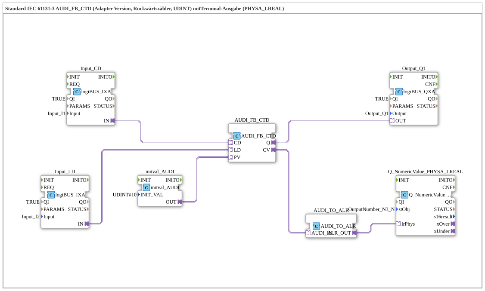

# Uebung_218b_ALR: Standard IEC 61131-3 AUDI_FB_CTD (Adapter Version, Rückwärtszähler, UDINT) mit Terminal-Ausgabe (PHYSA_LREAL)

* * * * * * * * * *

## Einleitung

Diese Übung realisiert einen **Rückwärtszähler (CTD)** nach IEC 61131-3 mit einem `AUDI_FB_CTD` (Adapter-Version, Datentyp UDINT). Der Zähler wird über zwei digitale Eingänge gesteuert (`I1` = Count Down, `I2` = Load); der Preset-Wert 10 kommt von einem `initval_AUDI`. Der aktuelle Zählerstand wird über `AUDI_TO_ALR` in einen LREAL-Wert gewandelt und mit `Q_NumericValue_PHYSA_LREAL` auf dem Terminal ausgegeben. Zusätzlich zeigt ein digitaler Ausgang (`Output_Q1`) den Zählerausgang `Q` an.

Zwei Kommentare im Netzwerk weisen darauf hin: „hier sind negative Werte möglich!“ (bei der LREAL-Ausgabe) und „hier gegebenenfalls einen AX_D_FF einbauen, damit die Events reduziert werden.“ (am Ausgang `Q`).

## Verwendete Funktionsbausteine (FBs)

- **Input_CD**: Eingang für den Abwärtszählimpuls
    - **Typ**: [`logiBUS::io::DI::logiBUS_IXA`](https://meisterschulen-am-ostbahnhof-munchen-docs.readthedocs.io/projects/4diac-library-reference-docs/de/latest/Bibliotheken/ExternalLibraries/logiBUS/io/DI/logiBUS_IXA/)
    - **Parameter**: `QI = TRUE`, `Input = Input_I1`
    - **Erklärung**: Stellt den Zustand von `I1` als AX-Adaptersignal bereit; es speist `AUDI_FB_CTD.CD`.
- **Input_LD**: Eingang für das Laden
    - **Typ**: [`logiBUS::io::DI::logiBUS_IXA`](https://meisterschulen-am-ostbahnhof-munchen-docs.readthedocs.io/projects/4diac-library-reference-docs/de/latest/Bibliotheken/ExternalLibraries/logiBUS/io/DI/logiBUS_IXA/)
    - **Parameter**: `QI = TRUE`, `Input = Input_I2`
    - **Erklärung**: Stellt den Zustand von `I2` als AX-Adaptersignal bereit; es speist `AUDI_FB_CTD.LD`.
- **initval_AUDI**: Preset-Wert
    - **Typ**: [`adapter::types::unidirectional::AUDI::initval::initval_AUDI`](https://meisterschulen-am-ostbahnhof-munchen-docs.readthedocs.io/projects/4diac-library-reference-docs/de/latest/Bibliotheken/ExternalLibraries/adapter/types/unidirectional/UDINT/initval/initval_AUDI/)
    - **Parameter**: `INIT_VAL = 10`
    - **Erklärung**: Stellt den konstanten Wert 10 als AUDI-Signal bereit.
- **AUDI_FB_CTD**: Rückwärtszähler
    - **Typ**: [`adapter::iec61131::counters::AUDI_FB_CTD`](https://meisterschulen-am-ostbahnhof-munchen-docs.readthedocs.io/projects/4diac-library-reference-docs/de/latest/Bibliotheken/ExternalLibraries/adapter/iec61131-3/counters/AUDI_FB_CTD/)
    - **Parameter**: keine
    - **Erklärung**: Zählt über den Adapter `CD` abwärts, lädt über `LD` den Preset-Wert `PV` (UDINT) und gibt den aktuellen Zählerstand am Adapter `CV` sowie den Zählerausgang am Adapter `Q` (laut Bausteinreferenz: TRUE, wenn der Zählerstand 0 erreicht ist) aus.
- **Output_Q1**: logiBUS Digitalausgang
    - **Typ**: [`logiBUS::io::DQ::logiBUS_QXA`](https://meisterschulen-am-ostbahnhof-munchen-docs.readthedocs.io/projects/4diac-library-reference-docs/de/latest/Bibliotheken/ExternalLibraries/logiBUS/io/DO/logiBUS_QXA/)
    - **Parameter**: `QI = TRUE`, `Output = Output_Q1`
    - **Erklärung**: Gibt den Zählerausgang `Q` am physischen Ausgang `Q1` aus.
- **AUDI_TO_ALR**: Konvertierungsadapter
    - **Typ**: [`adapter::conversion::unidirectional::AUDI_TO_ALR`](https://meisterschulen-am-ostbahnhof-munchen-docs.readthedocs.io/projects/4diac-library-reference-docs/de/latest/Bibliotheken/ExternalLibraries/adapter/conversion/unidirectional/ALR_AUDI/AUDI_TO_ALR/)
    - **Parameter**: keine
    - **Erklärung**: Wandelt den Zählerstand (UDINT, Adapter `AUDI_IN`) in einen LREAL-Wert (Adapter `ALR_OUT`) um.
- **Q_NumericValue_PHYSA_LREAL**: VT-Anzeige
    - **Typ**: [`isobus::UT::Q::Q_NumericValue_PHYSA_LREAL`](https://meisterschulen-am-ostbahnhof-munchen-docs.readthedocs.io/projects/4diac-library-reference-docs/de/latest/Bibliotheken/ExternalLibraries/isobus/UT/Q/Q_NumericValue_PHYSA_LREAL/)
    - **Parameter**: `stObj = OutputNumber_N3_N`
    - **Erklärung**: Zeigt den physikalischen LREAL-Wert vom Adapter `lrPhys` auf dem im Objektpool-Eintrag `stObj` angegebenen VT-Objekt an.

## Programmablauf und Verbindungen

1. `Input_CD.IN` → `AUDI_FB_CTD.CD` (AdapterConnection): Der Zustand von `I1` ist der Zähleingang.
2. `Input_LD.IN` → `AUDI_FB_CTD.LD`: Der Zustand von `I2` löst das Laden aus.
3. `initval_AUDI.OUT` → `AUDI_FB_CTD.PV`: Der Preset-Wert 10 wird dem Zähler vorgegeben.
4. `AUDI_FB_CTD.Q` → `Output_Q1.OUT`: Der Zählerausgang wird auf `Q1` gelegt.
5. `AUDI_FB_CTD.CV` → `AUDI_TO_ALR.AUDI_IN`: Der Zählerstand wird in LREAL gewandelt.
6. `AUDI_TO_ALR.ALR_OUT` → `Q_NumericValue_PHYSA_LREAL.lrPhys`: Der Wert wird auf dem Terminal ausgegeben.

Das Netzwerk enthält keine Ereignisverbindungen; alle Verbindungen sind Adapterverbindungen.

**Lernziele:**

- Aufbau und Parametrierung eines Adapter-basierten CTD-Funktionsbausteins
- Einbindung digitaler Ein-/Ausgänge über logiBUS-Adapter
- Datenkonvertierung (UDINT → LREAL) für Ausgabezwecke
- Erkennung von Problemen bei hohen Ereignisraten und Lösungsansätze (`AX_D_FF`)

## Zusammenfassung

Die Übung `Uebung_218b_ALR` vermittelt den Umgang mit einem IEC-61131-3-Rückwärtszähler in der 4diac-IDE. Der Zähler wird über zwei digitale Eingänge gesteuert (Zählen und Laden), sein Preset-Wert stammt von einem `initval_AUDI`, und er gibt seinen Status sowie den aktuellen Wert aus. Die Besonderheit liegt in der Umwandlung des UDINT-Zählwertes in eine LREAL-Terminalausgabe.

---

### 🌐 Passende Themen-Unterseiten auf ms-muc-docs.de

- [🌐 Eclipse 4diac IDE & Farb-Referenz auf ms-muc-docs.de](https://www.ms-muc-docs.de/iec-61499/eclipse-4diac/)
