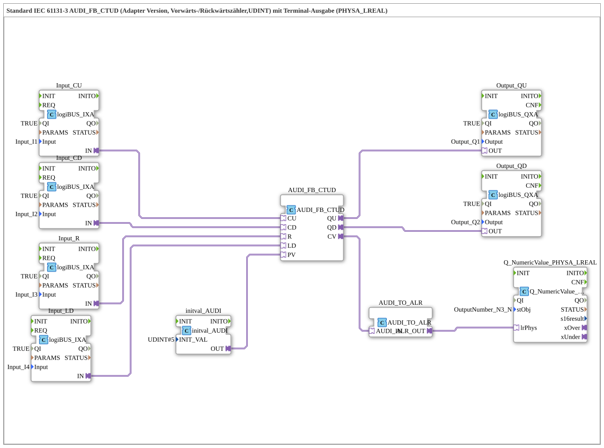

# Uebung_223b_ALR: Standard IEC 61131-3 AUDI_FB_CTUD (Adapter-Version, Vorwärts-/Rückwärtszähler, UDINT) mit Terminal-Ausgabe (PHYSA_LREAL)

* * * * * * * * * *

## Einleitung

Diese Übung realisiert einen Vorwärts-/Rückwärtszähler (CTUD) nach IEC 61131-3 mit dem Zählbereich `UDINT` als Adapter-Version. Vier Taster steuern den Zähler: `I1` zählt hoch (`CU`), `I2` zählt runter (`CD`), `I3` setzt zurück (`R`), `I4` löst das Laden (`LD`) aus. Der Vorgabewert `PV` ist über `initval_AUDI` fest auf 5 gesetzt. Die Ausgänge `QU` und `QD` schalten `Q1` und `Q2`; der Zählerstand `CV` wird in einen `LREAL`-Wert gewandelt und am Terminal-Objekt `OutputNumber_N3_N` ausgegeben.

## Verwendete Funktionsbausteine (FBs)

- **Input_CU**, **Input_CD**, **Input_R**, **Input_LD**: Digitaleingänge
    - **Typ**: [`logiBUS::io::DI::logiBUS_IXA`](https://meisterschulen-am-ostbahnhof-munchen-docs.readthedocs.io/projects/4diac-library-reference-docs/de/latest/Bibliotheken/ExternalLibraries/logiBUS/io/DI/logiBUS_IXA/)
    - **Parameter**: `QI = TRUE`, `Input = Input_I1` (`Input_CU`), `Input_I2` (`Input_CD`), `Input_I3` (`Input_R`), `Input_I4` (`Input_LD`)
    - **Erklärung**: Stellen den Zustand des jeweiligen Eingangs als Adapter `IN` bereit; sie gehen an `CU`, `CD`, `R` bzw. `LD` des Zählers.
- **initval_AUDI**: Vorgabewert
    - **Typ**: [`adapter::types::unidirectional::AUDI::initval::initval_AUDI`](https://meisterschulen-am-ostbahnhof-munchen-docs.readthedocs.io/projects/4diac-library-reference-docs/de/latest/Bibliotheken/ExternalLibraries/adapter/types/unidirectional/UDINT/initval/initval_AUDI/)
    - **Parameter**: `INIT_VAL = 5`
    - **Erklärung**: Liefert den Wert 5 als Vorgabewert `PV` an den Zähler.
- **AUDI_FB_CTUD**: Vorwärts-/Rückwärtszähler
    - **Typ**: [`adapter::iec61131::counters::AUDI_FB_CTUD`](https://meisterschulen-am-ostbahnhof-munchen-docs.readthedocs.io/projects/4diac-library-reference-docs/de/latest/Bibliotheken/ExternalLibraries/adapter/iec61131-3/counters/AUDI_FB_CTUD/)
    - **Parameter**: keine
    - **Erklärung**: Eingänge `CU`, `CD`, `R`, `LD` und `PV`; Ausgänge `QU`, `QD` und `CV` (aktueller Zählerstand), jeweils als Adapter.
- **Output_QU**, **Output_QD**: logiBUS Digitalausgänge
    - **Typ**: [`logiBUS::io::DQ::logiBUS_QXA`](https://meisterschulen-am-ostbahnhof-munchen-docs.readthedocs.io/projects/4diac-library-reference-docs/de/latest/Bibliotheken/ExternalLibraries/logiBUS/io/DO/logiBUS_QXA/)
    - **Parameter**: `QI = TRUE`, `Output = Output_Q1` (`Output_QU`), `Output_Q2` (`Output_QD`)
    - **Erklärung**: Geben `AUDI_FB_CTUD.QU` an `Q1` und `AUDI_FB_CTUD.QD` an `Q2` aus.
- **AUDI_TO_ALR**: Konvertierung `AUDI` nach `ALR`
    - **Typ**: [`adapter::conversion::unidirectional::AUDI_TO_ALR`](https://meisterschulen-am-ostbahnhof-munchen-docs.readthedocs.io/projects/4diac-library-reference-docs/de/latest/Bibliotheken/ExternalLibraries/adapter/conversion/unidirectional/ALR_AUDI/AUDI_TO_ALR/)
    - **Parameter**: keine
    - **Erklärung**: Wandelt den Zählerstand (`AUDI_IN`) in einen `LREAL`-Adapterwert (`ALR_OUT`). Laut Kommentar im Netzwerk sind hier negative Werte möglich.
- **Q_NumericValue_PHYSA_LREAL**: Terminal-Ausgabe
    - **Typ**: [`isobus::UT::Q::Q_NumericValue_PHYSA_LREAL`](https://meisterschulen-am-ostbahnhof-munchen-docs.readthedocs.io/projects/4diac-library-reference-docs/de/latest/Bibliotheken/ExternalLibraries/isobus/UT/Q/Q_NumericValue_PHYSA_LREAL/)
    - **Parameter**: `stObj = OutputNumber_N3_N`
    - **Erklärung**: Zeigt den `LREAL`-Wert aus `lrPhys` am Terminal-Objekt `OutputNumber_N3_N` an.

## Programmablauf und Verbindungen

1. `Input_CU.IN` → `AUDI_FB_CTUD.CU`, `Input_CD.IN` → `AUDI_FB_CTUD.CD`, `Input_R.IN` → `AUDI_FB_CTUD.R` und `Input_LD.IN` → `AUDI_FB_CTUD.LD` (AdapterConnections): Die vier Taster steuern den Zähler.
2. `initval_AUDI.OUT` → `AUDI_FB_CTUD.PV` (AdapterConnection): Vorgabewert 5.
3. `AUDI_FB_CTUD.QU` → `Output_QU.OUT` und `AUDI_FB_CTUD.QD` → `Output_QD.OUT` (AdapterConnections): Die Zählerausgänge schalten `Q1` und `Q2`.
4. `AUDI_FB_CTUD.CV` → `AUDI_TO_ALR.AUDI_IN` und `AUDI_TO_ALR.ALR_OUT` → `Q_NumericValue_PHYSA_LREAL.lrPhys` (AdapterConnections): Der Zählerstand wird als `LREAL` am Terminal angezeigt.

**Hinweis aus dem Netzwerk**: Hier kann gegebenenfalls je ein `AX_D_FF` eingebaut werden, damit die Events reduziert werden.

## Zusammenfassung

Die Übung 223b_ALR zeigt einen adapterbasierten IEC-Vorwärts-/Rückwärtszähler mit festem Vorgabewert 5 und Terminal-Ausgabe des Zählerstands über `AUDI_TO_ALR`. Alle Verbindungen sind Adapterverbindungen.

---

### 🌐 Passende Themen-Unterseiten auf ms-muc-docs.de

- [🌐 Eclipse 4diac IDE & Farb-Referenz auf ms-muc-docs.de](https://www.ms-muc-docs.de/iec-61499/eclipse-4diac/)
