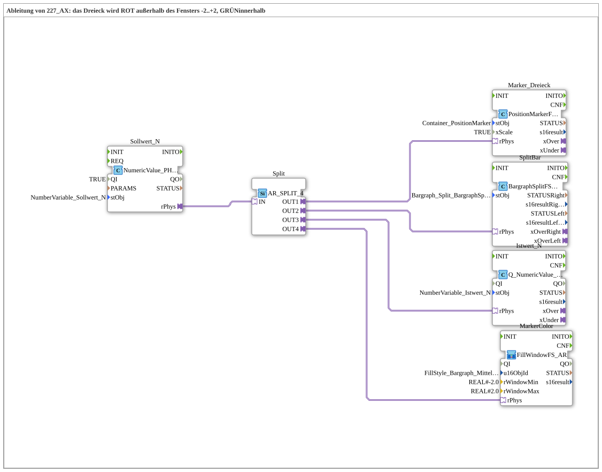

# Uebung_228_AX: Fenster-Farbrückmeldung am Dreieck (Change Fill Attributes, ISO 11783-6 F.32)

* * * * * * * * * *

## Einleitung

Diese Übung ist eine Ableitung von `Uebung_227_AX.md`: der Sollwert bewegt weiterhin ein Dreieck (Positionsmarker) und einen Split-Bargraph und wird als Istwert zurückgeschrieben, alles über AR-Adapter. Zusätzlich wird das Dreieck innerhalb des Fensters -2…+2 grün und außerhalb rot gefärbt. Die Übung demonstriert damit den Einsatz von Change Fill Attributes (ISO 11783-6, F.32) als einfache Statusanzeige auf dem VT-Terminal.

## Verwendete Funktionsbausteine (FBs)

- **Sollwert_N**: Terminal-Eingabe für den Sollwert
    - **Typ**: [`isobus::UT::io::NumericValue::NumericValue_PHYSA`](https://meisterschulen-am-ostbahnhof-munchen-docs.readthedocs.io/projects/4diac-library-reference-docs/de/latest/Bibliotheken/ExternalLibraries/isobus/UT/io/NumericValue/NumericValue_PHYSA/)
    - **Parameter**: `QI = TRUE`, `stObj = NumberVariable_Sollwert_N`
    - **Erklärung**: Liest den vom Bediener eingegebenen Sollwert vom VT-Terminal und stellt ihn als physikalischen Wert (`rPhys`, AR-Adapter) bereit.
- **Split**: Verteiler für den Sollwert
    - **Typ**: [`adapter::events::unidirectional::AR_SPLIT_4`](https://meisterschulen-am-ostbahnhof-munchen-docs.readthedocs.io/projects/4diac-library-reference-docs/de/latest/Bibliotheken/ExternalLibraries/adapter/events/unidirectional/REAL/AR_SPLIT_4/)
    - **Parameter**: keine
    - **Erklärung**: Verteilt den einen eingehenden AR-Sollwert auf vier Verbraucher (eine Stelle mehr als in `Uebung_227_AX.md`): Dreieck-Position, Split-Bargraph, Istwert-Rückschreibung und die Farblogik.
- **Marker_Dreieck**: Positionsmarker (Dreieck) auf dem Terminal
    - **Typ**: [`isobus::UT::Q::PositionMarkerFSA`](https://meisterschulen-am-ostbahnhof-munchen-docs.readthedocs.io/projects/4diac-library-reference-docs/de/latest/Bibliotheken/ExternalLibraries/isobus/UT/Q/PositionMarkerFSA/)
    - **Parameter**: `stObj = Container_PositionMarker`, `xScale = TRUE`
    - **Erklärung**: Positioniert das Dreieck-Objekt entsprechend dem Sollwert.
- **SplitBar**: Split-Bargraph auf dem Terminal
    - **Typ**: [`isobus::UT::Q::BargraphSplitFS_AR`](https://meisterschulen-am-ostbahnhof-munchen-docs.readthedocs.io/projects/4diac-library-reference-docs/de/latest/Bibliotheken/ExternalLibraries/isobus/UT/Q/BargraphSplitFS_AR/)
    - **Parameter**: `stObj = Bargraph_Split_BargraphSplit`
    - **Erklärung**: Stellt den Sollwert zusätzlich als geteilten Bargraph dar.
- **Istwert_N**: Terminal-Ausgabe des Istwerts
    - **Typ**: [`isobus::UT::Q::Q_NumericValue_PHYSA`](https://meisterschulen-am-ostbahnhof-munchen-docs.readthedocs.io/projects/4diac-library-reference-docs/de/latest/Bibliotheken/ExternalLibraries/isobus/UT/Q/Q_NumericValue_PHYSA/)
    - **Parameter**: `stObj = NumberVariable_Istwert_N`
    - **Erklärung**: Schreibt den (unverändert durchgereichten) Sollwert als Istwert auf das Terminal zurück.
- **MarkerColor**: Fenster-Farblogik für das Dreieck
    - **Typ**: `MyLib::sys::FillWindowFS_AR` (SubApp-Instanz)
    - **Parameter**: `u16ObjId = FillStyle_Bargraph_Mittelmarker_Gruen`, `rWindowMin = REAL#-2.0`, `rWindowMax = REAL#2.0`
    - **Erklärung**: Erhält den Sollwert über einen AR-Socket und färbt das FillAttributes-Objekt `FillStyle_Bargraph_Mittelmarker_Gruen` per Change Fill Attributes (ISO 11783-6 F.32) grün, solange der Sollwert im Fenster -2…+2 liegt, sonst rot.

### Sub-Bausteine: `FillWindowFS_AR` (SubAppType)

`FillWindowFS_AR` (`MyLib_AX-1.0.0\typelib\sys\FillWindowFS_AR.SUB`, Version 2.0) färbt ein FillAttributes-Objekt grün innerhalb von `[rWindowMin, rWindowMax]` und rot außerhalb. Er besteht ausschließlich aus vorhandenen Bausteinen, ohne eigene ST-Logik:

- **WindowMinConst**/**WindowMaxConst** (`initval_AR`): stellen die Fenstergrenzen `rWindowMin`/`rWindowMax` als AR-Werte bereit.
- **CENTER_CMP** (`AR_DEADBAND_COMPARE`): erhält den Sollwert (`rPhys` an `Y`) und die Grenzen (`WINDOW_MIN`, `WINDOW_MAX`) und liefert `CENTERED` für "im Fenster".
- **ColorSel** (`AX_SEL`, `IN0 = COLOR_RED`, `IN1 = COLOR_GREEN`): wählt anhand von `CENTERED` (an `G`) zwischen Rot und Grün.
- **Inner** (`Q_FillAttributes`, `u8FillType = USINT#2`, `u16FillPatternId = ID_NULL`): sendet die gewählte Farbe (`u8FillColour`) als Change-Fill-Attributes-Kommando an das per `u16ObjId` referenzierte VT-Objekt.

## Programmablauf und Verbindungen

1. `Sollwert_N.rPhys` → `Split.IN` (AdapterConnection): Der Sollwert speist den Verteiler `AR_SPLIT_4`.
2. `Split.OUT1` → `Marker_Dreieck.rPhys`: bewegt das Dreieck entsprechend dem Sollwert.
3. `Split.OUT2` → `SplitBar.rPhys`: stellt denselben Sollwert zusätzlich als Split-Bargraph dar.
4. `Split.OUT3` → `Istwert_N.rPhys`: schreibt den Sollwert unverändert als Istwert auf das Terminal zurück.
5. `Split.OUT4` → `MarkerColor.rPhys`: speist denselben Sollwert in die Fenster-Farblogik.
6. Innerhalb von `MarkerColor` (`FillWindowFS_AR`) vergleicht `AR_DEADBAND_COMPARE` den Sollwert mit dem Fenster `-2.0…+2.0`; `ColorSel` wählt `COLOR_GREEN` bzw. `COLOR_RED`, und `ColorSel.CNF` löst `Q_FillAttributes.REQ` aus.
7. `Q_FillAttributes` sendet ein Change-Fill-Attributes-Kommando (ISO 11783-6 F.32) an `FillStyle_Bargraph_Mittelmarker_Gruen`, wodurch sich die Füllfarbe des Dreiecks live ändert: grün innerhalb, rot außerhalb des Fensters -2…+2.

## Zusammenfassung

Die Übung 228 erweitert den aus `Uebung_227_AX.md` bekannten Aufbau (Dreieck, Split-Bargraph, Istwert, alles über AR-Adapter) um eine vierte Verbrauchsstelle des Sollwerts: eine Fenster-basierte Farbrückmeldung, die das Dreieck grün oder rot einfärbt. Sie zeigt, wie Change Fill Attributes (ISO 11783-6 F.32) als Statusanzeige genutzt werden kann und wie sich die Fensterlogik als SubApp aus vorhandenen Adapter-Bausteinen zusammensetzen lässt, ohne eigene ST-Logik.

---

### 🌐 Passende Themen-Unterseiten auf ms-muc-docs.de

- [🌐 Eclipse 4diac IDE & Farb-Referenz auf ms-muc-docs.de](https://www.ms-muc-docs.de/iec-61499/eclipse-4diac/)
