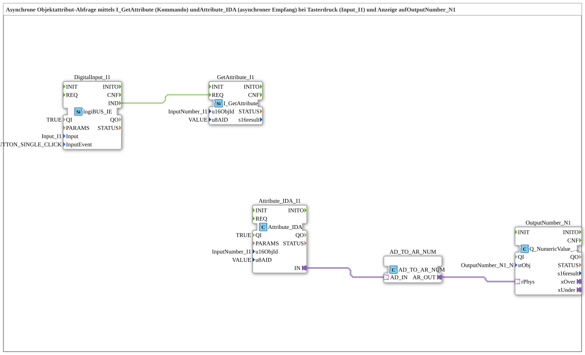

# Uebung_249_AX: Asynchrone Objektattribut-Abfrage mit I_GetAttribute und Attribute_IDA

* * * * * * * * * *

## Einleitung

Diese Übung fragt per Tasterdruck (`Input_I1`) ein Attribut eines VT-Objekts asynchron ab und zeigt es auf `OutputNumber_N1` an. Das Kommando wird von `I_GetAttribute` gesendet, die Antwort kommt unabhängig davon über `Attribute_IDA` an: Beide Bausteine sind nicht per Event verbunden, sondern beziehen sich über dieselben Parameter (`u16ObjId = InputNumber_I1`, `u8AID = VALUE`) auf dasselbe Objekt und Attribut. Der empfangene Wert wird über `AD_TO_AR_NUM` in einen `REAL`-Adapterwert gewandelt und mit `Q_NumericValue_PHYSA` ausgegeben.

## Verwendete Funktionsbausteine (FBs)

- **DigitalInput_I1**: Taster mit Klick-Erkennung
    - **Typ**: [`logiBUS::io::DI::logiBUS_IE`](https://meisterschulen-am-ostbahnhof-munchen-docs.readthedocs.io/projects/4diac-library-reference-docs/de/latest/Bibliotheken/ExternalLibraries/logiBUS/io/DI/logiBUS_IE/)
    - **Parameter**: `QI = TRUE`, `Input = Input_I1`, `InputEvent = BUTTON_SINGLE_CLICK`
    - **Erklärung**: Meldet einen Einzelklick auf `I1` als Event `IND`.
- **GetAttribute_I1**: Abfrage-Kommando
    - **Typ**: `isobus::UT::I::I_GetAttribute`
    - **Parameter**: `u16ObjId = InputNumber_I1`, `u8AID = VALUE`
    - **Erklärung**: Fordert bei `REQ` das Attribut `VALUE` des Objekts `InputNumber_I1` an.
- **Attribute_IDA_I1**: asynchroner Empfang des Attributs
    - **Typ**: `isobus::UT::io::Attribute::Attribute_IDA`
    - **Parameter**: `QI = TRUE`, `u16ObjId = InputNumber_I1`, `u8AID = VALUE`
    - **Erklärung**: Liefert den empfangenen Attributwert über den Adapter `IN`.
- **AD_TO_AR_NUM**: Konvertierung `AD` nach `AR`
    - **Typ**: [`adapter::conversion::unidirectional::AD_TO_AR_NUM`](https://meisterschulen-am-ostbahnhof-munchen-docs.readthedocs.io/projects/4diac-library-reference-docs/de/latest/Bibliotheken/ExternalLibraries/adapter/conversion/unidirectional/AD_AR/AD_TO_AR_NUM/)
    - **Parameter**: keine
    - **Erklärung**: Wandelt den Attributwert (`AD_IN`) numerisch in einen `REAL`-Adapterwert (`AR_OUT`).
- **OutputNumber_N1**: numerische Anzeige
    - **Typ**: [`isobus::UT::Q::Q_NumericValue_PHYSA`](https://meisterschulen-am-ostbahnhof-munchen-docs.readthedocs.io/projects/4diac-library-reference-docs/de/latest/Bibliotheken/ExternalLibraries/isobus/UT/Q/Q_NumericValue_PHYSA/)
    - **Parameter**: `stObj = OutputNumber_N1_N`
    - **Erklärung**: Zeigt den Wert aus `rPhys` am Objekt `OutputNumber_N1_N` an.

## Programmablauf und Verbindungen

1. `DigitalInput_I1.IND` → `GetAttribute_I1.REQ` (EventConnection): Ein Klick auf `I1` sendet die Attribut-Abfrage.
2. `Attribute_IDA_I1.IN` → `AD_TO_AR_NUM.AD_IN` (AdapterConnection): Der asynchron empfangene Attributwert wird gewandelt.
3. `AD_TO_AR_NUM.AR_OUT` → `OutputNumber_N1.rPhys` (AdapterConnection): Der Wert wird an `OutputNumber_N1` angezeigt.

## Zusammenfassung

Die Übung 249_AX zeigt, wie ein Attribut eines VT-Objekts abgefragt wird: `I_GetAttribute` sendet das Kommando bei Tasterdruck, `Attribute_IDA` empfängt die Antwort asynchron, und `AD_TO_AR_NUM` bringt den Wert für die Anzeige über `Q_NumericValue_PHYSA` in ein `REAL`-Format.

---

### 🌐 Passende Themen-Unterseiten auf ms-muc-docs.de

- [🌐 Eclipse 4diac IDE & Farb-Referenz auf ms-muc-docs.de](https://www.ms-muc-docs.de/iec-61499/eclipse-4diac/)
