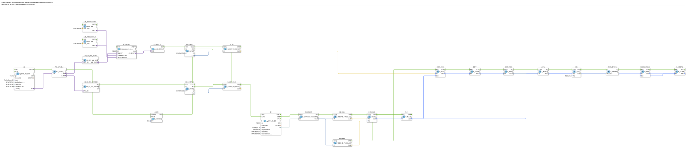

# Uebung_250_AX: Grenzfrequenz des Analogeingangs messen

* * * * * * * * * *

## Einleitung

Ein Analogeingang (AI) liefert keine Momentanwerte in beliebiger Geschwindigkeit. Diese Übung misst, **bis zu welcher Frequenz ein AI ein Rechtecksignal noch korrekt abbilden kann**. Dazu liegt dasselbe 0-10-V-Rechtecksignal gleichzeitig an `I1` (als AI, `logiBUS_AI_IDA`) und an `I2` (als PI, `logiBUS_PI_ID`). Der PI zählt die Impulse in Hardware und liefert damit die **Referenzfrequenz**. Aus den AI-Werten wird die Frequenz per Schmitt-Trigger und Flankenzähler selbst rekonstruiert. Beide Frequenzen werden je Sekunde Torzeit verglichen.

**Firmware-Hintergrund (`IOHandleESP32AnalogIN.cpp`):** Der ESP32-P4 liest den ADC im Continuous-Mode mit insgesamt 20 kHz. Je Lesevorgang werden 64 Samples (ca. 3,2 ms) pro Kanal gemittelt, nur dieser Mittelwert wird an 4diac gemeldet. Das ergibt grob 300 AI-Werte pro Sekunde. Oberhalb einer gewissen Signalfrequenz mittelt der Treiber das Rechteck zu einem Wert um 50 % – der Schmitt-Trigger schaltet dann nicht mehr, und die AI-Frequenz fällt ab.

> Die erwartete Grenzfrequenz (grob 100–150 Hz) ist eine Schätzung. Messergebnisse an der Maschine stehen noch aus.

## Verwendete Funktionsbausteine (FBs)

- **AI**: Analogeingang I1 (Typ: `logiBUS::io::AI::logiBUS_AI_IDA`)
    - **Parameter**: QI = TRUE, Input = AnalogInput_I1, AnalogInput_hysteresis = 1, TimeDelta = 1, TimeRateLimit = 0
    - **Erklärung**: Meldet jede ADC-Mittelung. Mit TimeRateLimit = 0 ist die Ratenbegrenzung abgeschaltet (der Standard von 100 ms würde schon bei ca. 5 Hz begrenzen).
- **AD_SPLIT_2**: verteilt den AI-Wert auf zwei Zweige (Typ: `adapter::events::unidirectional::AD_SPLIT_2`)
- **AD_TO_AR_NUM**: DWORD → REAL, numerisch korrekt (nicht die Bit-Reinterpretation, siehe `Uebung_237_AX`)
- **SCHMITT**: Schmitt-Trigger (Typ: `logiBUS::signalprocessing::hysteresis::Hysteresis_AR_AX`)
    - **Erklärung**: Ein ab 3072 (75 %), aus unter 1024 (25 %). Schwelle und Hysterese kommen aus den beiden Konstanten `LIT_THRESHOLD` und `LIT_HYSTERESIS` (je 2048.0).
- **R_TRIG_AI**: steigende Flanke (Typ: `AX_R_TRIG`) → **AI_EDGES** (`E_CTU`): zählt die Flanken je Torzeit.
- **AD_D_TO_DWORD** → **AI_SAMPLES** (`E_CTU`): zählt alle AI-Werte je Torzeit (effektive Abtastrate).
- **GATE**: `E_CYCLE`, DT = T#1s – die Torzeit. Wird von `AI.INITO` gestartet.
- **F_AI**, **SAMPLES_S**: `F_UINT_TO_REAL`, liefern Flanken bzw. AI-Werte pro Sekunde (= Hz bzw. 1/s).
- **PI**: Pulseingang I2 (Typ: `logiBUS::io::PI::logiBUS_PI_ID`), ImpulseDelta = 0, TimeDelta = 250, TimeRateLimit = 100. Hardware-Zähler als Referenz.
- **PI_UDINT** (`F_DWORD_TO_UDINT`) → **PI_NOW** (`F_UDINT_TO_REAL`), **PI_PREV** (Zählerstand der Vorsekunde), **F_PI_SUB** (`F_SUB`), **F_PI** (`F_MOVE`): Differenz der Zählerstände = `f_PI` in Hz.
    - **Hinweis:** bewusst über `F_DWORD_TO_UDINT` + `F_UDINT_TO_REAL`, nicht `F_DWORD_TO_REAL` (Bitfalle, siehe `Uebung_237_AX`).
- **DIFF_SUB**, **DIFF**, **DIFF_ABS**, **ABW**: Abweichung `|f_AI − f_PI|`.
- **OK**: `F_LE`, IN2 = REAL#2.0 – TRUE, solange die Abweichung höchstens 2 Hz beträgt.
- **PERMIT_OK** (`E_PERMIT`), **GRENZ_MAX** (`F_MAX`), **F_GRENZ** (`F_MOVE`): merkt sich die **höchste `f_PI`, bei der `OK` TRUE war** = gemessene Grenzfrequenz.
    - **Hinweis:** Die `F_MOVE` mit `DataType = REAL` dienen als Typanker hinter den generischen Bausteinen `F_SUB`, `F_ABS` und `F_MAX`.

### Sub-Bausteine: keine

## Programmablauf und Verbindungen

1. Jeder AI-Wert läuft über `AD_SPLIT_2` in zwei Zweige: Der erste geht über `AD_TO_AR_NUM` in den `SCHMITT`, dessen steigende Flanken (`R_TRIG_AI`) in `AI_EDGES` gezählt werden. Der zweite zählt in `AI_SAMPLES` jeden AI-Wert.
2. `GATE` löst jede Sekunde aus: `F_AI` liest `AI_EDGES.CV`, danach `SAMPLES_S` den Wert aus `AI_SAMPLES.CV`. Anschließend werden beide Zähler zurückgesetzt.
3. Dieselbe Kette fordert den PI an (`PI.REQ`). Die Differenz zum Zählerstand der Vorsekunde ergibt `f_PI`.
4. `F_AI` und `F_PI` werden verglichen: `ABW = |f_AI − f_PI|`, `OK = (ABW ≤ 2 Hz)`.
5. Nur bei `OK = TRUE` gibt `PERMIT_OK` weiter, und `F_GRENZ` übernimmt das Maximum aus `f_PI` und dem bisherigen Wert.

## Bedienung

1. Im `Control` der Datei `test_AX.sys` per *Change Type* auf `Uebungen::Uebung_250_AX` umstellen.
2. Watches auf `F_AI.OUT`, `F_PI.OUT`, `SAMPLES_S.OUT`, `ABW.OUT`, `OK.OUT`, `F_GRENZ.OUT` setzen.
3. Die Generatorfrequenz langsam steigern. Solange `OK.OUT` TRUE bleibt, folgt der AI dem Signal. `F_GRENZ.OUT` zeigt die bisher höchste Frequenz mit `OK`.
4. Für eine neue Messung das Programm neu starten.

**Hinweise:** Der erste Torzeit-Wert nach dem Start ist unzuverlässig. Ungeprüft ist noch, ob `PI.REQ` den Hardware-Zähler tatsächlich frisch liest.

## Zusammenfassung

Die Übung bestimmt die Grenzfrequenz des Analogeingangs experimentell, indem sie die aus den gemittelten AI-Werten rekonstruierte Frequenz mit der Hardware-Zählung des PI vergleicht. Sie zeigt, dass die Mittelung im Treiber (ca. 3,2 ms je Wert) die nutzbare Signalfrequenz begrenzt, und dass man schnelle Signale mit einem Pulseingang statt einem Analogeingang erfassen muss.

---

### 🌐 Passende Themen-Unterseiten auf ms-muc-docs.de

- [🌐 Eclipse 4diac IDE & Farb-Referenz auf ms-muc-docs.de](https://www.ms-muc-docs.de/iec-61499/eclipse-4diac/)
