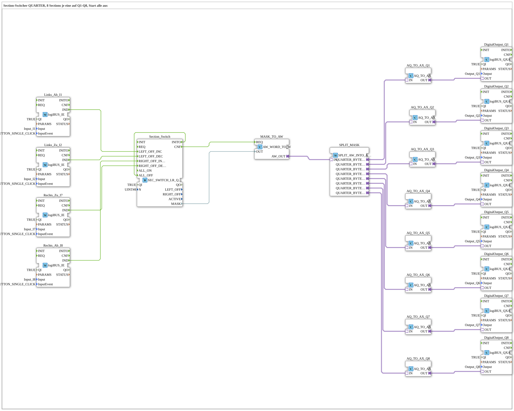

# Uebung_253_AX: Section-Switcher (QUARTER) mit vier Tastern

* * * * * * * * * *

## Einleitung

Der Section-Switcher [`SEC_SWITCH_LR_QUARTER_WORD`](https://meisterschulen-am-ostbahnhof-munchen-docs.readthedocs.io/projects/4diac-library-reference-docs/de/latest/Bibliotheken/ExternalLibraries/logiBUS/sections/SEC_SWITCH_LR_QUARTER_WORD/) schaltet 8 Abschnitte (Sections) von beiden Seiten her ab und wieder zu, wie bei einer Spritze mit Teilbreitenschaltung. Die Übung legt je eine Section auf einen Ausgang `Q1` bis `Q8`. Mit `I1`/`I2` wird die linke Seite, mit `I7`/`I8` die rechte Seite bedient. Beim Start sind alle Sections aus. Anders als in Übung 251 liefert der Baustein hier je Section 2 Bit (QUARTER-Maske): `01` = frei, `00` = gesperrt. `AQ_TO_AX` macht daraus je einen BOOL-Wert für den Ausgang.

## Verwendete Funktionsbausteine (FBs)

- **Links_Ab_I1**, **Links_Zu_I2**, **Rechts_Zu_I7**, **Rechts_Ab_I8**: Tasterereignisse (Typ: [`logiBUS_IE`](https://meisterschulen-am-ostbahnhof-munchen-docs.readthedocs.io/projects/4diac-library-reference-docs/de/latest/Bibliotheken/ExternalLibraries/logiBUS/io/DI/logiBUS_IE/), `InputEvent = BUTTON_SINGLE_CLICK`)
    - **Erklärung**: Ein kurzer Klick auf `I1` ruft `LEFT_OFF_INC` auf (links eine Section mehr aus), `I2` ruft `LEFT_OFF_DEC` auf (links eine Section weniger aus). `I8` ruft `RIGHT_OFF_INC`, `I7` `RIGHT_OFF_DEC` auf.
- **Section_Switch**: Section-Switcher (Typ: [`SEC_SWITCH_LR_QUARTER_WORD`](https://meisterschulen-am-ostbahnhof-munchen-docs.readthedocs.io/projects/4diac-library-reference-docs/de/latest/Bibliotheken/ExternalLibraries/logiBUS/sections/SEC_SWITCH_LR_QUARTER_WORD/))
    - **Parameter**: `QI = TRUE`, `N = 8`
    - **Erklärung**: Verwaltet die Maske der 8 Sections. `INITO` ist mit `ALL_OFF` verbunden, damit beim Start sicher alle Sections aus sind.
- **MASK_TO_AW** (`AW_WORD_TO_W`): übernimmt die Maske (`MASK`, WORD) in den Adapter.
- **SPLIT_MASK** (`SPLIT_AW_INTO_AQ`): zerlegt das Wort in 8 QUARTER-Werte (`QUARTER_BYTE_00` bis `QUARTER_BYTE_07`).
- **AQ_TO_AX_Q1** bis **AQ_TO_AX_Q8** (`AQ_TO_AX`): wandeln je einen QUARTER-Wert in einen BOOL-Wert.
- **DigitalOutput_Q1** bis **DigitalOutput_Q8**: digitale Ausgänge (Typ: [`logiBUS_QXA`](https://meisterschulen-am-ostbahnhof-munchen-docs.readthedocs.io/projects/4diac-library-reference-docs/de/latest/Bibliotheken/ExternalLibraries/logiBUS/io/DO/logiBUS_QXA/), `QI = TRUE`, `Output = Output_Q1` bis `Output_Q8`)

### Sub-Bausteine: keine

## Programmablauf und Verbindungen

1. Die vier Taster lösen im `Section_Switch` die Befehle `LEFT_OFF_INC`, `LEFT_OFF_DEC`, `RIGHT_OFF_DEC` und `RIGHT_OFF_INC` aus.
2. `Section_Switch.INITO` löst `ALL_OFF` aus: Beim Start sind alle Sections aus.
3. Nach jeder Änderung meldet `Section_Switch.CNF` an `MASK_TO_AW.REQ`, und die Maske geht als Adapter-Signal in `SPLIT_MASK`.
4. `SPLIT_MASK` verteilt die Maske auf acht QUARTER-Werte, `AQ_TO_AX` macht daraus je einen BOOL-Wert; dieser steuert `DigitalOutput_Q1` bis `DigitalOutput_Q8`.

## Bedienung

1. Im `Control` der Datei `test_AX.sys` per *Change Type* auf `Uebungen::Uebung_253_AX` umstellen.
2. Nach dem Start sind `Q1` bis `Q8` aus.
3. Mit `I1`/`I2` die linke, mit `I8`/`I7` die rechte Seite kurz tippen und beobachten, welche der Ausgänge `Q1` bis `Q8` schalten.

**Hinweis:** Das genaue Verhalten bei einem Klick (welche Section zuerst schaltet, Grenzen bei der Maske) beschreibt die Bibliotheksseite [`SEC_SWITCH_LR_QUARTER_WORD`](https://meisterschulen-am-ostbahnhof-munchen-docs.readthedocs.io/projects/4diac-library-reference-docs/de/latest/Bibliotheken/ExternalLibraries/logiBUS/sections/SEC_SWITCH_LR_QUARTER_WORD/).

## Zusammenfassung

Die Übung zeigt, wie ein Section-Switcher mit vier Tastern bedient wird und wie seine QUARTER-Maske auf acht Ausgänge verteilt wird. Der Weg über `AQ_TO_AX` zeigt, wie man 2-Bit-Werte in Ausgangssignale überträgt.

---

### 🌐 Passende Themen-Unterseiten auf ms-muc-docs.de

- [🌐 Eclipse 4diac IDE & Farb-Referenz auf ms-muc-docs.de](https://www.ms-muc-docs.de/iec-61499/eclipse-4diac/)
