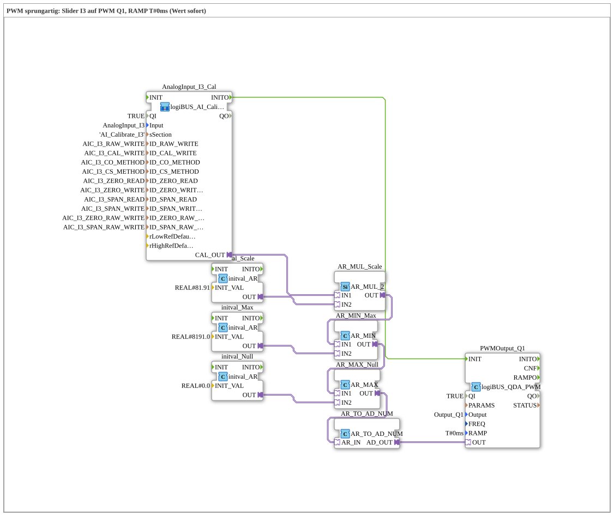

# Uebung_254_AX: PWM mit Sprung

* * * * * * * * * *

## Einleitung

Ein Slider am Analogeingang `I3` stellt den Tastgrad des PWM-Ausgangs `Q1` ein. Die Rampenzeit ist `T#0ms`: Jeder neue Wert gilt sofort (Sprung). Das ist die Grundübung zum Baustein [`logiBUS_QDA_PWM`](https://meisterschulen-am-ostbahnhof-munchen-docs.readthedocs.io/projects/4diac-library-reference-docs/de/latest/Bibliotheken/ExternalLibraries/logiBUS/io/DO/logiBUS_QDA_PWM/).

**Voraussetzung (einmalig):** Die Übung nutzt `logiBUS_AI_Calibrate_2P_OPC`. Dazu im `test_AX.sys` den `Button_AI_Calibrate_2P_OPC_UA` als `Control` einsetzen, das Bootfile exportieren und mit dem Web-Client `apixon-ai-calibrate-2p.html` kalibrieren (0 %: `CO`, 100 %: `CS`). Die INI-Datei (Sektion `AI_Calibrate_I3`) bleibt auf der Platine. Danach läuft die Übung ohne VT und ohne Dashboard.

## Verwendete Funktionsbausteine (FBs)

- **AnalogInput_I3_Cal**: Analogeingang I3 mit Zwei-Punkt-Kalibrierung über OPC UA (Typ: `logiBUS_AI_Calibrate_2P_OPC`, Sektion `AI_Calibrate_I3`)
    - **Erklärung**: `CAL_OUT` liefert den kalibrierten Wert 0 bis 100 %. `INITO` startet die PWM-Bausteine.
- **AR_MUL_Scale** (`AR_MUL_2`) mit **initval_Scale** (`initval_AR`, Faktor `81.91`): rechnet den Wert 0 bis 100 % in den Zielbereich um.
- **AR_MIN_Max** (`AR_MIN`) mit **initval_Max** (`8191.0`): begrenzt nach oben.
- **AR_MAX_Null** (`AR_MAX`) mit **initval_Null** (`0`): begrenzt nach unten. Zusammen mit `AR_MIN_Max` bleibt der Wert im Bereich 0 bis 8191.
- **AR_TO_AD_NUM** (`AR_TO_AD_NUM`): wandelt REAL **numerisch** in DWORD und gibt den Wert über den Adapter weiter.
- **PWMOutput_Q1** (Typ: `logiBUS_QDA_PWM`, `QI = TRUE`, `Output = Output_Q1`, `RAMP = T#0ms`)
    - **Erklärung**: PWM-Ausgang `Q1` mit Frequenz-Initialwert 400 Hz, der Tastgrad ist 0 bis 8191 (13 Bit). Der Baustein ist hier mit [`logiBUS_QDA_PWM`](https://meisterschulen-am-ostbahnhof-munchen-docs.readthedocs.io/projects/4diac-library-reference-docs/de/latest/Bibliotheken/ExternalLibraries/logiBUS/io/DO/logiBUS_QDA_PWM/) dokumentiert.

### Sub-Bausteine: keine

## Programmablauf und Verbindungen

1. Der Wert des Potis läuft von `AnalogInput_I3_Cal.CAL_OUT` über `AR_MUL_Scale`, `AR_MIN_Max` und `AR_MAX_Null` nach `AR_TO_AD_NUM` (0 bis 8191). Von dort geht der Wert direkt auf `PWMOutput_Q1.OUT`.
2. `AnalogInput_I3_Cal.INITO` initialisiert `PWMOutput_Q1`.

## Bedienung

1. Übung `Uebungen::Uebung_254_AX` im `Control` einstellen.
2. Den Slider an `I3` bewegen: Die Helligkeit bzw. die Leistung an `Q1` folgt dem Slider ohne Verzögerung.

## Zusammenfassung

Die Übung zeigt die kürzeste Kette vom kalibrierten Analogwert zum PWM-Ausgang. Mit `RAMP = T#0ms` springt der Ausgang auf jeden neuen Wert.

---

### 🌐 Passende Themen-Unterseiten auf ms-muc-docs.de

- [🌐 Eclipse 4diac IDE & Farb-Referenz auf ms-muc-docs.de](https://www.ms-muc-docs.de/iec-61499/eclipse-4diac/)
