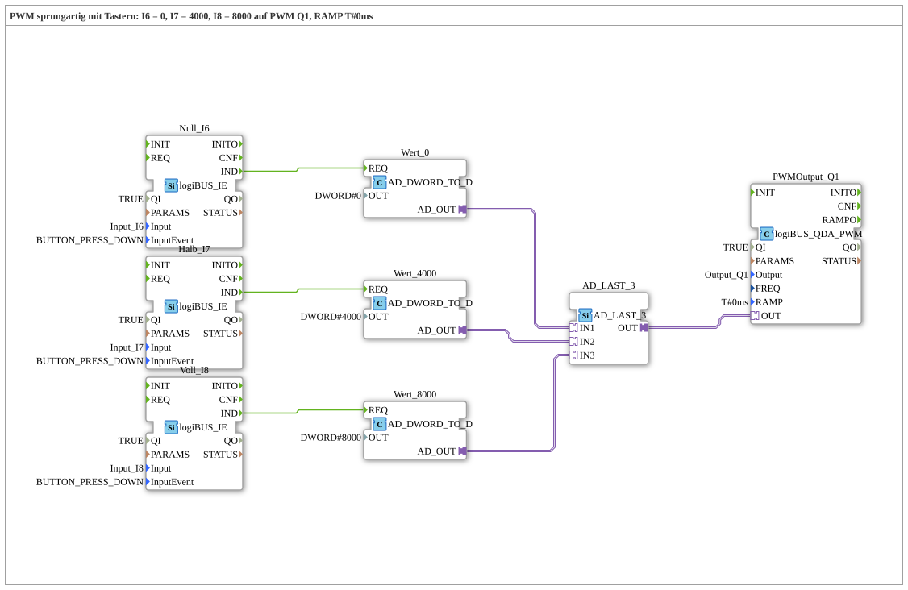

# Uebung_254b_AX: PWM mit Sprung und Tastern

* * * * * * * * * *

## Einleitung

Wie Übung 254, aber ohne Poti: Drei Taster setzen den Tastgrad an `Q1` auf feste Werte: `I6` = 0, `I7` = 4000, `I8` = 8000 (von 8191). Die Rampenzeit ist `T#0ms` (Sprung). Die drei Werte laufen über [`AD_LAST_3`](https://meisterschulen-am-ostbahnhof-munchen-docs.readthedocs.io/projects/4diac-library-reference-docs/de/latest/Bibliotheken/ExternalLibraries/adapter/events/unidirectional/DWORD/AD_LAST_3/) zu einem PWM-Baustein: Der zuletzt gedrückte Taster gewinnt.

## Verwendete Funktionsbausteine (FBs)

- **Null_I6**: Tasterereignis `I6` (Typ: [`logiBUS_IE`](https://meisterschulen-am-ostbahnhof-munchen-docs.readthedocs.io/projects/4diac-library-reference-docs/de/latest/Bibliotheken/ExternalLibraries/logiBUS/io/DI/logiBUS_IE/), `InputEvent = BUTTON_PRESS_DOWN`) → **Wert_0** (`AD_DWORD_TO_D`, `OUT = DWORD#0`): liefert den festen Wert 0 als Adapter-Signal.
- **Halb_I7**: Tasterereignis `I7` (Typ: [`logiBUS_IE`](https://meisterschulen-am-ostbahnhof-munchen-docs.readthedocs.io/projects/4diac-library-reference-docs/de/latest/Bibliotheken/ExternalLibraries/logiBUS/io/DI/logiBUS_IE/), `InputEvent = BUTTON_PRESS_DOWN`) → **Wert_4000** (`AD_DWORD_TO_D`, `OUT = DWORD#4000`): liefert den festen Wert 4000 als Adapter-Signal.
- **Voll_I8**: Tasterereignis `I8` (Typ: [`logiBUS_IE`](https://meisterschulen-am-ostbahnhof-munchen-docs.readthedocs.io/projects/4diac-library-reference-docs/de/latest/Bibliotheken/ExternalLibraries/logiBUS/io/DI/logiBUS_IE/), `InputEvent = BUTTON_PRESS_DOWN`) → **Wert_8000** (`AD_DWORD_TO_D`, `OUT = DWORD#8000`): liefert den festen Wert 8000 als Adapter-Signal.
- **AD_LAST_3**: führt die 3 Wert-Adapter zusammen (Typ: [`AD_LAST_3`](https://meisterschulen-am-ostbahnhof-munchen-docs.readthedocs.io/projects/4diac-library-reference-docs/de/latest/Bibliotheken/ExternalLibraries/adapter/events/unidirectional/DWORD/AD_LAST_3/))
    - **Erklärung**: Last Writer Wins: Der Wert des zuletzt gedrückten Tasters geht an `OUT`.
- **PWMOutput_Q1** (Typ: `logiBUS_QDA_PWM`, `QI = TRUE`, `Output = Output_Q1`, `RAMP = T#0ms`)
    - **Erklärung**: PWM-Ausgang `Q1` (Sprung).

### Sub-Bausteine: keine

## Programmablauf und Verbindungen

1. Ein Tastendruck löst `Wert_0.REQ`, `Wert_4000.REQ` bzw. `Wert_8000.REQ` aus.
2. Der zugehörige Wert geht an den Eingang `IN1`, `IN2` bzw. `IN3` von `AD_LAST_3`.
3. `AD_LAST_3.OUT` geht an `PWMOutput_Q1.OUT`. Dieser Ausgang springt auf den Wert.

## Bedienung

1. Übung `Uebungen::Uebung_254b_AX` im `Control` einstellen.
2. `I6` drücken: Tastgrad 0. `I7` drücken: Tastgrad 4000 (etwa die Hälfte). `I8` drücken: Tastgrad 8000 (fast voll).

**Hinweis:** Die Übung braucht keine Kalibrierung und keinen Web-Client.

## Zusammenfassung

Die Übung ersetzt das Poti durch drei Taster und fasst deren Werte mit `AD_LAST_3` zu einem Signal zusammen.

---

### 🌐 Passende Themen-Unterseiten auf ms-muc-docs.de

- [🌐 Eclipse 4diac IDE & Farb-Referenz auf ms-muc-docs.de](https://www.ms-muc-docs.de/iec-61499/eclipse-4diac/)
