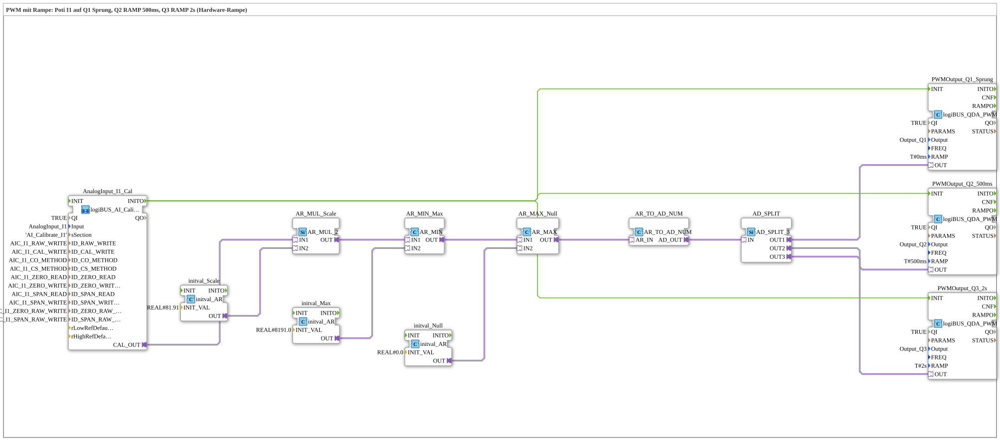

# Uebung_255_AX: PWM mit Hardware-Rampe

* * * * * * * * * *

## Einleitung

Dasselbe Poti-Signal geht parallel auf drei PWM-Ausgänge mit unterschiedlicher Rampenzeit: `Q1` springt (`T#0ms`), `Q2` fährt in 500 ms zum neuen Wert, `Q3` in 2 s. Die Rampe läuft in der Hardware und blockiert das Programm nicht (siehe [`logiBUS_QDA_PWM`](https://meisterschulen-am-ostbahnhof-munchen-docs.readthedocs.io/projects/4diac-library-reference-docs/de/latest/Bibliotheken/ExternalLibraries/logiBUS/io/DO/logiBUS_QDA_PWM/)).

**Voraussetzung (einmalig):** Die Übung nutzt `logiBUS_AI_Calibrate_2P_OPC`. Dazu im `test_AX.sys` den `Button_AI_Calibrate_2P_OPC_UA` als `Control` einsetzen, das Bootfile exportieren und mit dem Web-Client `apixon-ai-calibrate-2p.html` kalibrieren (0 %: `CO`, 100 %: `CS`). Die INI-Datei (Sektion `AI_Calibrate_I1`) bleibt auf der Platine. Danach läuft die Übung ohne VT und ohne Dashboard.

## Verwendete Funktionsbausteine (FBs)

- **AnalogInput_I1_Cal**: Analogeingang I1 mit Zwei-Punkt-Kalibrierung über OPC UA (Typ: `logiBUS_AI_Calibrate_2P_OPC`, Sektion `AI_Calibrate_I1`)
    - **Erklärung**: `CAL_OUT` liefert den kalibrierten Wert 0 bis 100 %. `INITO` startet die PWM-Bausteine.
- **AR_MUL_Scale** (`AR_MUL_2`) mit **initval_Scale** (`initval_AR`, Faktor `81.91`): rechnet den Wert 0 bis 100 % in den Zielbereich um.
- **AR_MIN_Max** (`AR_MIN`) mit **initval_Max** (`8191.0`): begrenzt nach oben.
- **AR_MAX_Null** (`AR_MAX`) mit **initval_Null** (`0`): begrenzt nach unten. Zusammen mit `AR_MIN_Max` bleibt der Wert im Bereich 0 bis 8191.
- **AR_TO_AD_NUM** (`AR_TO_AD_NUM`): wandelt REAL **numerisch** in DWORD und gibt den Wert über den Adapter weiter.
- **AD_SPLIT** (`AD_SPLIT_3`): verteilt den Wert auf 3 PWM-Ausgänge.
- **PWMOutput_Q1_Sprung** (Typ: `logiBUS_QDA_PWM`, `QI = TRUE`, `Output = Output_Q1`, `RAMP = T#0ms`)
    - **Erklärung**: PWM-Ausgang `Q1` mit der Rampenzeit `T#0ms`.
- **PWMOutput_Q2_500ms** (Typ: `logiBUS_QDA_PWM`, `QI = TRUE`, `Output = Output_Q2`, `RAMP = T#500ms`)
    - **Erklärung**: PWM-Ausgang `Q2` mit der Rampenzeit `T#500ms`.
- **PWMOutput_Q3_2s** (Typ: `logiBUS_QDA_PWM`, `QI = TRUE`, `Output = Output_Q3`, `RAMP = T#2s`)
    - **Erklärung**: PWM-Ausgang `Q3` mit der Rampenzeit `T#2s`.

### Sub-Bausteine: keine

## Programmablauf und Verbindungen

1. Der Wert des Potis läuft von `AnalogInput_I1_Cal.CAL_OUT` über `AR_MUL_Scale`, `AR_MIN_Max` und `AR_MAX_Null` nach `AR_TO_AD_NUM` (0 bis 8191). `AD_SPLIT` verteilt den Wert auf `PWMOutput_Q1_Sprung`, `PWMOutput_Q2_500ms` und `PWMOutput_Q3_2s`.
2. `AnalogInput_I1_Cal.INITO` initialisiert alle drei PWM-Bausteine. Die Rampenzeit (`RAMP`) wird dabei gelesen.

## Bedienung

1. Übung `Uebungen::Uebung_255_AX` im `Control` einstellen.
2. Das Poti an `I1` schnell verstellen und die drei Ausgänge `Q1`, `Q2`, `Q3` vergleichen: `Q1` folgt sofort, `Q2` in etwa einer halben Sekunde, `Q3` in etwa zwei Sekunden.

## Zusammenfassung

Die Übung zeigt die Hardware-Rampe von [`logiBUS_QDA_PWM`](https://meisterschulen-am-ostbahnhof-munchen-docs.readthedocs.io/projects/4diac-library-reference-docs/de/latest/Bibliotheken/ExternalLibraries/logiBUS/io/DO/logiBUS_QDA_PWM/): Die Rampenzeit wird je Baustein bei `INIT` festgelegt und gilt für jeden neuen Wert. Das Programm wartet nicht auf das Ende der Rampe.

---

### 🌐 Passende Themen-Unterseiten auf ms-muc-docs.de

- [🌐 Eclipse 4diac IDE & Farb-Referenz auf ms-muc-docs.de](https://www.ms-muc-docs.de/iec-61499/eclipse-4diac/)
