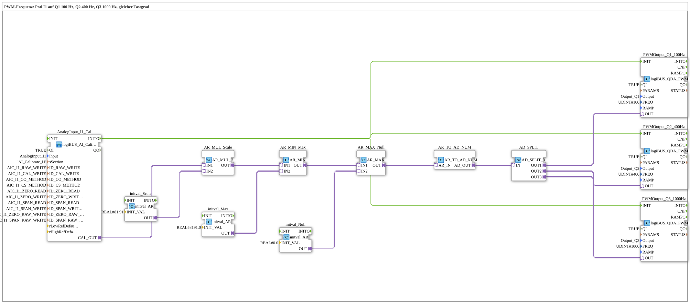

# Uebung_256_AX: PWM-Frequenz einstellen

* * * * * * * * * *

## Einleitung

Dasselbe Poti-Signal geht auf drei PWM-Ausgänge mit unterschiedlicher Frequenz: `Q1` 100 Hz, `Q2` 400 Hz, `Q3` 1000 Hz. Der Tastgrad ist bei allen drei gleich. Die Frequenz wird über `FREQ` bei `INIT` festgelegt (siehe [`logiBUS_QDA_PWM`](https://meisterschulen-am-ostbahnhof-munchen-docs.readthedocs.io/projects/4diac-library-reference-docs/de/latest/Bibliotheken/ExternalLibraries/logiBUS/io/DO/logiBUS_QDA_PWM/)).

**Voraussetzung (einmalig):** Die Übung nutzt `logiBUS_AI_Calibrate_2P_OPC`. Dazu im `test_AX.sys` den `Button_AI_Calibrate_2P_OPC_UA` als `Control` einsetzen, das Bootfile exportieren und mit dem Web-Client `apixon-ai-calibrate-2p.html` kalibrieren (0 %: `CO`, 100 %: `CS`). Die INI-Datei (Sektion `AI_Calibrate_I1`) bleibt auf der Platine. Danach läuft die Übung ohne VT und ohne Dashboard.

## Verwendete Funktionsbausteine (FBs)

- **AnalogInput_I1_Cal**: Analogeingang I1 mit Zwei-Punkt-Kalibrierung über OPC UA (Typ: `logiBUS_AI_Calibrate_2P_OPC`, Sektion `AI_Calibrate_I1`)
    - **Erklärung**: `CAL_OUT` liefert den kalibrierten Wert 0 bis 100 %. `INITO` startet die PWM-Bausteine.
- **AR_MUL_Scale** (`AR_MUL_2`) mit **initval_Scale** (`initval_AR`, Faktor `81.91`): rechnet den Wert 0 bis 100 % in den Zielbereich um.
- **AR_MIN_Max** (`AR_MIN`) mit **initval_Max** (`8191.0`): begrenzt nach oben.
- **AR_MAX_Null** (`AR_MAX`) mit **initval_Null** (`0`): begrenzt nach unten. Zusammen mit `AR_MIN_Max` bleibt der Wert im Bereich 0 bis 8191.
- **AR_TO_AD_NUM** (`AR_TO_AD_NUM`): wandelt REAL **numerisch** in DWORD und gibt den Wert über den Adapter weiter.
- **AD_SPLIT** (`AD_SPLIT_3`): verteilt den Wert auf 3 PWM-Ausgänge.
- **PWMOutput_Q1_100Hz** (Typ: `logiBUS_QDA_PWM`, `QI = TRUE`, `Output = Output_Q1`, `FREQ = 100`)
    - **Erklärung**: PWM-Ausgang `Q1` mit 100 Hz.
- **PWMOutput_Q2_400Hz** (Typ: `logiBUS_QDA_PWM`, `QI = TRUE`, `Output = Output_Q2`, `FREQ = 400`)
    - **Erklärung**: PWM-Ausgang `Q2` mit 400 Hz.
- **PWMOutput_Q3_1000Hz** (Typ: `logiBUS_QDA_PWM`, `QI = TRUE`, `Output = Output_Q3`, `FREQ = 1000`)
    - **Erklärung**: PWM-Ausgang `Q3` mit 1000 Hz.

### Sub-Bausteine: keine

## Programmablauf und Verbindungen

1. Der Wert des Potis läuft von `AnalogInput_I1_Cal.CAL_OUT` über `AR_MUL_Scale`, `AR_MIN_Max` und `AR_MAX_Null` nach `AR_TO_AD_NUM` (0 bis 8191). `AD_SPLIT` verteilt den Wert auf die drei PWM-Bausteine.
2. `AnalogInput_I1_Cal.INITO` initialisiert die drei PWM-Bausteine. Dabei wird `FREQ` gelesen; eine andere Frequenz braucht ein neues `INIT`.

## Bedienung

1. Übung `Uebungen::Uebung_256_AX` im `Control` einstellen.
2. Das Poti an `I1` verstellen. Der Tastgrad ist an `Q1`, `Q2` und `Q3` gleich, nur die Frequenz unterscheidet sich. Mit einem Oszilloskop sind die drei Frequenzen gut zu unterscheiden.

## Zusammenfassung

Die Übung zeigt, dass jeder PWM-Baustein seine Frequenz über `FREQ` bekommt und dass der Tastgrad davon unabhängig bleibt.

---

### 🌐 Passende Themen-Unterseiten auf ms-muc-docs.de

- [🌐 Eclipse 4diac IDE & Farb-Referenz auf ms-muc-docs.de](https://www.ms-muc-docs.de/iec-61499/eclipse-4diac/)
