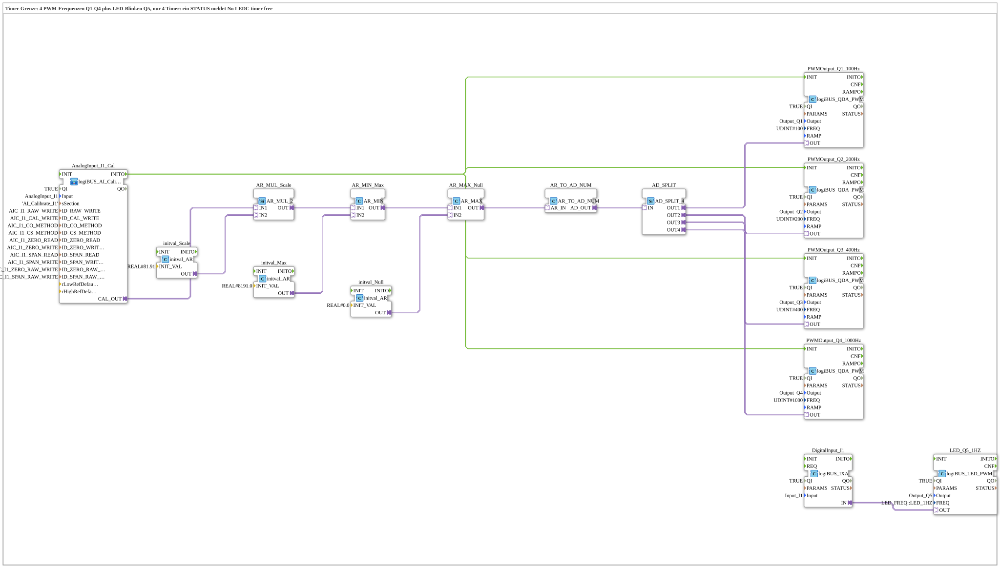

# Uebung_257_AX: Timer-Grenze der PWM-Ausgänge

* * * * * * * * * *

## Einleitung

Der ESP32 hat für PWM-Ausgänge 4 LEDC-Timer. Ausgänge mit gleicher Frequenz teilen sich einen Timer (siehe [`logiBUS_QDA_PWM`](https://meisterschulen-am-ostbahnhof-munchen-docs.readthedocs.io/projects/4diac-library-reference-docs/de/latest/Bibliotheken/ExternalLibraries/logiBUS/io/DO/logiBUS_QDA_PWM/)). Die Übung belegt mit vier verschiedenen Frequenzen (`Q1` 100 Hz, `Q2` 200 Hz, `Q3` 400 Hz, `Q4` 1000 Hz) alle Timer und startet zusätzlich ein LED-Blinken an `Q5`, das ebenfalls einen Timer braucht. Laut Kommentar im Modell meldet dadurch ein Baustein im `STATUS` **„No LEDC timer free“**.

**Voraussetzung (einmalig):** Die Übung nutzt `logiBUS_AI_Calibrate_2P_OPC`. Dazu im `test_AX.sys` den `Button_AI_Calibrate_2P_OPC_UA` als `Control` einsetzen, das Bootfile exportieren und mit dem Web-Client `apixon-ai-calibrate-2p.html` kalibrieren (0 %: `CO`, 100 %: `CS`). Die INI-Datei (Sektion `AI_Calibrate_I1`) bleibt auf der Platine. Danach läuft die Übung ohne VT und ohne Dashboard.

## Verwendete Funktionsbausteine (FBs)

- **AnalogInput_I1_Cal**: Analogeingang I1 mit Zwei-Punkt-Kalibrierung über OPC UA (Typ: `logiBUS_AI_Calibrate_2P_OPC`, Sektion `AI_Calibrate_I1`)
    - **Erklärung**: `CAL_OUT` liefert den kalibrierten Wert 0 bis 100 %. `INITO` startet die PWM-Bausteine.
- **AR_MUL_Scale** (`AR_MUL_2`) mit **initval_Scale** (`initval_AR`, Faktor `81.91`): rechnet den Wert 0 bis 100 % in den Zielbereich um.
- **AR_MIN_Max** (`AR_MIN`) mit **initval_Max** (`8191.0`): begrenzt nach oben.
- **AR_MAX_Null** (`AR_MAX`) mit **initval_Null** (`0`): begrenzt nach unten. Zusammen mit `AR_MIN_Max` bleibt der Wert im Bereich 0 bis 8191.
- **AR_TO_AD_NUM** (`AR_TO_AD_NUM`): wandelt REAL **numerisch** in DWORD und gibt den Wert über den Adapter weiter.
- **AD_SPLIT** (`AD_SPLIT_4`): verteilt den Wert auf 4 PWM-Ausgänge.
- **PWMOutput_Q1_100Hz** (Typ: `logiBUS_QDA_PWM`, `QI = TRUE`, `Output = Output_Q1`, `FREQ = 100`)
    - **Erklärung**: PWM-Ausgang `Q1` mit 100 Hz.
- **PWMOutput_Q2_200Hz** (Typ: `logiBUS_QDA_PWM`, `QI = TRUE`, `Output = Output_Q2`, `FREQ = 200`)
    - **Erklärung**: PWM-Ausgang `Q2` mit 200 Hz.
- **PWMOutput_Q3_400Hz** (Typ: `logiBUS_QDA_PWM`, `QI = TRUE`, `Output = Output_Q3`, `FREQ = 400`)
    - **Erklärung**: PWM-Ausgang `Q3` mit 400 Hz.
- **PWMOutput_Q4_1000Hz** (Typ: `logiBUS_QDA_PWM`, `QI = TRUE`, `Output = Output_Q4`, `FREQ = 1000`)
    - **Erklärung**: PWM-Ausgang `Q4` mit 1000 Hz.
- **DigitalInput_I1**: digitaler Eingang `I1` (Typ: [`logiBUS_IXA`](https://meisterschulen-am-ostbahnhof-munchen-docs.readthedocs.io/projects/4diac-library-reference-docs/de/latest/Bibliotheken/ExternalLibraries/logiBUS/io/DI/logiBUS_IXA/), `QI = TRUE`, `Input = Input_I1`)
- **LED_Q5_1HZ**: LED-Blinken an `Q5` (Typ: [`logiBUS_LED_PWM_QXA`](https://meisterschulen-am-ostbahnhof-munchen-docs.readthedocs.io/projects/4diac-library-reference-docs/de/latest/Bibliotheken/ExternalLibraries/logiBUS/io/DO-LED/logiBUS_LED_PWM_QXA/), `QI = TRUE`, `Output = Output_Q5`, `FREQ = LED_FREQ::LED_1HZ`)
    - **Erklärung**: Der Zustand von `I1` schaltet das Blinken ein und aus. Das Blinken belegt einen der 4 Timer.

### Sub-Bausteine: keine

## Programmablauf und Verbindungen

1. Der Wert des Potis läuft von `AnalogInput_I1_Cal.CAL_OUT` über `AR_MUL_Scale`, `AR_MIN_Max` und `AR_MAX_Null` nach `AR_TO_AD_NUM` (0 bis 8191). `AD_SPLIT` verteilt den Wert auf die vier PWM-Bausteine.
2. `AnalogInput_I1_Cal.INITO` initialisiert die vier PWM-Bausteine, jeder fordert einen LEDC-Timer für seine Frequenz an.
3. `DigitalInput_I1.IN` ist direkt mit `LED_Q5_1HZ.OUT` verbunden.

## Bedienung

1. Übung `Uebungen::Uebung_257_AX` im `Control` einstellen.
2. `STATUS` aller fünf Bausteine (`PWMOutput_Q1_100Hz` bis `PWMOutput_Q4_1000Hz`, `LED_Q5_1HZ`) per Watch beobachten: Ein Baustein meldet, dass kein LEDC-Timer mehr frei ist.
3. Zum Vergleich in `PWMOutput_Q4_1000Hz` die Frequenz auf eine bereits benutzte setzen (zum Beispiel 400 Hz): Dann teilen sich zwei Ausgänge einen Timer, und die Meldung verschwindet.

**Hinweis:** Welcher Baustein die Meldung ausgibt, hängt von der Reihenfolge der Initialisierung ab. Die Aussage zum Verschwinden der Meldung ist aus dem Timer-Prinzip abgeleitet und nicht an der Maschine geprüft.

## Zusammenfassung

Die Übung zeigt, dass PWM-Frequenzen eine begrenzte Ressource sind: Vier Timer genügen für vier verschiedene Frequenzen, aber nicht zusätzlich für ein LED-Blinken.

---

### 🌐 Passende Themen-Unterseiten auf ms-muc-docs.de

- [🌐 Eclipse 4diac IDE & Farb-Referenz auf ms-muc-docs.de](https://www.ms-muc-docs.de/iec-61499/eclipse-4diac/)
