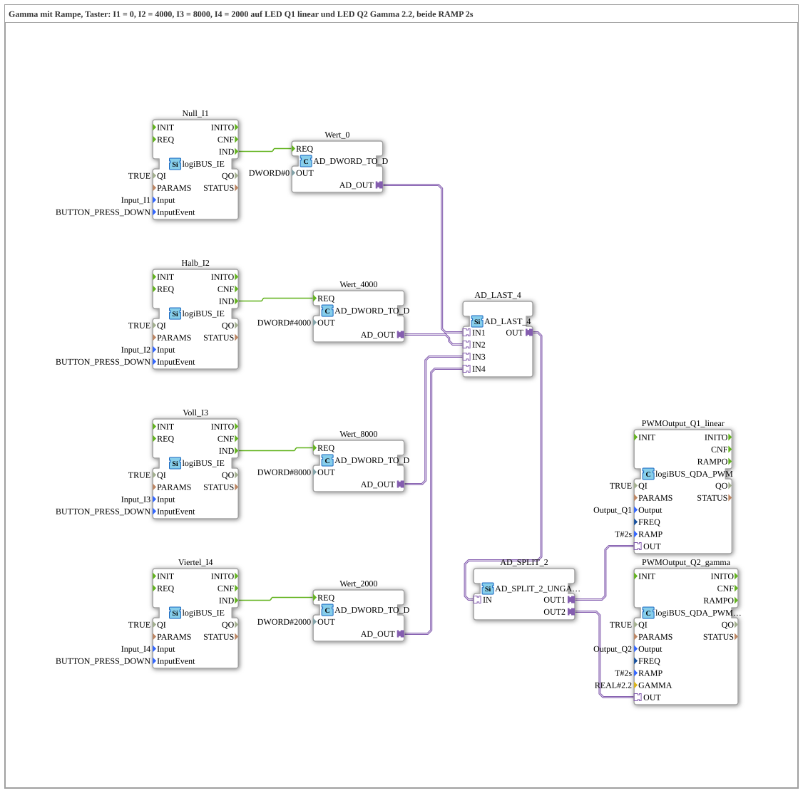

# Uebung_259b_AX: Gamma mit Rampe und Tastern

* * * * * * * * * *

## Einleitung

Wie Übung 259, aber ohne Poti: Vier Taster setzen den Tastgrad auf feste Werte: `I1` = 0, `I2` = 4000, `I3` = 8000, `I4` = 2000 (von 8191). Der Wert geht über [`AD_LAST_4`](https://meisterschulen-am-ostbahnhof-munchen-docs.readthedocs.io/projects/4diac-library-reference-docs/de/latest/Bibliotheken/ExternalLibraries/adapter/events/unidirectional/DWORD/AD_LAST_4/) gleichzeitig an `Q1` (linear) und `Q2` (Gamma 2.2), beide mit `RAMP = T#2s`. So lassen sich die beiden Kennlinien bei gleichen Sprüngen vergleichen.

## Verwendete Funktionsbausteine (FBs)

- **Null_I1**: Tasterereignis `I1` (Typ: [`logiBUS_IE`](https://meisterschulen-am-ostbahnhof-munchen-docs.readthedocs.io/projects/4diac-library-reference-docs/de/latest/Bibliotheken/ExternalLibraries/logiBUS/io/DI/logiBUS_IE/), `InputEvent = BUTTON_PRESS_DOWN`) → **Wert_0** (`AD_DWORD_TO_D`, `OUT = DWORD#0`): liefert den festen Wert 0 als Adapter-Signal.
- **Halb_I2**: Tasterereignis `I2` (Typ: [`logiBUS_IE`](https://meisterschulen-am-ostbahnhof-munchen-docs.readthedocs.io/projects/4diac-library-reference-docs/de/latest/Bibliotheken/ExternalLibraries/logiBUS/io/DI/logiBUS_IE/), `InputEvent = BUTTON_PRESS_DOWN`) → **Wert_4000** (`AD_DWORD_TO_D`, `OUT = DWORD#4000`): liefert den festen Wert 4000 als Adapter-Signal.
- **Voll_I3**: Tasterereignis `I3` (Typ: [`logiBUS_IE`](https://meisterschulen-am-ostbahnhof-munchen-docs.readthedocs.io/projects/4diac-library-reference-docs/de/latest/Bibliotheken/ExternalLibraries/logiBUS/io/DI/logiBUS_IE/), `InputEvent = BUTTON_PRESS_DOWN`) → **Wert_8000** (`AD_DWORD_TO_D`, `OUT = DWORD#8000`): liefert den festen Wert 8000 als Adapter-Signal.
- **Viertel_I4**: Tasterereignis `I4` (Typ: [`logiBUS_IE`](https://meisterschulen-am-ostbahnhof-munchen-docs.readthedocs.io/projects/4diac-library-reference-docs/de/latest/Bibliotheken/ExternalLibraries/logiBUS/io/DI/logiBUS_IE/), `InputEvent = BUTTON_PRESS_DOWN`) → **Wert_2000** (`AD_DWORD_TO_D`, `OUT = DWORD#2000`): liefert den festen Wert 2000 als Adapter-Signal.
- **AD_LAST_4**: führt die 4 Wert-Adapter zusammen (Typ: [`AD_LAST_4`](https://meisterschulen-am-ostbahnhof-munchen-docs.readthedocs.io/projects/4diac-library-reference-docs/de/latest/Bibliotheken/ExternalLibraries/adapter/events/unidirectional/DWORD/AD_LAST_4/))
    - **Erklärung**: Last Writer Wins: Der Wert des zuletzt gedrückten Tasters geht an `OUT`.
- **AD_SPLIT_2** (`AD_SPLIT_2_UNGATED`): verteilt den Wert auf zwei Ausgänge, ohne Torsteuerung.
- **PWMOutput_Q1_linear** (Typ: `logiBUS_QDA_PWM`, `QI = TRUE`, `Output = Output_Q1`, `RAMP = T#2s`)
    - **Erklärung**: linearer Tastgrad an `Q1`.
- **PWMOutput_Q2_gamma** (Typ: `logiBUS_QDA_PWM_G`, `QI = TRUE`, `Output = Output_Q2`, `RAMP = T#2s`, `GAMMA = 2.2`)
    - **Erklärung**: Gamma-korrigierter Tastgrad an `Q2` (siehe [`logiBUS_QDA_PWM_G`](https://meisterschulen-am-ostbahnhof-munchen-docs.readthedocs.io/projects/4diac-library-reference-docs/de/latest/Bibliotheken/ExternalLibraries/logiBUS/io/DO/logiBUS_QDA_PWM_G/)).

### Sub-Bausteine: keine

## Programmablauf und Verbindungen

1. Ein Tastendruck löst `Wert_0.REQ`, `Wert_4000.REQ`, `Wert_8000.REQ` bzw. `Wert_2000.REQ` aus.
2. Der zugehörige Wert geht an `IN1` bis `IN4` von `AD_LAST_4`.
3. `AD_LAST_4.OUT` geht über `AD_SPLIT_2` an `PWMOutput_Q1_linear.OUT` und `PWMOutput_Q2_gamma.OUT`.

## Bedienung

1. Übung `Uebungen::Uebung_259b_AX` im `Control` einstellen.
2. Je eine LED an `Q1` und `Q2` anschließen.
3. `I1` (0), `I2` (4000), `I3` (8000) und `I4` (2000) in wechselnder Reihenfolge drücken und beobachten, wie die LEDs in 2 s zum neuen Wert laufen. Die Gamma-LED (`Q2`) wirkt bei kleinen Werten dunkler als die lineare (`Q1`).

**Hinweis:** Die Übung braucht keine Kalibrierung und keinen Web-Client.

## Zusammenfassung

Die Übung vergleicht lineare und Gamma-Ansteuerung mit festen Sprüngen aus vier Tastern, ohne Poti und ohne Kalibrierung.

---

### 🌐 Passende Themen-Unterseiten auf ms-muc-docs.de

- [🌐 Eclipse 4diac IDE & Farb-Referenz auf ms-muc-docs.de](https://www.ms-muc-docs.de/iec-61499/eclipse-4diac/)
