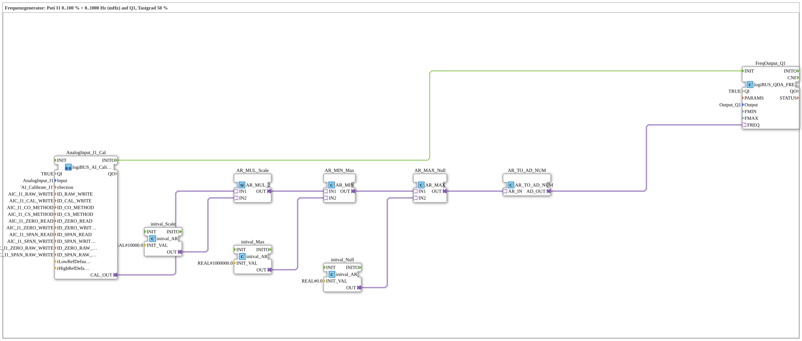

# Uebung_260_AX: Frequenzgenerator

* * * * * * * * * *

## Einleitung

Das Poti an `I1` stellt die Frequenz eines Rechtecksignals an `Q1` ein: 0 bis 100 % entsprechen 0 bis 1000 Hz. Der Tastgrad bleibt 50 %. Der Baustein [`logiBUS_QDA_FREQ`](https://meisterschulen-am-ostbahnhof-munchen-docs.readthedocs.io/projects/4diac-library-reference-docs/de/latest/Bibliotheken/ExternalLibraries/logiBUS/io/DO/logiBUS_QDA_FREQ/) erwartet die Frequenz in **Millihertz**, deshalb wird der Poti-Wert mit 10000 multipliziert (100 % × 10000 = 1 000 000 mHz = 1000 Hz) und auf 1 000 000 begrenzt.

**Voraussetzung (einmalig):** Die Übung nutzt `logiBUS_AI_Calibrate_2P_OPC`. Dazu im `test_AX.sys` den `Button_AI_Calibrate_2P_OPC_UA` als `Control` einsetzen, das Bootfile exportieren und mit dem Web-Client `apixon-ai-calibrate-2p.html` kalibrieren (0 %: `CO`, 100 %: `CS`). Die INI-Datei (Sektion `AI_Calibrate_I1`) bleibt auf der Platine. Danach läuft die Übung ohne VT und ohne Dashboard.

## Verwendete Funktionsbausteine (FBs)

- **AnalogInput_I1_Cal**: Analogeingang I1 mit Zwei-Punkt-Kalibrierung über OPC UA (Typ: `logiBUS_AI_Calibrate_2P_OPC`, Sektion `AI_Calibrate_I1`)
    - **Erklärung**: `CAL_OUT` liefert den kalibrierten Wert 0 bis 100 %. `INITO` startet die PWM-Bausteine.
- **AR_MUL_Scale** (`AR_MUL_2`) mit **initval_Scale** (`initval_AR`, Faktor `10000.0`): rechnet den Wert 0 bis 100 % in den Zielbereich um.
- **AR_MIN_Max** (`AR_MIN`) mit **initval_Max** (`1000000.0`): begrenzt nach oben.
- **AR_MAX_Null** (`AR_MAX`) mit **initval_Null** (`0`): begrenzt nach unten. Zusammen mit `AR_MIN_Max` bleibt der Wert im Bereich 0 bis 1000000.
- **AR_TO_AD_NUM** (`AR_TO_AD_NUM`): wandelt REAL **numerisch** in DWORD und gibt den Wert über den Adapter weiter.
- **FreqOutput_Q1**: Frequenzausgang (Typ: [`logiBUS_QDA_FREQ`](https://meisterschulen-am-ostbahnhof-munchen-docs.readthedocs.io/projects/4diac-library-reference-docs/de/latest/Bibliotheken/ExternalLibraries/logiBUS/io/DO/logiBUS_QDA_FREQ/), `QI = TRUE`, `Output = Output_Q1`)
    - **Erklärung**: Der Eingang `FREQ` (UDINT) nimmt die Frequenz in mHz auf.

### Sub-Bausteine: keine

## Programmablauf und Verbindungen

1. Der Wert des Potis läuft von `AnalogInput_I1_Cal.CAL_OUT` über `AR_MUL_Scale`, `AR_MIN_Max` und `AR_MAX_Null` nach `AR_TO_AD_NUM` (0 bis 1 000 000 mHz). Von dort geht der Wert an `FreqOutput_Q1.FREQ`.
2. `AnalogInput_I1_Cal.INITO` initialisiert `FreqOutput_Q1`.

## Bedienung

1. Übung `Uebungen::Uebung_260_AX` im `Control` einstellen.
2. Ein Oszilloskop oder einen Frequenzzähler an `Q1` anschließen und das Poti an `I1` verstellen: Die Frequenz folgt dem Poti von 0 bis 1000 Hz.

**Hinweis:** Das Verhalten bei `FREQ = 0` und bei sehr kleinen Frequenzen beschreibt die Bibliotheksseite [`logiBUS_QDA_FREQ`](https://meisterschulen-am-ostbahnhof-munchen-docs.readthedocs.io/projects/4diac-library-reference-docs/de/latest/Bibliotheken/ExternalLibraries/logiBUS/io/DO/logiBUS_QDA_FREQ/).

## Zusammenfassung

Die Übung zeigt, wie ein Analogwert in eine Frequenz in Millihertz umgerechnet und an einen Frequenzausgang gegeben wird. Der Einheitenfaktor 10000 ist dabei der Kern der Skalierung.

---

### 🌐 Passende Themen-Unterseiten auf ms-muc-docs.de

- [🌐 Eclipse 4diac IDE & Farb-Referenz auf ms-muc-docs.de](https://www.ms-muc-docs.de/iec-61499/eclipse-4diac/)
