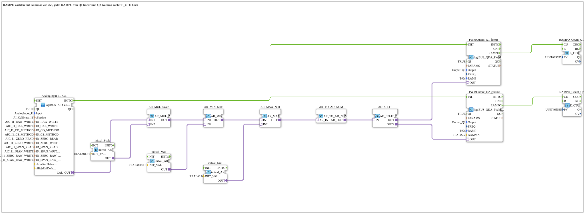

# Uebung_262_AX: RAMPO zählen mit Gamma

* * * * * * * * * *

## Einleitung

Jeder PWM-Baustein meldet mit dem Ereignis `RAMPO`, dass der neue Wert erreicht ist (siehe [`logiBUS_QDA_PWM`](https://meisterschulen-am-ostbahnhof-munchen-docs.readthedocs.io/projects/4diac-library-reference-docs/de/latest/Bibliotheken/ExternalLibraries/logiBUS/io/DO/logiBUS_QDA_PWM/)). Diese Übung zählt die `RAMPO`-Ereignisse mit je einem `E_CTU`, der Zählerstand `CV` wird per Watch gelesen. So lässt sich prüfen, wie oft die Rampe tatsächlich zu Ende läuft, wenn das Poti verstellt wird. Ausgänge: `Q1` linear und `Q2` mit Gamma 2.2, beide `RAMP = T#2s`.

**Voraussetzung (einmalig):** Die Übung nutzt `logiBUS_AI_Calibrate_2P_OPC`. Dazu im `test_AX.sys` den `Button_AI_Calibrate_2P_OPC_UA` als `Control` einsetzen, das Bootfile exportieren und mit dem Web-Client `apixon-ai-calibrate-2p.html` kalibrieren (0 %: `CO`, 100 %: `CS`). Die INI-Datei (Sektion `AI_Calibrate_I1`) bleibt auf der Platine. Danach läuft die Übung ohne VT und ohne Dashboard.

## Verwendete Funktionsbausteine (FBs)

- **AnalogInput_I1_Cal**: Analogeingang I1 mit Zwei-Punkt-Kalibrierung über OPC UA (Typ: `logiBUS_AI_Calibrate_2P_OPC`, Sektion `AI_Calibrate_I1`)
    - **Erklärung**: `CAL_OUT` liefert den kalibrierten Wert 0 bis 100 %. `INITO` startet die PWM-Bausteine.
- **AR_MUL_Scale** (`AR_MUL_2`) mit **initval_Scale** (`initval_AR`, Faktor `81.91`): rechnet den Wert 0 bis 100 % in den Zielbereich um.
- **AR_MIN_Max** (`AR_MIN`) mit **initval_Max** (`8191.0`): begrenzt nach oben.
- **AR_MAX_Null** (`AR_MAX`) mit **initval_Null** (`0`): begrenzt nach unten. Zusammen mit `AR_MIN_Max` bleibt der Wert im Bereich 0 bis 8191.
- **AR_TO_AD_NUM** (`AR_TO_AD_NUM`): wandelt REAL **numerisch** in DWORD und gibt den Wert über den Adapter weiter.
- **AD_SPLIT** (`AD_SPLIT_2`): verteilt den Wert auf 2 PWM-Ausgänge.
- **PWMOutput_Q1_linear** (Typ: `logiBUS_QDA_PWM`, `QI = TRUE`, `Output = Output_Q1`, `RAMP = T#2s`)
    - **Erklärung**: linearer Tastgrad an `Q1`.
- **PWMOutput_Q2_gamma** (Typ: `logiBUS_QDA_PWM_G`, `QI = TRUE`, `Output = Output_Q2`, `RAMP = T#2s`, `GAMMA = 2.2`)
    - **Erklärung**: Gamma-korrigierter Tastgrad an `Q2`.
- **RAMPO_Count_Q1**, **RAMPO_Count_Q2** (`E_CTU`, `PV = 65535`): zählen je die `RAMPO`-Ereignisse von `Q1` bzw. `Q2` hoch. `CV` ist der Zählerstand.

### Sub-Bausteine: keine

## Programmablauf und Verbindungen

1. Der Wert des Potis läuft von `AnalogInput_I1_Cal.CAL_OUT` über `AR_MUL_Scale`, `AR_MIN_Max` und `AR_MAX_Null` nach `AR_TO_AD_NUM` (0 bis 8191). `AD_SPLIT` verteilt den Wert auf `PWMOutput_Q1_linear` und `PWMOutput_Q2_gamma`.
2. `AnalogInput_I1_Cal.INITO` initialisiert beide PWM-Bausteine.
3. `PWMOutput_Q1_linear.RAMPO` geht an `RAMPO_Count_Q1.CU`, `PWMOutput_Q2_gamma.RAMPO` an `RAMPO_Count_Q2.CU`.

## Bedienung

1. Übung `Uebungen::Uebung_262_AX` im `Control` einstellen.
2. Watches auf `RAMPO_Count_Q1.CV` und `RAMPO_Count_Q2.CV` setzen.
3. Das Poti an `I1` einmal verstellen und danach die Zählerstände ablesen. Mit weiteren Verstellungen vergleichen, wie sich die beiden Zähler entwickeln: Bei der kurzen Rampe kann sich der Zähler anders verhalten als bei der langen.

## Zusammenfassung

Die Übung macht das Ereignis `RAMPO` messbar: Ein Zähler je Ausgang zeigt, wie oft die Rampe als beendet gemeldet wird.

---

### 🌐 Passende Themen-Unterseiten auf ms-muc-docs.de

- [🌐 Eclipse 4diac IDE & Farb-Referenz auf ms-muc-docs.de](https://www.ms-muc-docs.de/iec-61499/eclipse-4diac/)
