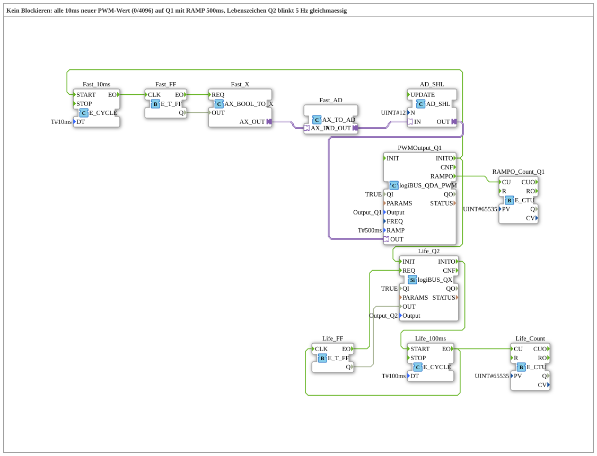

# Uebung_263_AX: Kein Blockieren

* * * * * * * * * *

## Einleitung

Die Rampe von [`logiBUS_QDA_PWM`](https://meisterschulen-am-ostbahnhof-munchen-docs.readthedocs.io/projects/4diac-library-reference-docs/de/latest/Bibliotheken/ExternalLibraries/logiBUS/io/DO/logiBUS_QDA_PWM/) läuft in der Hardware. Diese Übung beweist, dass sie das Programm **nicht blockiert**: Alle 10 ms bekommt `Q1` einen neuen Wert (abwechselnd 0 und 4096) bei `RAMP = T#500ms`. Gleichzeitig blinkt `Q2` als Lebenszeichen mit 5 Hz gleichmäßig. Würde die Rampe das Programm anhalten, würde das Blinken stottern.

## Verwendete Funktionsbausteine (FBs)

- **PWMOutput_Q1** (Typ: `logiBUS_QDA_PWM`, `QI = TRUE`, `Output = Output_Q1`, `RAMP = T#500ms`)
    - **Erklärung**: PWM-Ausgang `Q1` mit 500 ms Rampe. `INITO` startet die beiden Zyklen.
- **Fast_10ms** (`E_CYCLE`, `DT = T#10ms`) → **Fast_FF** (`E_T_FF`): schaltet alle 10 ms den Zustand um.
- **Fast_X** (`AX_BOOL_TO_X`) → **Fast_AD** (`AX_TO_AD`) → **AD_SHL** (`AD_SHL`, `N = UINT#12`): macht aus TRUE/FALSE den Wert 4096 bzw. 0 (1 um 12 Stellen nach links) und gibt ihn an `PWMOutput_Q1.OUT`.
- **RAMPO_Count_Q1** (`E_CTU`, `PV = 65535`): zählt die `RAMPO`-Ereignisse von `Q1`.
- **Life_Q2**: digitaler Ausgang `Q2` (Typ: `logiBUS_QX`, `QI = TRUE`, `Output = Output_Q2`): Lebenszeichen.
- **Life_100ms** (`E_CYCLE`, `DT = T#100ms`) → **Life_FF** (`E_T_FF`): schaltet `Q2` alle 100 ms um, das ergibt 5 Hz.
- **Life_Count** (`E_CTU`, `PV = 65535`): zählt die Umschaltungen des Lebenszeichens.

### Sub-Bausteine: keine

## Programmablauf und Verbindungen

1. `PWMOutput_Q1.INITO` startet `Fast_10ms` und initialisiert `Life_Q2`, dessen `INITO` startet `Life_100ms`.
2. Alle 10 ms schaltet `Fast_FF` um; der Wert 4096 oder 0 geht an `PWMOutput_Q1.OUT`. Weil die Rampe 500 ms dauert, kommt der nächste Wert, bevor sie zu Ende sein kann.
3. Alle 100 ms schaltet `Life_FF` den Ausgang `Q2` um.
4. `PWMOutput_Q1.RAMPO` zählt `RAMPO_Count_Q1`.

## Bedienung

1. Übung `Uebungen::Uebung_263_AX` im `Control` einstellen.
2. `Q2` beobachten (LED oder Oszilloskop): Das Blinken bleibt bei 5 Hz gleichmäßig, obwohl `Q1` ständig neue Werte bekommt.
3. Watches auf `RAMPO_Count_Q1.CV` und `Life_Count.CV` setzen und vergleichen.

## Zusammenfassung

Die Übung zeigt, dass die Hardware-Rampe das Programm nicht blockiert: Der schnelle Wertewechsel an `Q1` stört das gleichmäßige Blinken an `Q2` nicht.

---

### 🌐 Passende Themen-Unterseiten auf ms-muc-docs.de

- [🌐 Eclipse 4diac IDE & Farb-Referenz auf ms-muc-docs.de](https://www.ms-muc-docs.de/iec-61499/eclipse-4diac/)
