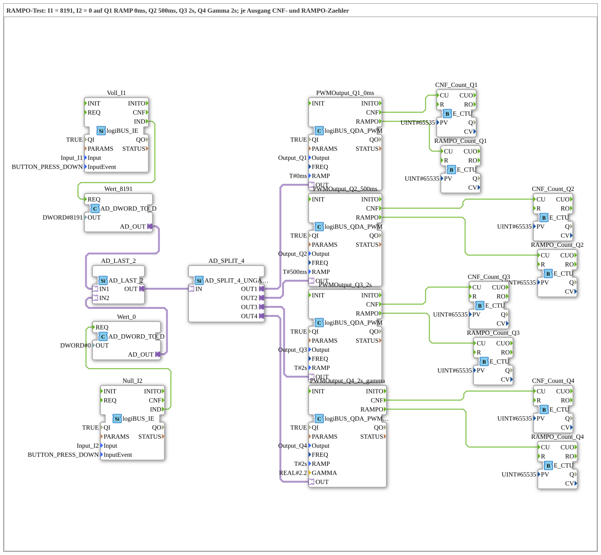

# Uebung_264_AX: RAMPO-Test mit vier Ausgängen

* * * * * * * * * *

## Einleitung

Zwei Taster setzen denselben Wert auf vier PWM-Ausgänge mit unterschiedlicher Rampe: `I1` = 8191 (voll), `I2` = 0. `Q1` hat `RAMP = T#0ms`, `Q2` 500 ms, `Q3` 2 s, `Q4` 2 s mit Gamma 2.2. Je Ausgang zählt ein `E_CTU` die Bestätigungen (`CNF`) und ein weiterer die Rampenenden (`RAMPO`). So lässt sich vergleichen, wie sich `CNF` und `RAMPO` je nach Rampenzeit verhalten (siehe [`logiBUS_QDA_PWM`](https://meisterschulen-am-ostbahnhof-munchen-docs.readthedocs.io/projects/4diac-library-reference-docs/de/latest/Bibliotheken/ExternalLibraries/logiBUS/io/DO/logiBUS_QDA_PWM/)).

## Verwendete Funktionsbausteine (FBs)

- **Voll_I1** ([`logiBUS_IE`](https://meisterschulen-am-ostbahnhof-munchen-docs.readthedocs.io/projects/4diac-library-reference-docs/de/latest/Bibliotheken/ExternalLibraries/logiBUS/io/DI/logiBUS_IE/), `InputEvent = BUTTON_PRESS_DOWN`) → **Wert_8191** (`AD_DWORD_TO_D`, `OUT = DWORD#8191`)
- **Null_I2** ([`logiBUS_IE`](https://meisterschulen-am-ostbahnhof-munchen-docs.readthedocs.io/projects/4diac-library-reference-docs/de/latest/Bibliotheken/ExternalLibraries/logiBUS/io/DI/logiBUS_IE/), `InputEvent = BUTTON_PRESS_DOWN`) → **Wert_0** (`AD_DWORD_TO_D`, `OUT = DWORD#0`)
- **AD_LAST_2** ([`AD_LAST_2`](https://meisterschulen-am-ostbahnhof-munchen-docs.readthedocs.io/projects/4diac-library-reference-docs/de/latest/Bibliotheken/ExternalLibraries/adapter/events/unidirectional/DWORD/AD_LAST_2/)): führt die beiden Werte zusammen, der zuletzt gedrückte Taster gewinnt.
- **AD_SPLIT_4** (`AD_SPLIT_4_UNGATED`): verteilt den Wert auf vier Ausgänge.
- **PWMOutput_Q1_0ms** (Typ: `logiBUS_QDA_PWM`, `QI = TRUE`, `Output = Output_Q1`, `RAMP = T#0ms`)
    - **Erklärung**: PWM-Ausgang `Q1` mit der Rampenzeit `T#0ms`.
- **PWMOutput_Q2_500ms** (Typ: `logiBUS_QDA_PWM`, `QI = TRUE`, `Output = Output_Q2`, `RAMP = T#500ms`)
    - **Erklärung**: PWM-Ausgang `Q2` mit der Rampenzeit `T#500ms`.
- **PWMOutput_Q3_2s** (Typ: `logiBUS_QDA_PWM`, `QI = TRUE`, `Output = Output_Q3`, `RAMP = T#2s`)
    - **Erklärung**: PWM-Ausgang `Q3` mit der Rampenzeit `T#2s`.
- **PWMOutput_Q4_2s_gamma** (Typ: `logiBUS_QDA_PWM_G`, `QI = TRUE`, `Output = Output_Q4`, `RAMP = T#2s`, `GAMMA = 2.2`)
    - **Erklärung**: Gamma-korrigierter PWM-Ausgang `Q4` (siehe [`logiBUS_QDA_PWM_G`](https://meisterschulen-am-ostbahnhof-munchen-docs.readthedocs.io/projects/4diac-library-reference-docs/de/latest/Bibliotheken/ExternalLibraries/logiBUS/io/DO/logiBUS_QDA_PWM_G/)).
- **CNF_Count_Q1** bis **CNF_Count_Q4**, **RAMPO_Count_Q1** bis **RAMPO_Count_Q4** (`E_CTU`, `PV = 65535`): zählen je `CNF` bzw. `RAMPO` des zugehörigen PWM-Bausteins.

### Sub-Bausteine: keine

## Programmablauf und Verbindungen

1. `I1` bzw. `I2` liefert den Wert 8191 bzw. 0 an `AD_LAST_2`, von dort geht er über `AD_SPLIT_4` an alle vier PWM-Bausteine.
2. Jeder PWM-Baustein bestätigt mit `CNF` (an `CNF_Count_Qn.CU`) und meldet das Ende der Rampe mit `RAMPO` (an `RAMPO_Count_Qn.CU`).
3. Bei `Q1` (`T#0ms`) kommt `RAMPO` direkt nach dem Sprung, bei den anderen erst nach Ablauf der Rampe.

## Bedienung

1. Übung `Uebungen::Uebung_264_AX` im `Control` einstellen.
2. Watches auf `CNF_Count_Q1.CV` bis `CNF_Count_Q4.CV` und `RAMPO_Count_Q1.CV` bis `RAMPO_Count_Q4.CV` setzen.
3. `I1` und `I2` abwechselnd mit Pausen drücken und die Zähler ablesen. Dann `I1` und `I2` schnell hintereinander drücken, bevor die Rampe fertig ist, und vergleichen, wie sich die `RAMPO`-Zähler gegenüber den `CNF`-Zählern verhalten.

## Zusammenfassung

Die Übung ist ein Test für `CNF` und `RAMPO` bei verschiedenen Rampenzeiten, mit linearer und Gamma-Ausgabe, jeweils mit Zählern zum Ablesen.

---

### 🌐 Passende Themen-Unterseiten auf ms-muc-docs.de

- [🌐 Eclipse 4diac IDE & Farb-Referenz auf ms-muc-docs.de](https://www.ms-muc-docs.de/iec-61499/eclipse-4diac/)
