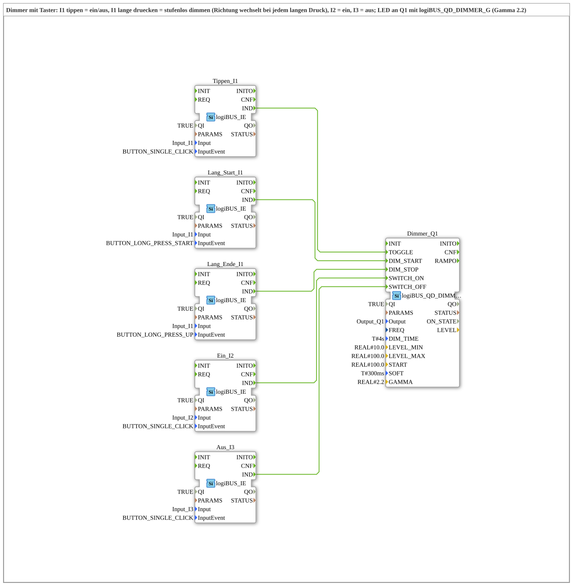

# Uebung_265_AX: Dimmer mit Taster: I1 tippen = ein/aus, I1 lange druecken = stufenlos dimmen …

Dieser Artikel beschreibt die 4diac IDE Subapplikation Uebung_265_AX (Dimmer mit Taster: I1 tippen = ein/aus, I1 lange druecken = stufenlos dimmen (Richtung wechselt bei jedem langen Druck), I2 = ein, I3 = aus; LED an Q1 mit logiBUS_QD_DIMMER_G (Gamma 2.2)).

----

## Ziel der Übung

Das Ziel dieser Übung ist die Umsetzung folgender Anforderung: **Dimmer mit Taster: I1 tippen = ein/aus, I1 lange druecken = stufenlos dimmen (Richtung wechselt bei jedem langen Druck), I2 = ein, I3 = aus; LED an Q1 mit logiBUS_QD_DIMMER_G (Gamma 2.2)**

-----

## Beschreibung und Komponenten

Die Übung besteht aus der Subapplikation Uebung_265_AX.SUB, welche die folgende Bausteinstruktur verwendet:

### Verwendete Funktionsbausteine (FBs)

- **Tippen_I1**: Instanz des Typs logiBUS::io::DI::logiBUS_IE.
  - Parameter QI = TRUE
  - Parameter Input = Input_I1
  - Parameter InputEvent = BUTTON_SINGLE_CLICK
- **Lang_Start_I1**: Instanz des Typs logiBUS::io::DI::logiBUS_IE.
  - Parameter QI = TRUE
  - Parameter Input = Input_I1
  - Parameter InputEvent = BUTTON_LONG_PRESS_START
- **Lang_Ende_I1**: Instanz des Typs logiBUS::io::DI::logiBUS_IE.
  - Parameter QI = TRUE
  - Parameter Input = Input_I1
  - Parameter InputEvent = BUTTON_LONG_PRESS_UP
- **Ein_I2**: Instanz des Typs logiBUS::io::DI::logiBUS_IE.
  - Parameter QI = TRUE
  - Parameter Input = Input_I2
  - Parameter InputEvent = BUTTON_SINGLE_CLICK
- **Aus_I3**: Instanz des Typs logiBUS::io::DI::logiBUS_IE.
  - Parameter QI = TRUE
  - Parameter Input = Input_I3
  - Parameter InputEvent = BUTTON_SINGLE_CLICK
- **Dimmer_Q1**: Instanz des Typs logiBUS::io::DQ::logiBUS_QD_DIMMER_G.
  - Parameter QI = TRUE
  - Parameter Output = Output_Q1
  - Parameter DIM_TIME = T#4s
  - Parameter LEVEL_MIN = 10.0
  - Parameter LEVEL_MAX = 100.0
  - Parameter START = 100.0
  - Parameter SOFT = T#300ms
  - Parameter GAMMA = 2.2

-----

## Zusammenfassung

Die Übung Uebung_265_AX demonstriert die modulare IEC 61499 Architektur in 4diac IDE.
