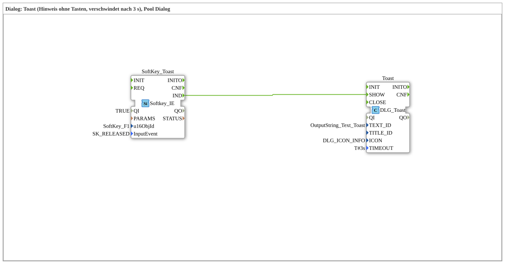

# Uebung_269_AX: Dialog: Toast (Hinweis ohne Tasten, verschwindet nach 3 s), Pool Dialog

Dieser Artikel beschreibt die 4diac IDE Subapplikation Uebung_269_AX (Dialog: Toast (Hinweis ohne Tasten, verschwindet nach 3 s), Pool Dialog).

----

## Ziel der Übung

Das Ziel dieser Übung ist die Umsetzung folgender Anforderung: **Dialog: Toast (Hinweis ohne Tasten, verschwindet nach 3 s), Pool Dialog**

-----

## Beschreibung und Komponenten

Die Übung besteht aus der Subapplikation Uebung_269_AX.SUB, welche die folgende Bausteinstruktur verwendet:

### Verwendete Funktionsbausteine (FBs)

- **SoftKey_Toast**: Instanz des Typs isobus::UT::io::Softkey::Softkey_IE.
  - Parameter QI = TRUE
  - Parameter u16ObjId = SoftKey_F1
  - Parameter InputEvent = SK_RELEASED
- **Toast**: Instanz des Typs isobus::UT::dialog::DLG_Toast.
  - Parameter TEXT_ID = OutputString_Text_Toast
  - Parameter ICON = DLG_ICON_INFO
  - Parameter TIMEOUT = T#3s

-----

## Zusammenfassung

Die Übung Uebung_269_AX demonstriert die modulare IEC 61499 Architektur in 4diac IDE.
