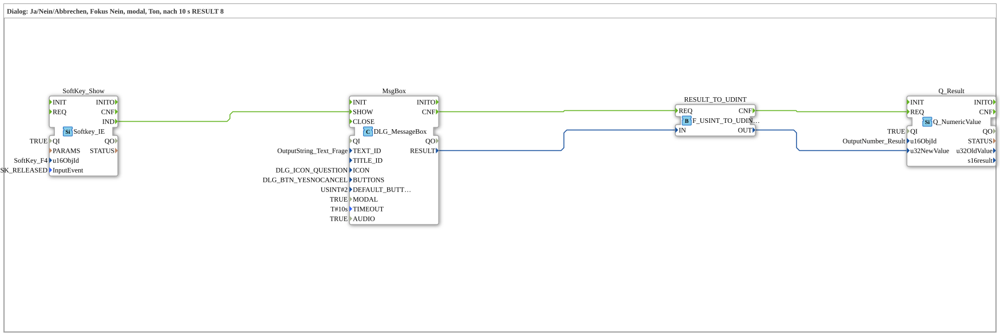

# Uebung_272_AX: Dialog: Ja/Nein/Abbrechen, Fokus Nein, modal, Ton, nach 10 s RESULT 8

Dieser Artikel beschreibt die 4diac IDE Subapplikation Uebung_272_AX (Dialog: Ja/Nein/Abbrechen, Fokus Nein, modal, Ton, nach 10 s RESULT 8).

----

## Ziel der Übung

Das Ziel dieser Übung ist die Umsetzung folgender Anforderung: **Dialog: Ja/Nein/Abbrechen, Fokus Nein, modal, Ton, nach 10 s RESULT 8**

-----

## Beschreibung und Komponenten

Die Übung besteht aus der Subapplikation Uebung_272_AX.SUB, welche die folgende Bausteinstruktur verwendet:

### Verwendete Funktionsbausteine (FBs)

- **SoftKey_Show**: Instanz des Typs isobus::UT::io::Softkey::Softkey_IE.
  - Parameter QI = TRUE
  - Parameter u16ObjId = SoftKey_F4
  - Parameter InputEvent = SK_RELEASED
- **MsgBox**: Instanz des Typs isobus::UT::dialog::DLG_MessageBox.
  - Parameter TEXT_ID = OutputString_Text_Frage
  - Parameter ICON = DLG_ICON_QUESTION
  - Parameter BUTTONS = DLG_BTN_YESNOCANCEL
  - Parameter DEFAULT_BUTTON = USINT#2
  - Parameter MODAL = TRUE
  - Parameter TIMEOUT = T#10s
  - Parameter AUDIO = TRUE
- **RESULT_TO_UDINT**: Instanz des Typs iec61131::conversion::F_USINT_TO_UDINT.
- **Q_Result**: Instanz des Typs isobus::UT::Q::Q_NumericValue.
  - Parameter QI = TRUE
  - Parameter u16ObjId = OutputNumber_Result

-----

## Zusammenfassung

Die Übung Uebung_272_AX demonstriert die modulare IEC 61499 Architektur in 4diac IDE.
