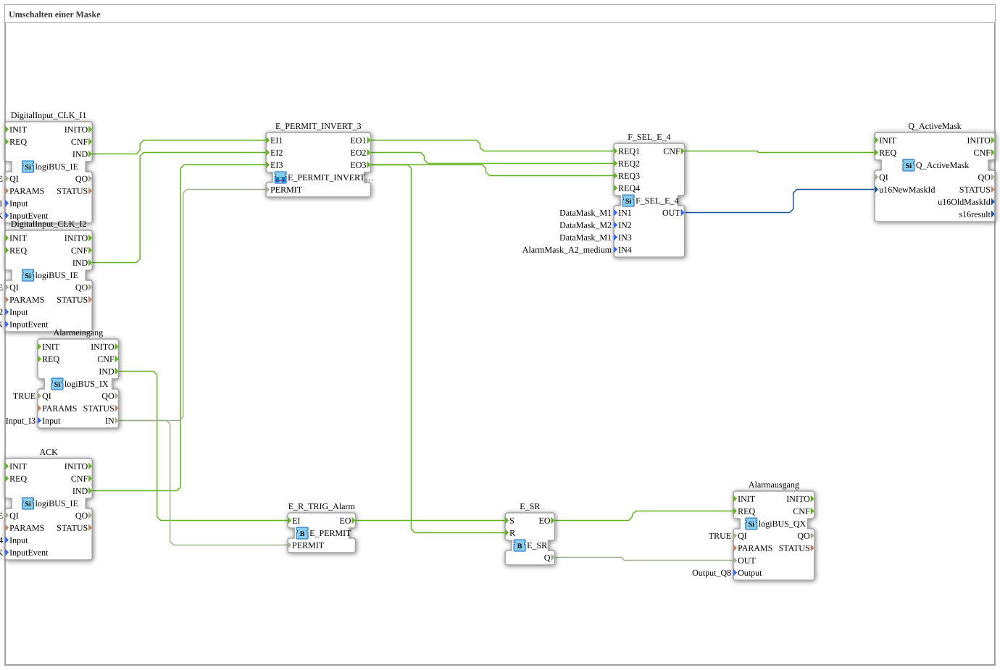

# Uebung_019c: Umschalten einer Maske

* * * * * * * * * *

## Einleitung

Dieser Artikel beschreibt die logiBUS®-Übung `Uebung_019c`. Dies ist die komplexeste Navigations-Logik, bei der die Maskenumschaltung aktiv vom Hardware-Zustand blockiert werden kann: Solange der Alarmeingang `I3` aktiv ist, werden die Navigations-Ereignisse nicht an die Maskenauswahl weitergegeben.

Ziel ist die Implementierung einer bedingten Navigationssteuerung. Der Wechsel der Bildschirmseiten soll unterbunden werden, solange ein aktiver Alarm anliegt.

## Verwendete Funktionsbausteine (FBs)

- **DigitalInput_CLK_I1**: logiBUS Eingang mit Klick-Erkennung
    - **Typ**: `logiBUS::io::DI::logiBUS_IE`
    - **Parameter**: `QI = TRUE`, `Input = Input_I1`, `InputEvent = BUTTON_SINGLE_CLICK`
    - **Erklärung**: Meldet einen Einzelklick auf `I1` als Event `IND` (Wunsch: Maske 1).
- **DigitalInput_CLK_I2**: logiBUS Eingang mit Klick-Erkennung
    - **Typ**: `logiBUS::io::DI::logiBUS_IE`
    - **Parameter**: `QI = TRUE`, `Input = Input_I2`, `InputEvent = BUTTON_SINGLE_CLICK`
    - **Erklärung**: Meldet einen Einzelklick auf `I2` als Event `IND` (Wunsch: Maske 2).
- **ACK**: physischer Quittier-Taster anstelle eines Softkeys
    - **Typ**: `logiBUS::io::DI::logiBUS_IE`
    - **Parameter**: `QI = TRUE`, `Input = Input_I4`, `InputEvent = BUTTON_SINGLE_CLICK`
    - **Erklärung**: Meldet einen Einzelklick auf `I4` als Event `IND`.
- **Alarmeingang**: physischer Alarm-Sensor
    - **Typ**: `logiBUS::io::DI::logiBUS_IX`
    - **Parameter**: `QI = TRUE`, `Input = Input_I3`
    - **Erklärung**: Liefert den Zustand `IN` von `I3` samt Ereignis `IND`. Solange `IN` TRUE ist, herrscht Alarmzustand.
- **E_PERMIT_INVERT_3**: dreikanaliges, invertiertes Event-Freigabe-Gate (SubApp-Instanz)
    - **Typ**: `MyLib::sys::E_PERMIT_INVERT_3`
    - **Parameter**: keine
    - **Erklärung**: Lässt die Ereignisse `EI1`..`EI3` nur dann als `EO1`..`EO3` durch, wenn `PERMIT` FALSE ist. Intern besteht der Baustein aus `F_NOT_BOOL_INIT` (invertiert `PERMIT`) und `E_PERMIT_3`. Hier wird `PERMIT` vom `Alarmeingang` gespeist: kein Alarm = Ereignisse werden durchgelassen, Alarm = Ereignisse werden blockiert.
- **F_SEL_E_4**: ereignisgesteuerte Auswahl aus vier Werten
    - **Typ**: `eclipse4diac::utils::selection::F_SEL_E_4`
    - **Parameter**: `IN1 = DataMask_M1`, `IN2 = DataMask_M2`, `IN3 = DataMask_M1`, `IN4 = AlarmMask_A2_medium`
    - **Erklärung**: Je nach eingetroffenem Ereignis `REQ1`..`REQ4` wird der zugehörige Wert `IN1`..`IN4` auf `OUT` gelegt und `CNF` gemeldet. Verbunden sind `REQ1`, `REQ2` und `REQ3`; `REQ4` (und damit `AlarmMask_A2_medium`) ist in diesem Netzwerk nicht verdrahtet.
- **Q_ActiveMask**: Wechsel der aktiven Maske
    - **Typ**: `isobus::UT::Q::Q_ActiveMask`
    - **Parameter**: keine
    - **Erklärung**: Setzt die vom `F_SEL_E_4` gelieferte Masken-ID (`u16NewMaskId`) als aktive Maske, ausgelöst durch `REQ`.
- **E_R_TRIG_Alarm**: Freigabe-Gate für den Alarm-Start
    - **Typ**: `iec61499::events::E_PERMIT`
    - **Parameter**: keine
    - **Erklärung**: Leitet das Ereignis `IND` des `Alarmeingang` nur dann als `EO` weiter, wenn `PERMIT` (= `Alarmeingang.IN`) TRUE ist.
- **E_SR**: Alarmspeicher
    - **Typ**: `iec61499::events::E_SR`
    - **Parameter**: keine
    - **Erklärung**: `S` setzt den Speicher (Alarm eingetreten), `R` setzt ihn zurück (quittiert). Ausgang `Q` mit Ereignis `EO`.
- **Alarmausgang**: logiBUS Digitalausgang für die Alarmanzeige
    - **Typ**: `logiBUS::io::DQ::logiBUS_QX`
    - **Parameter**: `QI = TRUE`, `Output = Output_Q8`
    - **Erklärung**: Schaltet den physischen Ausgang `Q8` gemäß `E_SR.Q`.

## Programmablauf und Verbindungen

1. `DigitalInput_CLK_I1.IND` → `E_PERMIT_INVERT_3.EI1`, `DigitalInput_CLK_I2.IND` → `E_PERMIT_INVERT_3.EI2` und `ACK.IND` → `E_PERMIT_INVERT_3.EI3`: alle drei Bedien-Ereignisse laufen zuerst durch das invertierte Freigabe-Gate.
2. `Alarmeingang.IN` → `E_PERMIT_INVERT_3.PERMIT`: das Gate prüft vor jeder Aktion den Alarmeingang.
    - Ist **kein** Alarm vorhanden (`IN = FALSE`), wird das Ereignis durchgelassen: `E_PERMIT_INVERT_3.EO1` → `F_SEL_E_4.REQ1`, `EO2` → `REQ2`, `EO3` → `REQ3`. Die Seite wechselt.
    - Ist ein Alarm aktiv (`IN = TRUE`), wird das Ereignis blockiert. Der Seitenwechsel wird **ignoriert**.
3. `F_SEL_E_4.OUT` → `Q_ActiveMask.u16NewMaskId` und `F_SEL_E_4.CNF` → `Q_ActiveMask.REQ`: die gewählte Maske (`DataMask_M1` für `I1`, `DataMask_M2` für `I2`, `DataMask_M1` für `ACK`) wird aktiv.
4. `Alarmeingang.IND` → `E_R_TRIG_Alarm.EI` und `Alarmeingang.IN` → `E_R_TRIG_Alarm.PERMIT`: ein Ereignis von `I3` wird nur bei aktivem Alarm (`IN = TRUE`) weitergeleitet.
5. `E_R_TRIG_Alarm.EO` → `E_SR.S`: der Alarmspeicher wird gesetzt.
6. `E_PERMIT_INVERT_3.EO3` → `E_SR.R`: der Quittier-Taster `I4` setzt den Speicher zurück, aber nur, wenn der Alarmeingang `I3` wieder FALSE ist (sonst blockiert das Gate das Ereignis).
7. `E_SR.EO` → `Alarmausgang.REQ` und `E_SR.Q` → `Alarmausgang.OUT`: der Ausgang `Q8` folgt dem Alarmspeicher.

**Verhalten**: Solange `I3` aktiv ist, bleiben `I1`, `I2` und `I4` wirkungslos. Erst wenn der Alarm-Sensor (`I3`) wieder FALSE ist **UND** der Nutzer den Quittier-Taster (`I4`) drückt, wird der Speicher zurückgesetzt und gleichzeitig auf `DataMask_M1` gewechselt; die Navigation ist dann wieder frei.

## Zusammenfassung

Die Übung zeigt, wie ein invertiertes Event-Freigabe-Gate (`E_PERMIT_INVERT_3`) die Maskenumschaltung vom Hardware-Zustand abhängig macht: ein aktiver Alarm sperrt die Navigation, und erst das Quittieren bei zurückgenommenem Alarm gibt sie wieder frei.

**Anwendungsbeispiel - zwingende Störungsbehebung**: Bei einem kritischen Hardware-Fehler (z.B. Not-Aus betätigt) darf der Bediener das Terminal nicht weiter zur normalen Maschinensteuerung nutzen. Er wird auf der Alarmseite "festgehalten", bis der Not-Aus entriegelt und die Störung quittiert wurde. Dies erzwingt die Aufmerksamkeit für das vorrangige Sicherheitsproblem.

---

### 🌐 Passende Themen-Unterseiten auf ms-muc-docs.de

- [🌐 Eclipse 4diac IDE & Farb-Referenz auf ms-muc-docs.de](https://www.ms-muc-docs.de/iec-61499/eclipse-4diac/)
