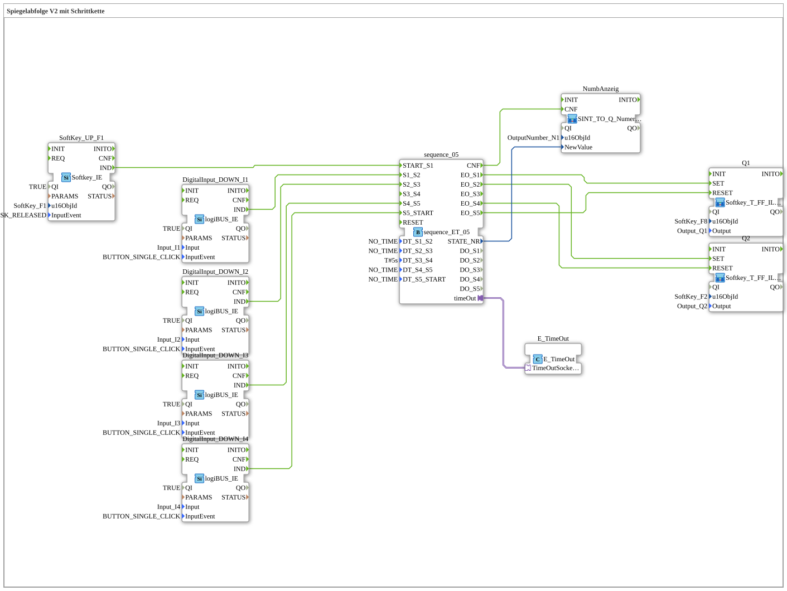

# Uebung_039a: Spiegelabfolge V2 mit Schrittkette

* * * * * * * * * *

## Einleitung

Diese Übung ist eine Spezialisierung der Ventilsteuerung für Systeme mit 3/2-Wege-Ventilen (z. B. hydraulische Ringsysteme wie bei Claas). Die Schrittkette `sequence_ET_05` verwaltet den Ablauf der Zylinderbewegungen. Die Ansteuerung der physischen Ausgänge `Q1` und `Q2` erfolgt über je eine Instanz des Bausteins `Softkey_T_FF_ILOCK_TO_QX_BG`, die zusätzlich ein direktes visuelles Feedback auf dem ISOBUS-Softkey liefert. Die aktuelle Schrittnummer wird auf einem VT-Zahlenfeld angezeigt. Dies demonstriert die Anpassbarkeit der logiBUS-Sequenz-Bausteine an verschiedene hydraulische Verschaltungskonzepte.

## Verwendete Funktionsbausteine (FBs)

- **SoftKey_UP_F1**: Softkey-Eingang für den Start
    - **Typ**: [`isobus::UT::io::Softkey::Softkey_IE`](https://meisterschulen-am-ostbahnhof-munchen-docs.readthedocs.io/projects/4diac-library-reference-docs/de/latest/Bibliotheken/ExternalLibraries/isobus/UT/io/Softkey/Softkey_IE/)
    - **Parameter**: `QI = TRUE`, `u16ObjId = SoftKey_F1`, `InputEvent = SK_RELEASED`
    - **Erklärung**: Meldet das Loslassen des Softkeys `SoftKey_F1` als Ereignis `IND`.
- **DigitalInput_DOWN_I1** ... **DigitalInput_DOWN_I4**: Klick-Eingänge für die manuellen Schrittübergänge
    - **Typ**: [`logiBUS::io::DI::logiBUS_IE`](https://meisterschulen-am-ostbahnhof-munchen-docs.readthedocs.io/projects/4diac-library-reference-docs/de/latest/Bibliotheken/ExternalLibraries/logiBUS/io/DI/logiBUS_IE/)
    - **Parameter**: `QI = TRUE`, `Input = Input_I1` bzw. `Input_I2`, `Input_I3`, `Input_I4`, jeweils `InputEvent = BUTTON_SINGLE_CLICK`
    - **Erklärung**: Melden einen Einzelklick auf `I1` bis `I4` als Ereignis `IND`.
- **sequence_05**: Schrittkette
    - **Typ**: [`logiBUS::utils::sequence::combi::sequence_ET_05`](https://meisterschulen-am-ostbahnhof-munchen-docs.readthedocs.io/projects/4diac-library-reference-docs/de/latest/Bibliotheken/ExternalLibraries/logiBUS/utils/sequence/combi/sequence_ET_05/)
    - **Parameter**: `DT_S1_S2 = NO_TIME`, `DT_S2_S3 = NO_TIME`, `DT_S3_S4 = T#5s`, `DT_S4_S5 = NO_TIME`, `DT_S5_START = NO_TIME`
    - **Erklärung**: Fünf Schritte mit Start-Zustand. Jeder Übergang erfolgt ereignisgesteuert oder zeitgesteuert; `NO_TIME` schaltet die Zeitsteuerung ab. Hier läuft nur der Übergang von Schritt 3 nach Schritt 4 automatisch nach 5 s, alle anderen Übergänge sind manuell. Der Baustein liefert beim Eintritt in Schritt n das Ereignis `EO_Sn` und bei jedem Wechsel `CNF` mit der Schrittnummer `STATE_NR`.
- **E_TimeOut**: Zeitgeber der Schrittkette
    - **Typ**: [`iec61499::events::E_TimeOut`](https://meisterschulen-am-ostbahnhof-munchen-docs.readthedocs.io/projects/4diac-library-reference-docs/de/latest/Bibliotheken/StandardLibraries/events/E_TimeOut/)
    - **Parameter**: keine
    - **Erklärung**: Stellt über den Adapter `TimeOutSocket` die Zeitüberwachung für die zeitgesteuerten Übergänge von `sequence_05` bereit.
- **Q1**: Ausgang `Q1` mit Softkey-Feedback
    - **Typ**: [`MyLib::sys::Softkey_T_FF_ILOCK_TO_QX_BG`](https://meisterschulen-am-ostbahnhof-munchen-docs.readthedocs.io/projects/4diac-library-reference-docs/de/latest/Bibliotheken/ExternalLibraries/MyLib_B/sys/Softkey_T_FF_ILOCK_TO_QX_BG/) (SubApp-Instanz)
    - **Parameter**: `u16ObjId = SoftKey_F8`, `Output = Output_Q1`
    - **Erklärung**: Digitalausgang als Toggle-Flip-Flop: Ein Loslassen des Softkeys `SoftKey_F8` kippt den Ausgang, zusätzlich können die Ereignisse `SET` und `RESET` den Ausgang von außen setzen bzw. zurücksetzen (Verriegelung). Die Hintergrundfarbe des Softkeys spiegelt den Zustand.
- **Q2**: Ausgang `Q2` mit Softkey-Feedback
    - **Typ**: [`MyLib::sys::Softkey_T_FF_ILOCK_TO_QX_BG`](https://meisterschulen-am-ostbahnhof-munchen-docs.readthedocs.io/projects/4diac-library-reference-docs/de/latest/Bibliotheken/ExternalLibraries/MyLib_B/sys/Softkey_T_FF_ILOCK_TO_QX_BG/) (SubApp-Instanz)
    - **Parameter**: `u16ObjId = SoftKey_F2`, `Output = Output_Q2`
    - **Erklärung**: Wie `Q1`, jedoch für den Softkey `SoftKey_F2` und den Ausgang `Q2`.
- **NumbAnzeig**: Anzeige der Schrittnummer
    - **Typ**: [`MyLib::sys::SINT_TO_Q_NumericValue`](https://meisterschulen-am-ostbahnhof-munchen-docs.readthedocs.io/projects/4diac-library-reference-docs/de/latest/Bibliotheken/ExternalLibraries/MyLib_B/sys/SINT_TO_Q_NumericValue/) (SubApp-Instanz)
    - **Parameter**: `u16ObjId = OutputNumber_N1`
    - **Erklärung**: Wandelt den SINT-Wert `NewValue` in UINT um und zeigt ihn auf dem VT-Zahlenfeld `OutputNumber_N1` an.

## Programmablauf und Verbindungen

1. `SoftKey_UP_F1.IND` → `sequence_05.START_S1` (EventConnection): Das Loslassen von `SoftKey_F1` startet die Schrittkette in Schritt 1.
2. `DigitalInput_DOWN_I1.IND` → `sequence_05.S1_S2`, `DigitalInput_DOWN_I2.IND` → `sequence_05.S2_S3`, `DigitalInput_DOWN_I3.IND` → `sequence_05.S4_S5` und `DigitalInput_DOWN_I4.IND` → `sequence_05.S5_START`: Ein Klick auf `I1`, `I2`, `I3` bzw. `I4` schaltet manuell von Schritt 1 nach 2, von 2 nach 3, von 4 nach 5 bzw. von 5 zurück zum Start. Der Übergang von Schritt 3 nach 4 ist nicht verdrahtet und läuft zeitgesteuert nach `DT_S3_S4 = T#5s`.
3. `sequence_05.timeOut` → `E_TimeOut.TimeOutSocket` (AdapterConnection): Die Zeitsteuerung der Schrittkette.
4. `sequence_05.EO_S1` → `Q1.SET`: In Schritt 1 wird `Q1` gesetzt.
5. `sequence_05.EO_S2` → `Q2.SET`: In Schritt 2 wird `Q2` gesetzt.
6. `sequence_05.EO_S4` → `Q2.RESET`: In Schritt 4 wird `Q2` zurückgesetzt.
7. `sequence_05.EO_S5` → `Q1.RESET`: In Schritt 5 wird `Q1` zurückgesetzt.
8. `sequence_05.CNF` → `NumbAnzeig.CNF` (EventConnection) und `sequence_05.STATE_NR` → `NumbAnzeig.NewValue` (DataConnection): Bei jedem Schrittwechsel wird die Schrittnummer auf dem VT angezeigt.

**Verhalten (Spiegelabfolge)**: `Q1` wird in Schritt 1 gesetzt und erst in Schritt 5 zurückgesetzt; `Q2` wird in Schritt 2 gesetzt und in Schritt 4 zurückgesetzt. Die Ausgänge werden also in spiegelbildlicher Reihenfolge ein- und ausgeschaltet.

## Zusammenfassung

Die Übung zeigt, wie eine fünfstufige Schrittkette (`sequence_ET_05`) zwei Ausgänge in einer Spiegelabfolge setzt und zurücksetzt, wobei Übergänge teils manuell über Klick-Eingänge und teils zeitgesteuert erfolgen. Die Ausgangsbausteine geben auf den Softkeys visuelles Feedback, und die aktuelle Schrittnummer wird auf dem VT angezeigt.

---

### 🌐 Passende Themen-Unterseiten auf ms-muc-docs.de

- [🌐 Eclipse 4diac IDE & Farb-Referenz auf ms-muc-docs.de](https://www.ms-muc-docs.de/iec-61499/eclipse-4diac/)
