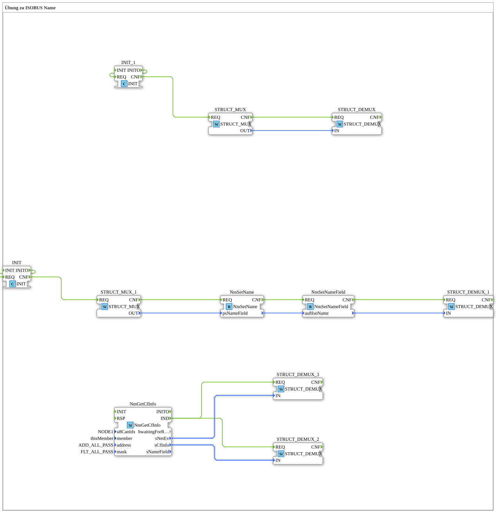

# Uebung_121: Übung zu ISOBUS Name

Dieser Artikel beschreibt die logiBUS®-Übung `Uebung_121`.

----

## Übersicht

In dieser Übung wird das Gegenstück zu 120 gezeigt: Das Auslesen der eigenen Identität.
Über den Parameter `member = thisMember` am Baustein `NmGetCfInfo` liefert die Steuerung ihren eigenen 64-Bit Namen zurück. Mit dem Baustein `NmSetName` können zudem die einzelnen Felder der eigenen Identität (z.B. die Funktions-Instanz) zur Laufzeit dynamisch angepasst werden, bevor sie über den Bus kommuniziert werden.

## Muster mit `NmGetCfInfo` (IND/RSP)

`NmGetCfInfo` meldet ein Netzwerkereignis mit `IND` und wartet danach auf `RSP` (`bwaitingForRSP = TRUE`). Erst nach `RSP` liefert der Baustein das nächste Ereignis aus seiner internen Warteschlange. Diese Übung ist deshalb so aufgebaut:

- `NmGetCfInfo.sNetEv` geht an `STRUCT_DEMUX`, dessen `CNF` an `NmGetCfInfo.RSP` (reine Anzeige, die Verbindung ist in der IDE ausgeblendet).

Stand der Umstellung: 2026-11-17, noch nicht auf Hardware getestet.
