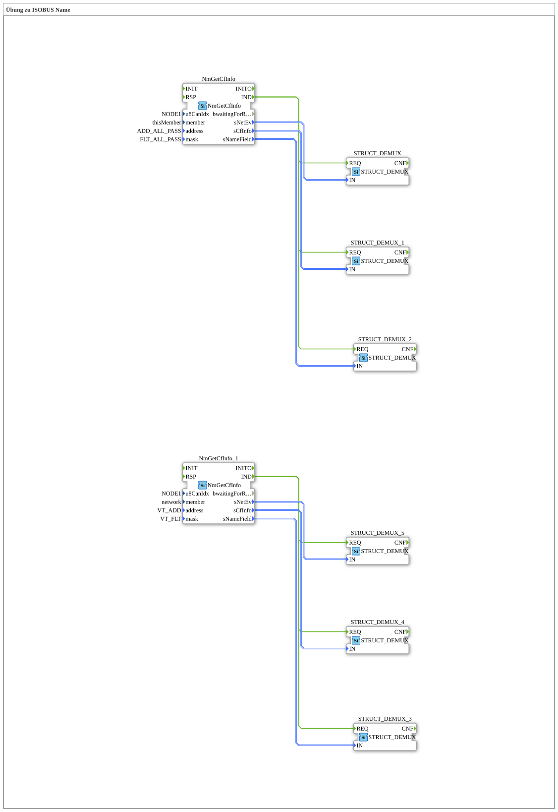

# Uebung_123: Übung zu ISOBUS Name

Dieser Artikel beschreibt die logiBUS®-Übung `Uebung_123`.

----

## Übersicht

Hier wird gezeigt, wie man den Netzwerk-Scan gezielt auf bestimmte Gerätetypen einschränkt.
Durch die Angabe einer Zieladresse (`VT_ADD`) und einer Maske (`VT_FLT`) am Baustein `NmGetCfInfo_1` wird das Programm so konfiguriert, dass es nur auf Teilnehmer reagiert, die dem Profil eines "Virtual Terminals" (VT) entsprechen. Alle anderen Bus-Teilnehmer (z.B. Joysticks oder Task Controller) werden von diesem Baustein ignoriert. Dies ermöglicht eine saubere Trennung der Kommunikationslogik nach Funktionsgruppen.

## Muster mit `NmGetCfInfo` (IND/RSP)

`NmGetCfInfo` meldet ein Netzwerkereignis mit `IND` und wartet danach auf `RSP` (`bwaitingForRSP = TRUE`). Erst nach `RSP` liefert der Baustein das nächste Ereignis aus seiner internen Warteschlange. Diese Übung ist deshalb so aufgebaut:

- `NmGetCfInfo.sNetEv` geht an `STRUCT_DEMUX`, dessen `CNF` an `NmGetCfInfo.RSP` (reine Anzeige, die Verbindung ist in der IDE ausgeblendet).

Stand der Umstellung: 2026-11-17, noch nicht auf Hardware getestet.
