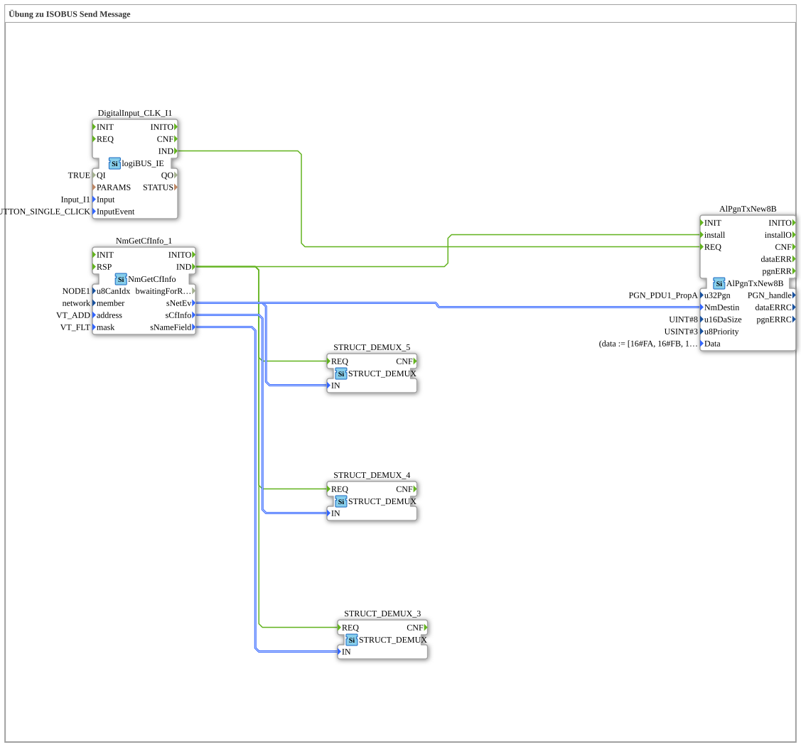

# Uebung_124: Übung zu ISOBUS Send Message

Dieser Artikel beschreibt die logiBUS®-Übung `Uebung_124`. Hier verlassen wir die Standard-Nachrichten und senden eigene Datenpakete (PGNs) an einen spezifischen Partner im Netzwerk.

----

## Ziel der Übung

Verwendung des Bausteins `AlPgnTxNew8B`. Es wird gezeigt, wie man eine herstellerspezifische Nachricht (Proprietary PGN) definiert und diese gezielt an ein anderes Steuergerät sendet.

-----

## Beschreibung und Komponenten

Die Subapplikation `Uebung_124.SUB` kombiniert die Teilnehmer-Suche mit einem Sende-Baustein.

### Funktionsbausteine (FBs)

  - **`NmGetCfInfo_1`**: Sucht den Zielpartner (hier ein Virtual Terminal).
  - **`AlPgnTxNew8B`**: Der Sende-Baustein für 8-Byte Nachrichten.
  - **Parameter**:
    - `u32Pgn`: Die Nummer der Nachricht (hier `61184` = Proprietary A).
    - `Data`: Der Inhalt der Nachricht (8 Bytes Hex-Daten).

-----

## Muster mit `NmGetCfInfo` (IND/RSP)

`NmGetCfInfo` meldet ein Netzwerkereignis mit `IND` und wartet danach auf `RSP` (`bwaitingForRSP = TRUE`). Erst nach `RSP` liefert der Baustein das nächste Ereignis aus seiner internen Warteschlange. Diese Übung ist deshalb so aufgebaut:

- `IND` löst `STRUCT_DEMUX` (`sNetEv`) aus. Dessen `CNF` geht an `NetEv_Install.REQ`, `eNetEvent` an `NetEv_Install.eNetEvent`.
- Die SubApp `NetEv_Install` (`MyLib::sys::NetEv_Install_Filter`) filtert nach dem Ereignis: Bei `Active` und `NewAddress` gibt sie `INSTALL` aus (nur beim ersten Mal, danach `RSP`), alle anderen Ereignisse gehen direkt auf `RSP`. Ereignisnummern ab 7 landen ebenfalls auf `RSP`.
- `installO` geht an `NetEv_Install.SET` und an `RSP`, `pgnERR` ebenfalls an `RSP`.
- `INIT` bleibt unverbunden (`EInit`), so wird beim Start der Replay aller bekannten Ereignisse ausgelöst.
- Alle Verbindungen auf `RSP` sind in der IDE ausgeblendet.

Stand der Umstellung: 2026-11-17, noch nicht auf Hardware getestet. Offen ist, ob die PGN nach Abmelden und Wiederanmelden des Partners weiter ankommt, denn sie wird pro Deploy nur einmal installiert.

## Funktionsweise

1.  Zuerst identifiziert `NmGetCfInfo` den Partner und liefert dessen Netzwerk-Identität (`NmDestin`).
2.  Durch das `IND`-Event wird der Sende-Baustein einmalig im System registriert (`install`).
3.  Jeder Klick auf den physischen Taster **I1** triggert nun den `REQ`-Eingang.
4.  Die Steuerung sendet daraufhin das vordefinierte Datenpaket direkt an den gewählten Partner.

Dies ist die Grundlage für die herstellerspezifische Kommunikation zwischen Traktor und Anbaugerät.
