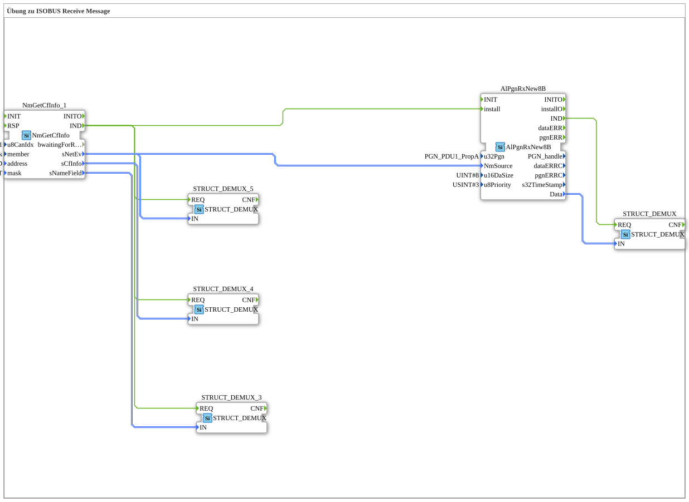

# Uebung_130: Übung zu ISOBUS Receive Message

Dieser Artikel beschreibt die logiBUS®-Übung `Uebung_130`. Hier wird das Gegenstück zum Senden gezeigt: Das gezielte Empfangen von herstellerspezifischen Nachrichten.

----

## Ziel der Übung

Verwendung des Bausteins `AlPgnRxNew8B`. Es wird demonstriert, wie man auf eine spezifische Nachricht (PGN) eines bestimmten Partners lauscht und den Inhalt für das eigene Programm auswertet.

-----

## Beschreibung und Komponenten

In `Uebung_130.SUB` wird ein Empfangs-Filter für eine herstellerspezifische PGN konfiguriert.

### Funktionsbausteine (FBs)

  - **`NmGetCfInfo_1`**: Identifiziert den Absender der Nachricht (Source).
  - **`AlPgnRxNew8B`**: Der Empfangs-Baustein. Er filtert alle CAN-Nachrichten und lässt nur die passende PGN durch.
  - **`STRUCT_DEMUX`**: Zerlegt die empfangene 8-Byte Nachricht wieder in einzelne Signale.

-----

## Muster mit `NmGetCfInfo` (IND/RSP)

`NmGetCfInfo` meldet ein Netzwerkereignis mit `IND` und wartet danach auf `RSP` (`bwaitingForRSP = TRUE`). Erst nach `RSP` liefert der Baustein das nächste Ereignis aus seiner internen Warteschlange. Diese Übung ist deshalb so aufgebaut:

- `IND` löst `STRUCT_DEMUX` (`sNetEv`) aus. Dessen `CNF` geht an `NetEv_Install.REQ`, `eNetEvent` an `NetEv_Install.eNetEvent`.
- Die SubApp `NetEv_Install` (`MyLib::sys::NetEv_Install_Filter`) filtert nach dem Ereignis: Bei `Active` und `NewAddress` gibt sie `INSTALL` aus (nur beim ersten Mal, danach `RSP`), alle anderen Ereignisse gehen direkt auf `RSP`. Ereignisnummern ab 7 landen ebenfalls auf `RSP`.
- `installO` geht an `NetEv_Install.SET` und an `RSP`, `pgnERR` ebenfalls an `RSP`.
- `INIT` bleibt unverbunden (`EInit`), so wird beim Start der Replay aller bekannten Ereignisse ausgelöst.
- Alle Verbindungen auf `RSP` sind in der IDE ausgeblendet.

Stand der Umstellung: 2026-11-17, noch nicht auf Hardware getestet. Offen ist, ob die PGN nach Abmelden und Wiederanmelden des Partners weiter ankommt, denn sie wird pro Deploy nur einmal installiert.

## Funktionsweise

1.  Der Baustein wird über `install` im System registriert und mit dem gewünschten Absender (`NmSource`) verknüpft.
2.  Sobald der Partner die passende Nachricht (PGN `61184`) sendet, erkennt dies der Baustein.
3.  Er feuert das Ereignis `IND` (Indication) ab und stellt das Datenpaket am Port `Data` bereit.
4.  Über den Demultiplexer kann das Programm nun auf den Inhalt der Nachricht reagieren.

Dies ermöglicht eine private Kommunikation zwischen zwei spezifischen Geräten am Bus, ohne andere Teilnehmer zu stören.
