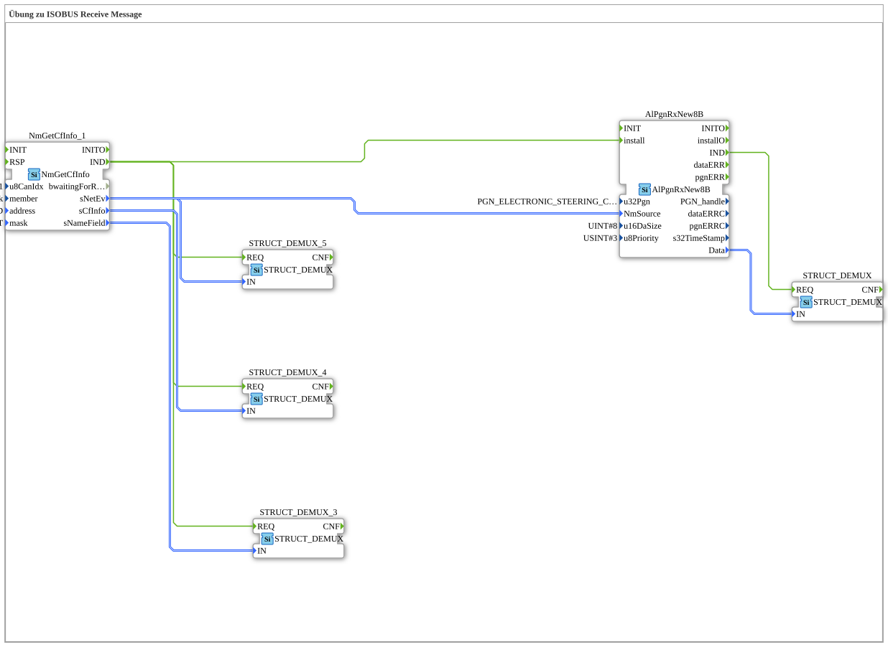

# Uebung_135: Übung zu ISOBUS Receive Message

Dieser Artikel beschreibt die logiBUS®-Übung `Uebung_135`. Wir empfangen eine ISOBUS-Nachricht (PGN) und zerlegen die enthaltenen Strukturdaten in ihre Einzelfelder.

----

## Ziel der Übung

Anmeldung eines Steuergeräts (CF) auf dem ISOBUS-Netzwerk verfolgen, dessen zugehörige Empfangs-PGN abonnieren und die empfangenen Rohdaten (`8B`, 8 Byte) in einzelne Felder zerlegen.

-----

## Beschreibung und Komponenten

- **`NmGetCfInfo_1`**: `isobus::pgn::NmGetCfInfo`, verfolgt die Netzwerk-Anmeldung eines Steuergeräts (`address = PRIM_TECU_ADD`, `mask = PRIM_TECU_FLT`) und liefert dessen Namens-, Kennungs- und Netzwerkereignis-Strukturen.
- **`AlPgnRxNew8B`**: `isobus::pgn::rx::AlPgnRxNew8B`, abonniert eine konkrete PGN (`u32Pgn = PGN_ELECTRONIC_STEERING_CONTROL`) für das erkannte Steuergerät und empfängt deren 8-Byte-Rohdaten.
- **`STRUCT_DEMUX`** (mehrfach instanziiert): `eclipse4diac::convert::STRUCT_DEMUX`, zerlegt eine Struktur in ihre einzelnen Felder.

-----

## Muster mit `NmGetCfInfo` (IND/RSP)

`NmGetCfInfo` meldet ein Netzwerkereignis mit `IND` und wartet danach auf `RSP` (`bwaitingForRSP = TRUE`). Erst nach `RSP` liefert der Baustein das nächste Ereignis aus seiner internen Warteschlange. Diese Übung ist deshalb so aufgebaut:

- `IND` löst `STRUCT_DEMUX` (`sNetEv`) aus. Dessen `CNF` geht an `NetEv_Install.REQ`, `eNetEvent` an `NetEv_Install.eNetEvent`.
- Die SubApp `NetEv_Install` (`MyLib::sys::NetEv_Install_Filter`) filtert nach dem Ereignis: Bei `Active` und `NewAddress` gibt sie `INSTALL` aus (nur beim ersten Mal, danach `RSP`), alle anderen Ereignisse gehen direkt auf `RSP`. Ereignisnummern ab 7 landen ebenfalls auf `RSP`.
- `installO` geht an `NetEv_Install.SET` und an `RSP`, `pgnERR` ebenfalls an `RSP`.
- `INIT` bleibt unverbunden (`EInit`), so wird beim Start der Replay aller bekannten Ereignisse ausgelöst.
- Alle Verbindungen auf `RSP` sind in der IDE ausgeblendet.

Stand der Umstellung: 2026-11-17, noch nicht auf Hardware getestet. Offen ist, ob die PGN nach Abmelden und Wiederanmelden des Partners weiter ankommt, denn sie wird pro Deploy nur einmal installiert.

## Funktionsweise

1. `NmGetCfInfo_1` meldet (`IND`), sobald das gesuchte Steuergerät im Netzwerk erkannt wurde.
2. Die gelieferten Strukturen (Name, Kennung, Netzwerkereignis) werden über drei `STRUCT_DEMUX`-Instanzen in ihre Einzelfelder zerlegt.
3. Parallel installiert `NmGetCfInfo_1.IND` den PGN-Empfang `AlPgnRxNew8B` für dieses Steuergerät.
4. Empfängt `AlPgnRxNew8B` eine neue Nachricht (`IND`), wird deren 8-Byte-Rohdatum ebenfalls per `STRUCT_DEMUX` in seine Einzelfelder zerlegt.
