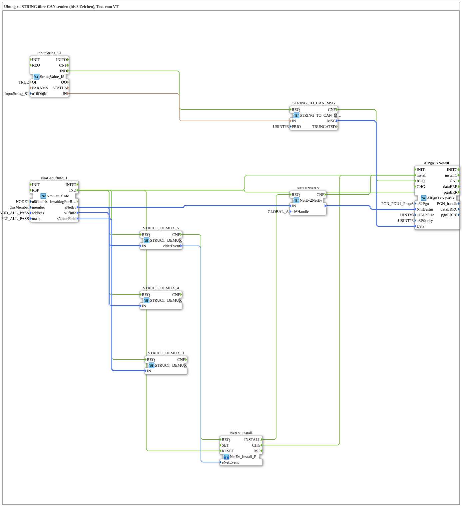

# Uebung_136b: Übung zu STRING über CAN senden (bis 8 Zeichen), Text vom VT

Dieser Artikel beschreibt die 4diac IDE Subapplikation Uebung_136b (Übung zu STRING über CAN senden (bis 8 Zeichen), Text vom VT).

----

## Ziel der Übung

Das Ziel dieser Übung ist die Umsetzung folgender Anforderung: **Übung zu STRING über CAN senden (bis 8 Zeichen), Text vom VT**

-----

## Beschreibung und Komponenten

Die Übung besteht aus der Subapplikation Uebung_136b.SUB, welche die folgende Bausteinstruktur verwendet:

### Verwendete Funktionsbausteine (FBs)

- **STRUCT_DEMUX_3**: Instanz des Typs eclipse4diac::convert::STRUCT_DEMUX.
- **NmGetCfInfo_1**: Instanz des Typs isobus::pgn::NmGetCfInfo.
  - Parameter u8CanIdx = NODE1
  - Parameter member = thisMember
  - Parameter address = ADD_ALL_PASS
  - Parameter mask = FLT_ALL_PASS
- **STRUCT_DEMUX_4**: Instanz des Typs eclipse4diac::convert::STRUCT_DEMUX.
- **STRUCT_DEMUX_5**: Instanz des Typs eclipse4diac::convert::STRUCT_DEMUX.
- **NetEv2NetEv**: Instanz des Typs isobus::pgn::NetEv2NetEv.
  - Parameter s16Handle = GLOBAL_A
- **STRING_TO_CAN_MSG**: Instanz des Typs isobus::pgn::STRING_TO_CAN_MSG.
  - Parameter PRIO = 3
- **AlPgnTxNew8B**: Instanz des Typs isobus::pgn::tx::AlPgnTxNew8B.
  - Parameter u32Pgn = PGN_PDU1_PropA
  - Parameter u16DaSize = 8
  - Parameter u8Priority = 3
- **InputString_S1**: Instanz des Typs isobus::UT::io::StringValue::StringValue_IS.
  - Parameter QI = TRUE
  - Parameter u16ObjId = InputString_S1
- **NetEv_Install**: Untergeordnete Subapplikation (SubApp) MyLib::sys::NetEv_Install_Filter.

Die Übung nutzt das gemeinsame Muster mit `NmGetCfInfo` (IND/RSP): `IND` löst `STRUCT_DEMUX` aus, `NetEv_Install` verarbeitet das Ereignis und quittiert mit `RSP`.

-----

## Zusammenfassung

Die Übung Uebung_136b demonstriert die modulare IEC 61499 Architektur in 4diac IDE.
