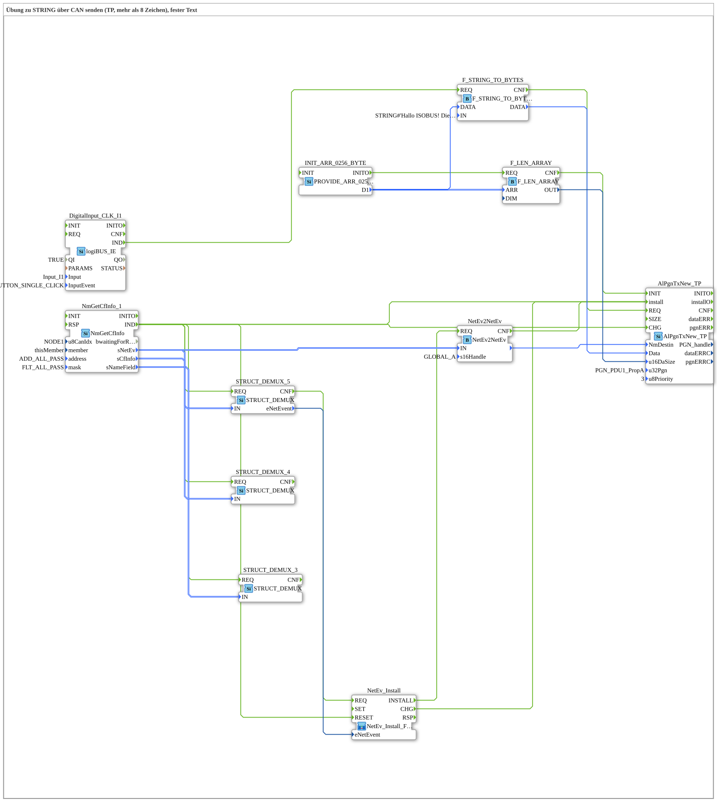

# Uebung_138: Übung zu STRING über CAN senden (TP, mehr als 8 Zeichen), fester Text

Dieser Artikel beschreibt die 4diac IDE Subapplikation Uebung_138 (Übung zu STRING über CAN senden (TP, mehr als 8 Zeichen), fester Text).

----

## Ziel der Übung

Das Ziel dieser Übung ist die Umsetzung folgender Anforderung: **Übung zu STRING über CAN senden (TP, mehr als 8 Zeichen), fester Text**

-----

## Beschreibung und Komponenten

Die Übung besteht aus der Subapplikation Uebung_138.SUB, welche die folgende Bausteinstruktur verwendet:

### Verwendete Funktionsbausteine (FBs)

- **STRUCT_DEMUX_3**: Instanz des Typs eclipse4diac::convert::STRUCT_DEMUX.
- **NmGetCfInfo_1**: Instanz des Typs isobus::pgn::NmGetCfInfo.
  - Parameter u8CanIdx = NODE1
  - Parameter member = thisMember
  - Parameter address = ADD_ALL_PASS
  - Parameter mask = FLT_ALL_PASS
- **STRUCT_DEMUX_4**: Instanz des Typs eclipse4diac::convert::STRUCT_DEMUX.
- **STRUCT_DEMUX_5**: Instanz des Typs eclipse4diac::convert::STRUCT_DEMUX.
- **NetEv2NetEv**: Instanz des Typs isobus::pgn::NetEv2NetEv.
  - Parameter s16Handle = GLOBAL_A
- **INIT_ARR_0256_BYTE**: Instanz des Typs eclipse4diac::convert::providers::PROVIDE_ARR_0256_BYTE.
- **F_LEN_ARRAY**: Instanz des Typs eclipse4diac::utils::arrays::F_LEN_ARRAY.
- **F_STRING_TO_BYTES**: Instanz des Typs logiBUS::utils::dyn_arr::F_STRING_TO_BYTES.
  - Parameter IN = STRING#'Hallo ISOBUS! Dieser Text ist laenger als 8 Zeichen und geht deshalb per Transportprotokoll.'
- **AlPgnTxNew_TP**: Instanz des Typs isobus::pgn::tx::AlPgnTxNew_TP.
  - Parameter u32Pgn = PGN_PDU1_PropA
  - Parameter u8Priority = 3
- **DigitalInput_CLK_I1**: Instanz des Typs logiBUS::io::DI::logiBUS_IE.
  - Parameter QI = TRUE
  - Parameter Input = Input_I1
  - Parameter InputEvent = BUTTON_SINGLE_CLICK
- **NetEv_Install**: Untergeordnete Subapplikation (SubApp) MyLib::sys::NetEv_Install_Filter.

Die Übung nutzt das gemeinsame Muster mit `NmGetCfInfo` (IND/RSP): `IND` löst `STRUCT_DEMUX` aus, `NetEv_Install` verarbeitet das Ereignis und quittiert mit `RSP`.

-----

## Zusammenfassung

Die Übung Uebung_138 demonstriert die modulare IEC 61499 Architektur in 4diac IDE.
