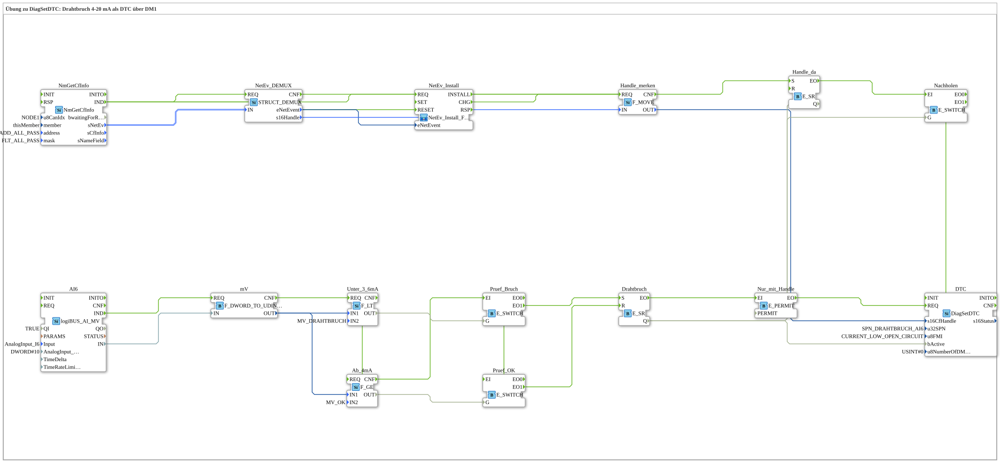

# Uebung_141: Übung zu DiagSetDTC (Drahtbruch 4–20 mA als DTC über DM1)

Dieser Artikel beschreibt die logiBUS®-Übung `Uebung_141`.

----

## Ziel der Übung

Ein Drahtbruch an einem 4–20-mA-Eingang wird als Diagnose-Fehlercode (DTC) über die Diagnosenachricht DM1 gemeldet. Verwendet wird der Baustein `DiagSetDTC`.

-----

## Beschreibung und Komponenten

### Funktionsbausteine (FBs)

- `AI6`: `logiBUS::io::AI::logiBUS_AI_MV`, liefert die Spannung am Pin in mV (Eingang `AnalogInput_I6`, 4–20 mA über eine Bürde von 500 Ω, effektiv 491,2 Ω).
- `mV`, `Unter_3_6mA`, `Ab_4mA`: `F_DWORD_TO_UDINT` und die Vergleicher `F_LT` / `F_GE` gegen die Konstanten `MV_DRAHTBRUCH` und `MV_OK`.
- `Pruef_Bruch`, `Pruef_OK`, `Drahtbruch`: `E_SWITCH` und `E_SR`. Der Ausgang von `Drahtbruch` feuert nur bei einem Zustandswechsel.
- `NmGetCfInfo` (`member = thisMember`) und `Handle_merken` (`F_MOVE`): liefern und merken den eigenen CF-Handle (`s16Handle`).
- `Handle_da` (`E_SR`), `Nur_mit_Handle` (`E_PERMIT`), `Nachholen` (`E_SWITCH`): Der DTC wird erst gesendet, wenn der Handle bekannt ist. War der Drahtbruch schon vorher da, wird er nachgeholt.
- `DTC`: `isobus::pgn::diag::DiagSetDTC` mit `u32SPN = SPN_DRAHTBRUCH_AI6` (520192), `u8FMI = CURRENT_LOW_OPEN_CIRCUIT` (5) und `u8NumberOfDM1Messages = 0`.

Die Übung nutzt das gemeinsame Muster mit `NmGetCfInfo` (IND/RSP): `IND` löst `STRUCT_DEMUX` aus, `NetEv_Install` (`MyLib::sys::NetEv_Install_Filter`) verarbeitet das Ereignis und quittiert immer mit `RSP` (die RSP-Verbindungen sind in der IDE ausgeblendet). `INIT` ist als `EInit` nicht verbunden.

-----

## Funktionsweise

1. Die Schwellen stehen in `Diag.gcf`: Unter 564 mV (3,6 mA) gilt der Eingang als gebrochen, ab 626 mV (4 mA) als in Ordnung, dazwischen bleibt der letzte Zustand erhalten (Hysterese). Die Werte sind gerechnet (4 mA = 626,4 mV, 3,6 mA = 563,8 mV), nicht gemessen.
2. Jeder neue mV-Wert von `AI6` läuft durch die beiden Vergleicher. `Drahtbruch` (`E_SR`) wird bei Bruch gesetzt und bei OK zurückgesetzt.
3. Bei jedem Zustandswechsel löst `DTC.REQ` aus, `bActive` ist der Zustand von `Drahtbruch.Q`.
4. Der eigene CF-Handle kommt aus `NmGetCfInfo` (`thisMember`, bei `Active` und `NewAddress`) und geht an `DTC.s16CfHandle`.
5. Der Ausgang `s16Status` von `DiagSetDTC` zeigt 0 bei Erfolg. `E_CONFIG` heißt, dass die Firmware ohne `ISO_DIAG_ENABLE_DM1` gebaut ist.

-----

## Erwartetes Verhalten

- Kabel ab: DM1 mit SPN 520192 und FMI 5 (`CURRENT_LOW_OPEN_CIRCUIT`), jede Sekunde.
- Kabel wieder dran: der DTC ist inaktiv, er steht danach in DM2 und lässt sich mit DM3 löschen (erwartet).
- Der Occurrence Count steigt bei jeder Aktivierung.

Es sind keine Hardware-Ergebnisse dokumentiert: Die Übung ist noch nicht auf Hardware getestet. Aussagen zum Verhalten stammen aus dem Kommentar im Netzwerk der Übung und sind als erwartet zu lesen.

-----

## Anwendungsbeispiel

Überwachung von 4–20-mA-Sensoren (Druck, Füllstand): Fällt der Strom unter 3,6 mA, meldet die Steuerung dem Terminal oder Diagnosewerkzeug einen Drahtbruch, statt mit einem falschen Messwert weiterzuarbeiten.

